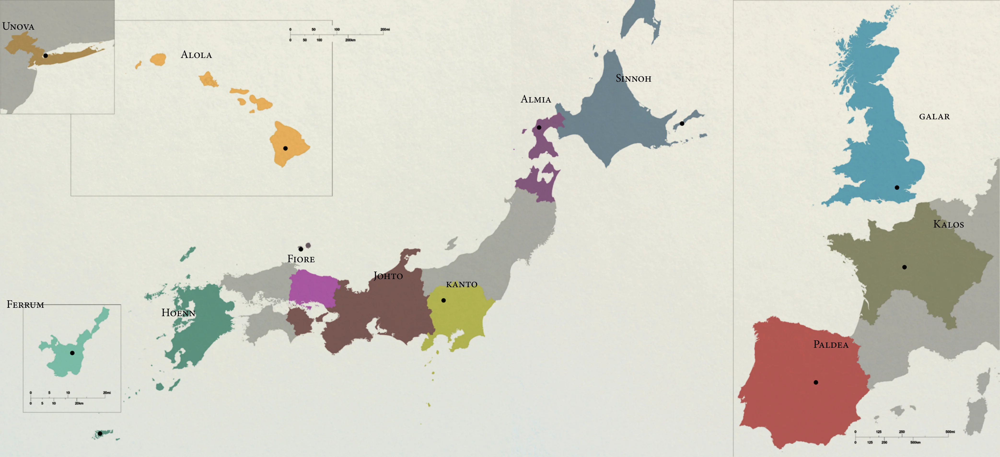
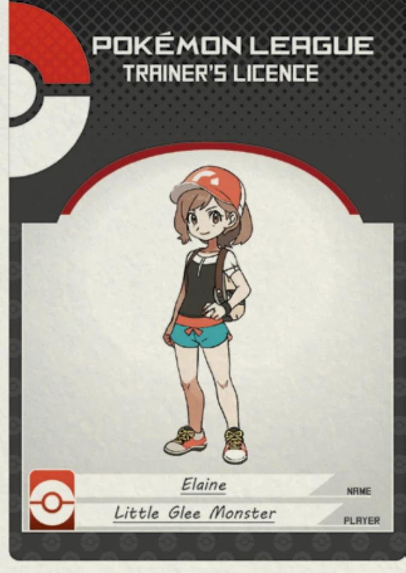
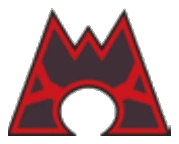
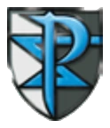
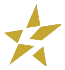

# 不可思议的宝可梦世界
## 全新的冒险世界

这世界上的人们，和我们本没有什么不同。他们同样拥有家人与朋友，也同样在追逐财富、爱情、名声、安稳或是新鲜刺激的生活。

但宝可梦的出现改变了许多事物的运行逻辑，让我们的世界和他们原本的世界之间存在着明显差异。

在这个世界上，许多人游历各地，探寻冒险，求索奥秘，只为抓住机会，攀上前无古人的巅峰。

真正的大城市极为稀少，小镇却遍布世界各地。他们的科技某些方面非常先进，某些方面看上去却挺落伍。

然而这个游戏不仅关乎人与地点，更关乎他们与宝可梦之间的羁绊。

想想你与你的宠物之间的关系。你可曾觉得你家忠心的狗狗会不顾一切地保护你？哪怕天塌下来，忠犬也会始终陪伴左右,不论艰难险阻？

这正是这个游戏的真谛——

一场与忠诚的狗狗、机灵的猫咪和呆萌的小鸟共同展开的旅程。

> [!tip] 你已经了解这个世界了吗？
>
> 本章节将引导新玩家了解宝可梦世界的设定，解释宝可梦是什么， 
> 以及它们如何与这个世界的人互动，介绍不同的地区、宝可梦联盟， 
> 甚至存在于这个世界的邪恶组织。
>
> 若你已熟悉这些内容，可直接跳转到
> <a href="#/02-system-explained">“系统详解”</a> 章节了解基本游戏规则。

## “口袋妖怪”

这些生物形态各异大小不一，自世界诞生之初便栖息于此。有些已然灭绝，而另一些则是最近才被发现。
远古时期，最古老的怪兽通过掌控自然力量统治世界。人类与这些生物不得不共存，最初充满恐惧，后来建立了忠诚与友谊的纽带。
人们学会了用一种口袋大小的设备收服这些生物，这种设备可以随时召唤它们提供帮助。
这项技术赋予了这些生物现在的名称：“口袋妖怪”或“宝可梦（Pokémon）”。
宝可梦对这个世界上存在的不同属性能量具有亲和力。
迄今为止已发现18种属性：

    
一般Normal

    
虫Bug

    
恶Dark

    
龙Dragon

    
电Electric

    
妖精Fairy

    
格斗Fight

    
火Fire

    
飞行Flying

    
幽灵Ghost

    
草Grass

    
地面Ground

    
冰Ice

    
毒Poison

    
超能力Psychic

    
岩石Rock

    
钢Steel

    
水Water

将这些属性的力量装入口袋，很多人的伟大冒险就此扬帆起航——甚至有人试图去收服所有宝可梦！ 

### 宝可梦进化

除了操控属性能量的惊人能力之外，大多数种类的宝可梦还会经历一场突然而剧烈的蜕变，变得更加巨大、敏捷与强壮，人们将这种现象称作“进化”。

触发宝可梦进化的条件多种多样，其中最常见的是宝可梦成长到特定阶段。除此之外，接触特殊能量、得到精心培育，甚至身处危急处境，都有可能引发进化。

有些宝可梦终其一生都无法进化，即便其种类具备进化能力。关于该现象仍需大量研究。

值得注意的是，许多宝可梦进化后性情骤变。有些获得力量后变得不听话，有些则更严肃、大胆或暴戾。

## 宝可梦世界的生活

有关世界起源的理论、传说与神话说法各异，但在所有版本的故事里，宝可梦自开天辟地之初就已经存在。

倘若化石能够开口说话，那些早已灭绝的宝可梦，便会道出它们当年为争夺陆地、海洋与天空领地厮杀征战的过往，或许还会讲述，在人类诞生之前的遥远年代，它们最钟爱的食物与特有的生活方式。

随着人类族群不断扩张、建立起稳定聚居地之后，远古宝可梦也得以向人类传递出某些信息。

最无害的宝可梦最先与人类建立联系，它们以帮助人类对抗更具攻击性的物种为交换，获取食物和庇护所。

富有创造力的人类想出利用这种协助的新方式：与火属性宝可梦建立友谊，便可替代钻木取火的技能。

在这个世界上，开拓者是那些发明属性能量类型新用法的人，以及那些具有强烈共情力和协作能力的人。

如今，这个世界的科技和文化正是这一发展成果的直接体现。

相较我们的世界，这个世界的某些技术惊人地先进，其他方面却过于古朴落后。在这个以对战为核心的世界里，神奇的治疗手段与回复装置随处可见。但生活却简朴至极，人类通常只直接从自然获取所需。

社会大体和平，因而无需复杂的经济体系或强力的执法机构。

在这个世界上，“争斗”是一种运动，而这项运动就是宝可梦对战。

准备好与宝可梦伙伴携手同行，共闯世界，并肩作战吧！

### 人类与宝可梦的互动

在现代社会，文明区域与野生宝可梦栖息地之间存在明确分界。

无害的宝可梦被允许在人类的安全聚居城镇中自由活动。它们大多会协助人类完成日常工作，一部分成为了家养宠物，一部分负责私人护卫，还有一部分属于温驯的野生种群。

更为凶猛强大的宝可梦则隐匿在远离人烟的荒野中。野生宝可梦会积极捍卫自己的领地，驱逐入侵者。 

因此，敢于涉足荒野的人们总会携带至少一只宝可梦作为护卫。

那些毕生致力于收服、驯服并教导这些生物与人类共处的专家，被称为宝可梦训练家。

宝可梦训练是一项专业运动。

其核心赛事是对战（正式名称为宝可梦对战），目标在于用己方宝可梦击败对手。

宝可梦训练广泛地存在于这个世界上的每个地区，而宝可梦联盟负责规范和维持这项运动的秩序。

## 主要地区

地区相当于我们世界的国家，每个地区由不同的宝可梦联盟管辖。

锦标赛、知名训练家、商品服务、科技文化乃至宝可梦种类都因地区而异。许多训练家周游世界，只是为了一窥其他地区特有的宝可梦。

上图是原书的世界地图。左侧几个方框是合众、阿罗拉与坚铁的放大图，中间是关都、城都、丰缘、神奥所在的列岛，右侧则是伽勒尔、卡洛斯与帕底亚。

地名标注得比较小，点击图片可以放大查看。

### 关都地区

关都地区的发展程度类似现代日本。其联盟规模庞大，甚至涵盖城都地区，在这里宝可梦对战不仅是国民运动，更是一种生活方式。连研究所和著名的西尔佛公司都致力于化石复活、幽灵系探测器等前沿技术研发，不断突破对战的前沿发展。

谁知道他们下一步会尝试什么创新呢？

### 城都地区

城都地区毗邻关都。星罗棋布的小镇上，古色古香的房屋与寺庙在风中吱呀作响，它们的呻吟描绘着这片土地上的居民代代相传的悠久历史和传说。这里的生活节奏缓慢，但宁静祥和。然而，大多数人只愿意讲述故事，而不愿去探索阿露福遗迹或烧焦塔等区域的源头。

### 丰缘地区

在这些岛屿上，人们与宝可梦以及大自然的关系格外紧密。这实属万幸，因为人类和宝可梦要共同应对多变且危险的天气与环境。沙暴、大潮、暴雨、烈日，甚至烟囱山喷发的火山灰和熔岩，都对所有生命构成威胁。众多海底洞穴和珊瑚礁也非安全港湾，探索这片土地需要极大勇气。

### 神奥地区

传说神奥是神明最先创造的地区。天冠山顶与归途洞窟中发现的古代文明雕像与遗迹，都印证了这点。

它们宏大的神秘气息激励着训练家们寻找有关世界起源的线索。

那些放弃追寻的人低语着“传送门”或"恐怖维度"。

### 合众地区	

远离其他地区的合众，栖息着世上外形最具异域风情的宝可梦。

这里崇尚宏伟气象，豪华列车与机场服务着它广袤的都市圈。冒险踏足这片繁华区域之外的训练家警告说，电暴、龙卷风、地震等自然灾害日益频繁——他们声称这些都是由非常强大的宝可梦造成的。

### 卡洛斯地区

这个安宁稳定、恬静怡人的地区因受游客青睐，财富与生活质量不断提升。有人因为深爱这个环境而永久迁居至此，带来了他们的爱好与传统。

有句俗语说：“漫步密阿雷市，如同环游世界”。眺望矗立城市中央的棱镜塔，无疑是最美的体验。

### 阿罗拉地区

一座小型群岛。这里最近才成立了宝可梦联盟。每座岛屿的本土文化与岛屿之王对其诸岛巡礼有着深远影响。

在这个天堂般的地区，宝可梦作为自古以来备受尊崇的生物，其历史鲜活地留存至今。快来享受阳光海滩、热带气候、友善的本地人和丰富的文化吧。

### 伽勒尔地区

伽勒尔地区的人民以他们作为古代战争中战士、骑士与国王的历史为荣。他们的荣誉与辉煌理念至今仍生生不息，这一点在他们的联盟赛事中展露无遗。每场对战都是盛大的体育赛事，在宏伟体育场举办、充满观众、赞助商与商业元素。

在伽勒尔，对战是重中之重，绝无儿戏。

### 帕底亚地区

该地区因学术闻名，拥有研究各类宝可梦现象最古老且最负盛名的高等学府。

尽管这是个历史悠久的地区，其先进的科技研究却让人仿佛同时置身过去与未来。看似矛盾，却又奇妙地和谐共存。

### 其他地区

宝可梦世界的大部分区域至今仍未得到探索，由于缺少宝可梦联盟的介入，也缺乏充分的勘探开发，这些区域始终没能发展出大型人类聚居地，即便深入荒野腹地，最多也只能偶然发现零星一两座小型小镇。

哪些宝可梦物种栖息在远离人烟的偏远地带？在无人探索的土地上又会遭遇怎样的阻碍？

> [!gm] 🎭 叙事者笔记
>
> 你可以通过一个或多个现有的地区来构建你的故事， 甚至可以创建属于你自己的 **定制地区**！

## 宝可梦联盟

宝可梦联盟是规范人类与宝可梦互动的组织。

他们颁发训练家证，允许人们在公共场合拥有和指挥宝可梦。

在宝可梦联盟成立之前，人们没有规则或法律来保护自己免受使用宝可梦伤害他人、谋取私利的恶徒侵害。

宝可梦之间的战斗有极度危险的可能性，所以联盟在混乱的时代创立了秩序。在一个地区成立宝可梦联盟，能让当地居民确信：宝可梦们会受到训练家的协调指挥。此外，他们还可以指望宝可梦联盟在城镇中提供名为“宝可梦中心”的现代化医疗设施。

联盟还设置了道馆挑战赛与联盟锦标赛等试炼赛事，届时来自地区各地的人们都会齐聚竞技场，共同见证训练家、四天王成员与冠军之间的顶级对决。

### 宝可梦中心

宝可梦世界危机四伏，训练家旅途中是需要偶尔休整的。

大多数城镇都设有联盟资助的宝可梦中心，所有注册训练家和他们的宝可梦都可以在这里免费住宿，还能获得免费医疗护理——没错，一分钱都不用花。

训练家傍晚带着受伤疲惫的宝可梦队伍入住，次日清晨便能带着完好如初的队伍出发。

神奇的回复装置让手术变得不再那么必要。护士通常只需几个小时就能够治愈满编的六只宝可梦。

非常严重的伤势可能需要更长时间。

一层设有医疗室，幸福蛋、胖可丁或差不多娃娃等治疗型宝可梦与护士会操作回复装置和使用急诊室。

二层设有训练家交流的公共休息室、卧室，以及可供自由使用的官方宝可梦交换装置。

宝可梦中心的工作人员是联盟当局的成员。

任何违反联盟规则的训练家都可能受到当局处罚或被吊销训练家证。

> [!trainer] 💡 训练家贴士
>
> 宝可梦中心是训练家休憩社交的场所，设施内**禁止**对战。

### 宝可梦道馆

所有训练家都渴望变得更强、培育更出色的队伍、制定更精妙的战术。毕竟独自一人修行在领悟上终究有极限。

如果有个地方能让你与他人交流对战、分享心得，甚至得到最顶尖的训练家亲自指导呢？

这正是宝可梦道馆存在的意义。

在这里，你可以通过对战证明实力，或单纯观战汲取经验。每座道馆都专精于某种宝可梦属性，其装潢通常也体现着与之相关的主题。

道馆由道馆馆主执掌，他们都是对宝可梦联盟当局产生过深远影响的训练家。

比如借助海洋宝可梦进行海洋研究，运营收容遗弃弱小宝可梦的慈善机构，亦或单纯凭借过人的对战实力。

地区联盟认可这些贡献，授予他们道馆馆主的职位。

任何训练家都可前往道馆寻求指导、参加教学课程，或者——直接挑战道馆馆主。

接受训练家的挑战是道馆馆主的职责。但挑战者必须要做好苦战准备——道馆馆主个个实力超群。如果获胜，你将得到象征胜利荣誉的道馆徽章。

每个设立宝可梦联盟的地区都至少有八座道馆。

目标是参加联盟锦标赛的训练家，必须收集至少8颗徽章才能获得参赛资格。

### 四天王

顾名思义，四天王是由四位地区最强训练家组成的团队，“天王”头衔是训练家所能获得的至高荣誉之一。

联盟需多次认可你的实力，才会授予此头衔。道馆馆主等强者将受邀参加联盟卫冕战，角逐当季四天王席位。

在这场赛事中，现任天王需要迎战那些志在取代他们的顶尖训练家与道馆馆主。

尽管地位崇高，四天王一般并不参与公共事务。他们虽然会出席联盟的部分活动，但大多数四天王仍保持深居简出的私生活。

### 冠军

冠军称号，是宝可梦对战竞技的最高巅峰，无论是训练家还是普通民众，都对这个头衔心怀敬重。每个地区只会诞生一位冠军，他们往往会以宝可梦联盟公开代言人的身份出现在公众视野中。

加冕冠军是许多训练家毕生追逐的梦想，但唯有通过联盟最严酷的挑战，才会诞生真正的宝可梦冠军。

首先，你必须连续击败四天王。这是获得挑战冠军资格的唯一途径；最后，在一场背水一战的对决中战胜现任冠军，你才能赢得这个称号。

> [!gm] 🎭 叙事者笔记
>
> 前往<a href="#/冠军之路">“冠军之路”</a> 章节获取关于设计四天王与冠军遭遇战的技巧与灵感。 
> 这样才能构筑真正的史诗之战！

## 宝可梦联盟 训练家规则集

    

        
            📜 一定要遵守规则
            宝可梦联盟 · 训练家规则集
            “我们”一直看着你哦
        
        
            <svg viewBox="0 0 24 24">
                <path d="M6 9l6 6 6-6"/>
            </svg>
        
    

    

        

            
基本规则

            <ul>
                <li>必须持有官方训练家证才能训练宝可梦或参加联盟挑战。</li>
                <li>训练家需对所持宝可梦的行为负责。</li>
                <li>每只宝可梦都享有幸福的权利。</li>
                <li>没有精灵球便不能拥有宝可梦。</li>
                <li>最多随身携带六只宝可梦。</li>
                <li>只能使用联盟官方交换装置进行宝可梦交换。</li>
            </ul>
        

        

            
正式对战规则

            <ul>
                <li>只能挑战拥有训练家证的训练家。</li>
                <li>若被发起正式对战挑战，必须接受。</li>
                <li>可以利用正式对战解决争端；败者必须至少让步24小时。</li>
                <li>挑战道馆馆主是训练家的权利，接受训练家挑战是道馆馆主的义务。</li>
                <li>在正式对战中，由挑战者先派出宝可梦。但道馆馆主与四天王在任何对战中均需先派出宝可梦。</li>
                <li>标准对战采用一对一形式，训练家每次最多派出一只宝可梦。双打对战模式下，训练家每次最多派出两只宝可梦。</li>
                <li>正式对战中，若未事先征得全体参战训练家同意，不得使用药物。</li>
                <li>每只宝可梦不能受到超过一种异常状态的影响。</li>
                <li>正式对战中严禁使用致命伤害。</li>
                <li>你的宝可梦可携带联盟认证的持有物参战。但正式对战中严禁使用未经联盟认可的武器。</li>
                <li>招式必须使用官方名称宣告。</li>
                <li>不得通过含混不清的指令迷惑对手。</li>
                <li>在正式对战中，禁止干扰或攻击训练家。</li>
            </ul>
        

        

            
权益

            <ul>
                <li>宝可梦联盟将表彰为社区作出贡献的训练家；他们运用宝可梦做好事，发展宝可梦对战运动及弘扬积极的训练家生活方式。</li>
                <li>正式对战应按事先约定给予胜者金钱奖励。若未达成协议，奖励金额为败方半数资金。</li>
                <li>训练家有权免费使用联盟所有设施。</li>
            </ul>
        

        

            
处罚

            <ul>
                <li>违反联盟规则，无论是否有意，都会受到宝可梦联盟当局的处罚。</li>
                <li>宝可梦联盟会收到所有注册训练家违规行为的通报。“我们”知晓一切，理所当然。</li>
                <li>根据违规情节轻重，处罚措施可能包括 $5000以上金额的罚款及社区服务，甚至暂停或吊销训练家证。</li>
            </ul>
        

        

            欲了解更多信息，请联系您当地的宝可梦中心，或致电：(555) 0123 - PKMN 
            宝可梦联盟总部，冠军之路巷 #001，邮政编码09876。
        

    

## 邪恶组织

在这个总体和平的宝可梦世界里，依然存在犯罪与邪恶。联盟鼓励持证训练家挺身对抗那些利用宝可梦实施欺凌、胁迫、恐吓等不法行为之人。

宝可梦联盟与警方分属两个独立的机构，联盟负责对战监管并提供协作，但只有警方有权缉拿违法者。

然而某些组织严密的犯罪集团势力庞大，难以轻易铲除。

### 火箭队

案件始于盗窃弱小训练家的宝可梦的团伙。随后嫌疑人又牵扯到宝可梦道馆徽章失窃案，最终顺藤摸瓜发现了西尔佛公司被盗的科技产品。所有追回赃物都标有鲜红的"R"字样。

不久后，大量与"火箭队"相关的犯罪浮出水面：宝可梦抢劫、单车盗窃、徽章伪造、私人财产侵害等。

至此警方才意识到面对的绝非零星罪犯，而是个展现出周密部署的大型犯罪组织。

无论警方抓了多少“火箭队”成员，总是会有更多人补充。不断有年轻人被金钱和权力诱惑加入他们的队伍。

首领身份成谜，但能持续扩张说明其势力已渗透关都宝可梦联盟。他们扬言要将触角伸向城都乃至全世界，甚至觊觎星辰宇宙。

造访关都或城都时务必小心，否则可能会被光速轰飞。

### 海洋队&熔岩队

丰缘群岛流传着两只巨兽为争夺陆海主权激烈交战的神话。讽刺的是，如今"海洋队"和"熔岩队"两伙暴徒正重演这样的领土争夺，在整个地区惹是生非。

虽目标不明，但海洋队的水梧桐与熔岩队的赤焰松有极大的夙怨，他们指使手下找到机会就破坏对方的计划。

虽不直接侵扰平民训练家，但他们的地盘之争常常波及公共区域，使无辜路人屡遭池鱼之殃。船舶工程师、船长和潜艇维修员竟成了最常被殃及的群体。

### 银河队

调查宝可梦神话的训练家们时常发现有人捷足先登。

当学者们以为自己在进行突破性研究时，一家皮包公司已用白皮书抢先发表。考古学家报告前所未见的发现时，却会在遗址挖掘现场发现不明的活动痕迹。

因“平行发现”屡遭研究经费驳回，科学界提出假说：这都是银河队所为。

特殊调查组掌握的情报显示，这个窃取高科技武器、航天材料与研究的组织是专业犯罪集团。他们潜伏暗处，迅速出击，而后重归阴影。

最令人不安的是，无人知晓他们的终极目标或下次行动地点。他们或许正酝酿着一整个宇宙级别的麻烦。

### 等离子队

他们举着扩音器和愤怒的标语，在合众地区的公园与街角宣扬宝可梦联盟的暴行，控诉人类将宝可梦奴役，呼吁解放它们。

这虽不违法，但这个号称维护宝可梦权益的组织里混入了害群之马。

有报道称，“等离子队”成员会强行夺走训练家和市民手中的宝可梦，以此进行所谓的“解放”。尽管盗窃宝可梦属于重罪，但迄今为止没有一名等离子队成员遭到起诉。即便相关部门展开严密调查，也无法找到任何证据，被夺走的宝可梦也就此消失不见。

狂热的布道每天吸引更多追随者加入。如今等离子队的规模已难以估量。

### 闪焰队

一群衣着光鲜者在密阿雷市的豪华街区及卡洛斯地区各处游荡，他们自称“闪焰队”。

由于成员活动可疑，警方曾拘留并审讯了其中部分人，但他们始终声称自己的目标仅仅是“创造更美好的世界”。即便疑点重重，这些人最终总能得到释放。

他们衣着考究，谈吐得体，甚至气味芬芳。

但如此优雅之人频繁出没洞穴与偏远地区实属反常。他们随身携带的密码箱里，究竟藏着什么？

现在穿着红色制服的人们进行的活动似乎是暴风雨前的宁静。谁都无法预料。或许一点火花就会让他们闪焰而起。

### 骷髅队

被警方视为所有地区最无害的犯罪团伙，"骷髅队"正全力维护这个"美誉"！他们会插队！抢小孩糖果！而且永远不会在别人打喷嚏的时候说“上帝保佑”！

该团伙以试图盗窃宝可梦闻名，但所有"受害者"都安然无恙地自行归来。这群乌合之众的首领是个叫古兹马的家伙，他们存在的唯一意义就是为找乐子而制造麻烦。

他们的组织运作资金来路成谜。光靠父母给的零花钱绝对买不起那些装备，背后一定有金主支持。

长辈们对这些叛逆青年深感不满，但愿这些误入歧途的小混混能重返校园，别再如此冥顽不灵。

### 呐喊队

在伽勒尔地区，宝可梦对战可是重头戏。体育场里的观众本就狂热，但"呐喊队"能把分贝推向新高度。

这群暴徒组成的毒瘤粉丝团会不择手段为他们支持的训练家争取优势。

尖钉镇的网红训练家、偶像“玛俐”吸引了这支队伍，让他们心甘情愿成为她的跟班。呐喊队并没有统治世界的野心，只想守护他们女王（难得一见）的笑容。

封锁体育馆通道、在竞技场动手脚、现场大声喧哗、对战时故意令宝可梦分心、甚至绑架裁判，这些通通都是他们标榜的“文明”举止。输了比赛就煽动城市骚乱，赢了比赛就肆无忌惮胡作非为。

见到他们请绕道。别担心，隔着几里地你就能听见他们的动静。

### 天星队

每所名校里，总有一批自以为高人一等的学生。帕底亚地区的葡萄学院和橘子学院的明星学员们不光是这么想，更是打从心底坚信，自己本来就比你优秀。

这些自视甚高的家伙每门功课都顶尖，要是你稍微显露出一点学术潜力，他们说不定就会“邀请”你加入学习小组——还是用强制手段！

“天星队”就是原本遭受严重霸凌的书呆子转而成为霸凌者的典型产物。他们会利用自身的智巧设计巧妙逃避惩罚，匮乏的社交关系让他们可以肆无忌惮地伤害他人。

当心，可不是所有较量都靠蛮力决胜，敏锐的头脑同样能制敌死命——如果说图书馆是道馆，那这些孩子早就在这里练出一身紧实的八块腹肌了！

### 劲敌

有时候，人们生活在某个比自己更有天赋、更受欢迎、更成功的人的阴影下。

不幸的是，这或许正是你的处境！你的劲敌就是你人生与梦想道路上的反派角色！

在宝可梦对战的竞技世界里，拥有劲敌相当常见，毕竟众人追逐着相同的目标。

劲敌形态各异，从青梅竹马到宿命冤家。他们或善或恶，或相识或陌路。但无论何种面目，都注定是你成为宝可梦大师路上的绊脚石。

你们的冒险之间存在着超乎想象的羁绊，正因有他们的存在，你才得以变得更强大。

前往<a href="#/劲敌">“劲敌”</a> 章节了解更多信息。

## 成为训练家

现在你对宝可梦世界的奇妙与危机已经略知一二。但这些与你又有什么关系呢？

游戏中，你将扮演一名宝可梦训练家。

在这个世界里，训练家是激励他人的源泉，他们是领导力、勇气、友谊等诸多美德的化身。

你将在这个世界生活，直面可能降临的考验。突破困境，化解危机，与伙伴和宝可梦缔结更深羁绊。

宝可梦训练家以巅峰为目标，通过旅程变得更强、更睿智，并不断成长。

你将如何实现目标？每位训练家都会有自己的答案。经历独特的冒险，走出只属于你的道路！

挑战其他训练家，参加联盟大赛，骑乘最信赖的宝可梦驰骋，同时在荒野求生并与新旧伙伴分享这些瞬间——这才是训练家的生活。

一个全新的冒险世界正等着你！所以尽你所能展现最棒的自己吧！

> [!trainer] 💡 训练家贴士
>
> 宝可梦训练家们踏上变强与挑战自我的旅程。 宝可梦和朋友们会在旅途中助你一臂之力！

> [!gm] 🎭 叙事者笔记
>
> 在基础冒险模式中，玩家将扮演宝可梦训练家的角色。 其他类型冒险玩法请前往<a href="#/游戏主持人">“游戏主持人”</a> 章节了解更多信息
