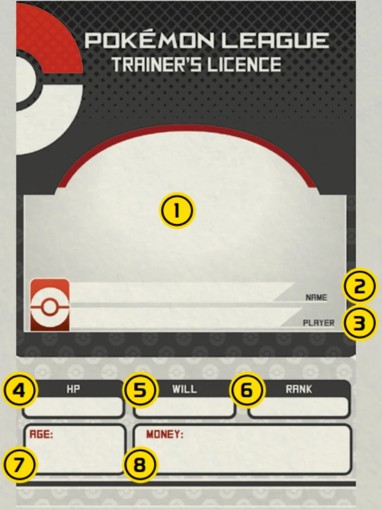
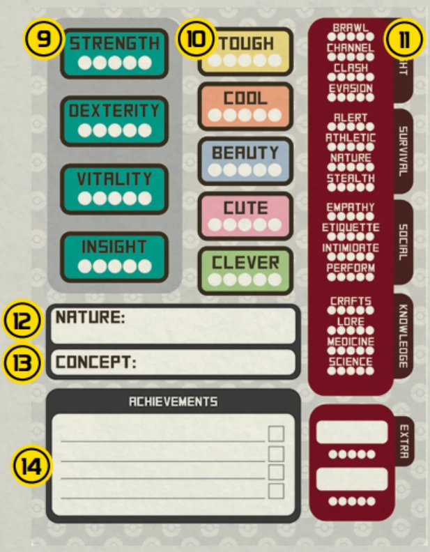
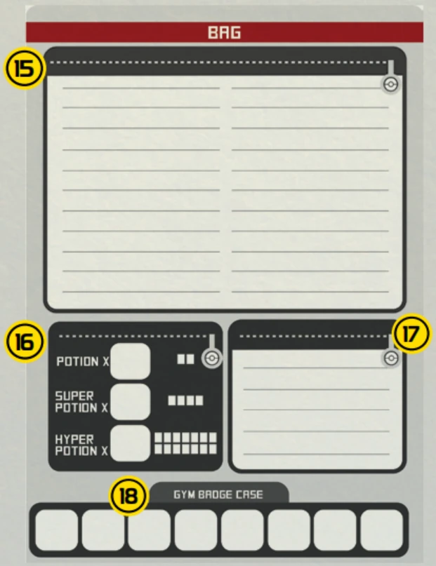
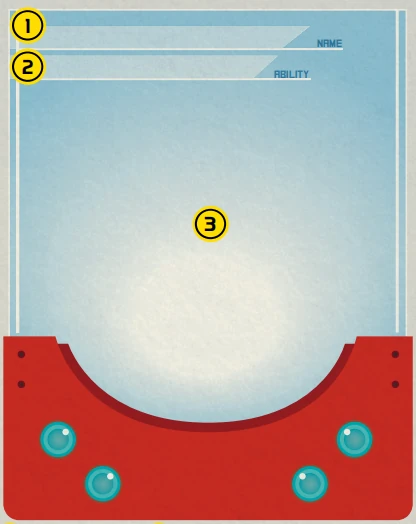
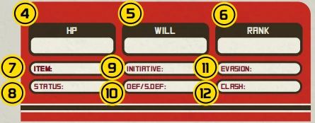
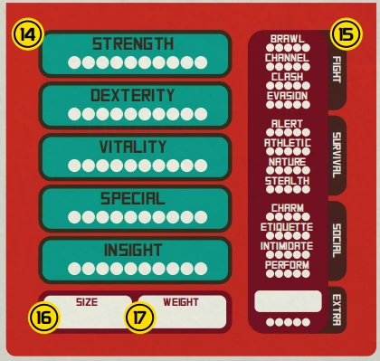
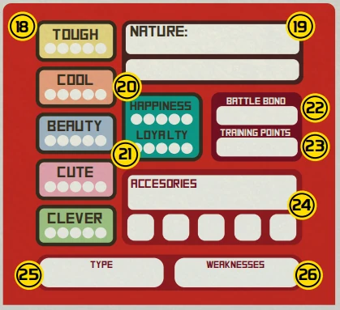

# 角色创建

## 创建一名角色

在《宝可梦：角色扮演游戏》中，你需要创建一个由玩家操作的角色。根据游戏故事的设定，该角色可以是训练家或宝可梦。

这个角色将成为你在故事中的化身。

为了简化讲解的流程，我们默认你选择扮演宝可梦训练家的标准设定。

作为训练家，你将选择一只宝可梦作为伙伴。扮演何种训练家、选择哪类宝可梦都是重要决定——记住，你的宝可梦正是训练家个性与抱负的写照。

创建角色时，记得选用有趣的形象，大胆搞怪也无所谓，甚至可以采用你最天马行空的想法。

你可以扮演动漫里英雄，或者以你崇拜的对象为原型，也能戏仿某个知名的人物。

不过你最好还是选择能够轻松演绎的性格，毕竟角色扮演游戏中需要大量扮演。

切记，塑造一个能推动故事发展的角色，别整出什么破坏剧情的存在来。

### 训练家设定

训练家是持有官方执照的宝可梦培育者，但对于整个角色而言也不过冰山一角。

你应该为你的角色设计职业：医生、钓鱼佬、学校风纪委员、模特新秀——或者任何你觉得有趣的设定。

赋予训练家有别于单纯的“成为最强”的目标，你与其他玩家需协同创作角色，通过团队合作与叙事者共同打造出色的冒险队伍。

让角色与队友形成互补，携手实现所有训练家的目标。

### 性格与背景

向叙事者和同伴们介绍一下你的训练家的过往。

你的训练家就像一张白纸，正等待你为他赋予血肉：他们从来不是游戏里只会移动的空壳，而是怀揣梦想与抱负、兼具优点与缺陷的鲜活角色。

要塑造真实可信的角色，你可以先从角色的角度出发，回答以下这些问题。

1. 你的名字？
2. 你的年龄？
3. 你的性格？
4. 你的职业/设定是什么？
5. 你的宝可梦伙伴是谁？
6. 你对宝可梦世界有什么样的期许？

最重要的是：

7. 你在故事里的目标是什么？
8. 你达成这个目标的动机是什么？
9. 你能为团队贡献什么？

这些答案能帮助叙事者更轻松地为你打造理想的游戏体验，还能让你的角色获得贴合自身、逻辑合理的专属故事线。

请注意，不同故事的背景各不相同，你能参与哪种类型的故事，很大程度上取决于你选择的性格是否合适。

务必先向叙事者了解冒险剧本的整体基调，再据此创建你的角色。

玩家与叙事者之间的良好沟通，会让角色的故事发展更加流畅。

> [!gm] 🎭 叙事者笔记
>
> 应当根据玩家的回答，在故事中为他们呈现独特的挑战。

### 年龄的重要性

当你回答角色性格与背景的问题时，就基本确定了他们的年龄——这一细节至关重要，因为人类的基础能力和社交能力会受年龄影响。

哪怕你已经事实上持有了训练家执照，也不意味着你作为一个孩子就已经准备好独自踏上旅程了。

在标准设定中，训练家角色通常是青少年。但如果叙事者允许，或故事情节需要，你的角色也可以设定为其他年龄。以下是年龄对角色基础能力的影响：

|年龄|基础能力点数|社交能力点数|
|:---:|:---:|:---:|
| 儿童 | 0 | 0 |
| 青少年* | 2 | 2 |
| 成人 | 4 | 4 |
| 长者 | 3 | 6 |

*适用于新游戏的基础等级。

每个年龄段都有各自的考验。孩童仍需汲取知识，少年正开始证明自我，成人将面对最凶险的敌手，而长者则为新一代指引方向。

> [!trainer] 💡 训练家贴士
>
> 人类初始各项基础能力均为1点，所有基础能力和社交能力的上限值为5点。 
> 将年龄赋予的点数与等级提供的点数相结合，强化你的能力。

### 选择一个等级

与年龄因素类似，不同故事也适合不同技能水平的角色。

若进行常规的宝可梦冒险，你的角色应是新手级训练家。

若想选择其他等级，可参照以下简易指南：

|等级|基础能力|社交|技能点|技能上限|
|:---:|:---:|:---:|:---:|:---:|
| 入门 Starter | 0 | 0 | 5 | 1 |
| 新手* Rookie | 2 | 2 | 10 | 2 |
| 正式 Standard | 4 | 4 | 14 | 3 |
| 资深 Advanced | 6 | 6 | 17 | 4 |
| 专家 Expert | 8 | 8 | 19 | 5 |
| 精英 Ace | 10 | 10 | 20 | 5 |
| 大师 Master | 10 | 10 | 22 | 5 |
| 冠军 Champion | 14 | 14 | 25 | 5 |

*适用于新游戏的基础等级。

将不同年龄段与不同等级相结合，能更全面地展现角色特质。

精英级的小孩无疑是天才，大师级的长者则彰显出其毕生投入修炼的历程，而新手级的成年人或许是刚刚终于决定辞去工作，追寻成为训练家周游世界的梦想的人。

请记住，这是属于你的故事。塑造一个有趣的角色来经历这一切，正是乐趣所在。

> [!tip] 等级能给你什么？
>
> 各等级对应的奖励（基础能力点、社交能力点、技能点、技能上限、对战最大目标数）详见<a href="#/02-system-explained?id=等级">“等级”</a> 章节。

## 训练家角色卡

训练家角色卡由三个窗口组成：训练家卡片、基础能力与技能、背包。

### 训练家卡片窗口

|编号|说明|
|:---:|---|
| ① | 训练家的图片 |
| ② | 训练家的姓名 |
| ③ | 你的名字 |
| ④ | 基础生命值（BHP）为4，每点耐力提升1点HP |
| ⑤ | 意志值。意志值等于洞察+3 |
| ⑥ | 训练家的等级 |
| ⑦ | 训练家的年龄 |
| ⑧ | 起始资金为2000 |

### 训练家基础能力与技能窗口

|编号|说明|
|:---:|---|
| ⑨ | 基础能力。起始为1点。根据年龄和等级分配点数 |
| ⑩ | 社交能力。起始为1点。根据年龄和等级分配点数 |
| ⑪ | 技能。根据等级与技能极限分配点数 |
| ⑫ | 选择性格 |
| ⑬ | 角色设定 |
| ⑭ | 成就。记录提升等级所需达成的目标 |

### 背包窗口

|编号|说明|
|:---:|---|
| ⑮ | 大口袋。此处道具不可以在对战中使用。 |
| ⑯ | 伤药口袋。记录携带伤药数量及剩余剂量。 |
| ⑰ | 小口袋。此处道具可以在对战中使用。 |
| ⑱ | 道馆徽章盒 |

## 填写训练家角色卡

既然训练家的设定、性格、背景、年龄与等级已确定，现在该填写角色卡了！

让我们创建示例角色，以便你参照填写训练家角色表。

> [!note] 译注
>
> 这里就省略掉小驱的角色卡填写的过程，我认为大家看到这里基本上已经理解该怎么填了。

### 设置成就

角色需要明确目标，否则他们只会在故事中漫无目的地游荡。

完成清单上的所有成就，就可以让你的训练家晋升至下一等级！

来看看刚才的预设角色小驱从新手级晋升正式级需要达成哪些成就：

- 获得第一枚道馆徽章
- 收服3只宝可梦
- 遇到大木博士
- 探索常青森林

看来在提升等级之前，他还需要进行冒险、训练与对战！

叙事者可以选择采用<a href="#/02-system-explained?id=等级">“等级”</a> 中各等级的推荐成就，也可以根据角色设定与目标提供定制成就。

### 宝可梦，就决定是你了！

训练家角色已准备就绪，但他们还需要一只宝可梦伙伴共同旅行！

若不确定选择哪只宝可梦，可查阅本书图鉴部分，在条目中寻找“最初的伙伴”图标：

请慎重考虑，因为所选的宝可梦很可能要陪伴你完成整个冒险之旅。

最初的伙伴，等级将会和训练家保持一致。当你找到心仪的伙伴之后，就可以着手创建属于它的宝可梦角色卡了！

## 创建宝可梦

创建宝可梦时需注意，它是独立于训练家的生物，角色扮演环节中玩家不可操控它。

玩家仅能在战斗时操控宝可梦，并使用角色卡进行掷骰。

叙事者将负责演绎宝可梦对环境的反应以及它的交流尝试，你只能通过互动，观察它的表情、肢体语言和行为举止来理解它的想法。

宝可梦无需像训练家那样进行角色设定。它们的行为遵循种族本能，并受性格影响。

这意味着同种宝可梦可能有相同需求，但不同性格会让它们采取不同的实现方式。

> [!gm] 🎭 叙事者笔记
>
> 宝可梦是智慧生物，但大多无法言语，且世界观与人类迥然不同。

## 填写宝可梦卡

以图鉴条目作为参考，创建新宝可梦其实非常简单，只需要把对应的数据抄写到宝可梦卡中即可。所有图鉴条目展示的默认都是宝可梦的初始等级，如果你的宝可梦等级更高，就需要手动分配能力点数。

接下来我们就开始填写小驱的第一只宝可梦的角色表。

> [!note] 译注
>
> 这里也省略了，因为这个东西要对照着宝可梦图鉴来填。

## 宝可梦角色卡

宝可梦角色卡与训练家卡结构相似，但多了几项宝可梦独有的内容。

### 图鉴扫描窗口

|编号|说明|
|:---:|---|
| ① | 宝可梦的名称与种类 |
| ② | 宝可梦特性 |
| ③ | 宝可梦的图片 |

### 快速参考窗口

|编号|说明|
|:---:|---|
| ④ | 宝可梦的HP。BHP在宝可梦图鉴中有记载，每点耐力提升1点HP。 |
| ⑤ | 意志值。意志值等于洞察+3。 |
| ⑥ | 等级 |
| ⑦ | 宝可梦的持有物 |
| ⑧ | 异常状态与状态变化。填入“健康”，当陷入异常状态时再作修改。 |
| ⑨ | 基础先攻 |
| ⑩ | 物防/特防。根据所选防御方案，通常为耐力/洞察值 |
| ⑪ | 闪避。在这里填写闪避骰池。 |
| ⑫ | 冲抵。在这里填写冲抵骰池。 |
| ⑬ | 招式窗口。在这里填写招式。 |

### 宝可梦基础能力与技能窗口

|编号|说明|
|:---:|---|
| ⑭ | 基础能力。初始基础能力与极限都在宝可梦图鉴中有记载。 |
| ⑮ | 技能。根据等级分配技能点数。 |
| ⑯ | 宝可梦的体型，在宝可梦图鉴中有记载。 |
| ⑰ | 宝可梦的体重，在宝可梦图鉴中有记载。 |

### 社交能力与其他信息窗口

|编号|说明|
|:---:|---|
| ⑱ | 社交能力。起始为1。 |
| ⑲ | 选择一个性格。 |
| ⑳ | 最初的伙伴幸福度为2。 |
| ㉑ | 最初的伙伴忠诚度为2。 |
| ㉒ | 牵绊变身。 |
| ㉓ | 训练点，保持记录。 |
| ㉔ | 饰品&获得的华丽大赛缎带 |
| ㉕ | 宝可梦的属性，在宝可梦图鉴中有记载。 |
| ㉖ | 弱点，取决于宝可梦的属性。 |

## 性格

无论是人类还是宝可梦，都拥有独一无二的个性，而决定个体在特定情境下做出何种反应的，正是性格。

你的性格是你的本质，它会映照出你内心的想法，并显露于外。

所有性格都有其优势与局限，并无优劣之分。

宝可梦可以在训练家的领导下突破自身的性格限制。经过正确的培养，哪怕原本胆小或是暴躁的宝可梦，也能变得友善合群。

宝可梦进化时也可能改变性格。

但对人类而言，唯有依靠意志能力从内心深处激发出力量，才能够做出违背自身本性的行为。

某些看似不合群的性格，并不是破坏乐趣的理由。相反，这恰恰是丰富角色本身，以及队伍中不同性格成员互动关系的绝佳机会。宝可梦的性格不仅会影响它和训练家之间的羁绊，也决定了它和其他队友的关系——是和睦相处，还是形成竞争，或是发展出友谊？

当不同性格在游戏中相互交融，尽管尽情探索其中蕴藏的丰富可能性吧，这无疑是游戏最富趣味的环节之一。你可以寻找最适配自身角色的性格，如果没有合适的选项，也完全可以自由创造。

> [!gm] 🎭 叙事者笔记
>
> 人类未必总是依照本性行事。 
> 但宝可梦永远忠于本心，遵循性格而活。

> [!note] 译注
>
> 说真的，宝可梦的性格翻译，本来就因为日语本身含义的特殊，无法完好地转译为英文与中文，而且因为早年缺乏官方翻译导致积弊已久，词意和原意对不上，所以下面这部分的具体介绍建议大家看看得了，别往心里去。

### 固执 Adamant

**意志顽强、凶猛、不屈不挠。**

坚韧不拔的意志，永不屈服。具有固执性格者，往往好斗且冷峻。

这世界唯有强者能生存。力量是他们最崇尚的品质。若你无法与之比肩，便会被视为弱者。团队协作非其所长，他们信奉人皆应自立，无能者终遭淘汰。

他们在受到威胁时可能会发怒，且很少遵守社会规范。

### 害羞 Bashful

**富有同情心、脆弱、重视家庭。**

他们身上带着一种动人的羞涩，懂得享受生活里每一件简单的小事，又天生富有同理心。他们十分清楚自己的弱点，也始终在努力补足这些不足；可若总是被人呼来喝去，他们也会真心感到受伤；而当面临的挑战过于艰巨时，他们也难免会陷入沮丧。他们需要一位愿意信任自己的领袖来增加自信，不过也恰恰是因为他们深知自身的脆弱，这份认知反而会成为一份难得的优势。

### 大胆 Bold

**冒险精神、自信、胆识过人。**

追求刺激者。大胆者以乐观与激情看待生活，坚信无论后果都必须勇往直前。因此，他们极易被激怒且行动迅速，往往敢于挑战那些远超自身能力的难题。尽管失败会给他们带来沉重打击，但他们总能重整旗鼓，再次投身于冒险之中。

没有哪座山能阻挡他们的脚步，他们总爱成为众人瞩目的焦点。

### 勇敢 Brave

**无畏、冷静、守护者。**

面对任何情况，他们都能以勇气和冷静的态度应对，绝不容忍身边的欺凌或虐待行为，并始终鼓励他人战胜恐惧。

“无私”是他们的写照，勇敢者即便牺牲自身安全也绝不背弃同伴。众人敬仰他们，因为他们能激发人们的信心与信任；因为勇气并非没有恐惧，而是战胜了恐惧。

### 温和 Calm

**理性、平和、稳健。**

他们的平和神圣不可侵犯。他们享受宁静，不热衷生活中的刺激，避免冲突并常充当调停者。他们极少会被挑衅所动摇——在面对困境时，他们始终能保持沉着，置身事外。即便在压力骤增之时，他们也能借助内心的平静来维持身心的平衡。

他们的存在总是令人愉悦而舒缓。

### 慎重 Careful

**分析、多疑、内向。**

他们会根据风险程度仔细权衡各种选择，通常会选择风险较低的方案。他们需要时间才能对陌生人敞开心扉。维持控制感对他们至关重要，因为无法掌控局面会令他们感到焦虑和压力。如果事态失控，他们可能会选择暂时撤退以待时机。

### 坦率 Docile

**友善、团队合作、奉献精神。**

这种温顺的“性格”体现了将他人置于自身之上的处世态度。具有此类天性者往往乐于取悦他人，并为同伴及社群提供帮助。

他们不追求显赫成就，可能缺乏主动性，往往只要获得一个人的认可，就会心满意足。

他们是绝佳的队友，总会率先询问：“需要我做什么？”

### 温顺 Gentle

**优雅、魅力、外向。**

温顺人格体现在优雅的谈吐与令人愉悦的社交互动中。他们做事讲究细致周到，精致得体，他人常会慕名而来，只为亲身感受其高雅的气质。

他们崇尚奢华，且对品味要求颇高。

这些天生的社交宠儿，生来就该站在聚光灯下，更不愿与旁人分享这份舞台光芒。

### 勤奋 Hardy

**可靠、顽强、机智。**

他们饱经沧桑，却始终以坚忍不拔的姿态直面人生风雨。面对压力与挫折时拥有极强的耐受力，极少灰心丧气。

几乎从来见不到他们毫无准备的模样。他们永远拼尽全力，坚持到底。哪怕放松随性对他们而言并非易事，他们却绝对值得信赖，无论处境多艰难，他们都能陪你闯过去。

### 急躁 Hasty

**热切、积极、奋进。**

精力充沛、率性而为，又略带几分冲动。他们乐于享受当下，既不会为过往的失利懊恼，也不会为未来的挑战忧心。这类性格的人很少感受到压力，因为他们早已习惯在不停奔忙中度日，做事向来无需过多深思熟虑。虽说行事稍欠条理，却总能凭借灵活的随机应变弥补这方面的不足。

### 淘气 Impish

**淘气、机智、活泼。**

崇尚自由不羁的灵魂，总爱以捉弄他人为乐。他们举止散漫随性，脸上却总挂着一抹让人一眼就能看穿的狡黠坏笑。

他们性格活泼，思维敏捷，行事不拘小节，不喜欢按部就班、循规蹈矩。处理问题时更倾向于采用迂回的方式，因为直面冲突往往会让他们感到不适与压力。

他们同样渴望获得他人的认可，因此会主动成为团队里的捣蛋鬼，以此吸引他人的关注。

### 爽朗 Jolly

**欢快、迷人、活力四射。**

他们乐于传播快乐，总会给你一个灿烂的笑容。他们很少感到忧郁，也不喜欢看到别人愁眉不展。

他们很容易和他人建立深厚的友谊，旁人总会被他们愉悦的心境与温厚的性情吸引。改变命运的力量，藏在他们热情洋溢的态度与积极向上的心态之中，哪怕身处逆境，他们那明朗欢快的笑容，也能驱散一整天的阴霾。

### 乐天 Lax

**漫不经心、怠惰、单纯。**

乐天是一种反复无常的天性，拥有这种性格的人行事向来随心所欲。

他们并不是懒惰，只是认为不值得把精力浪费在那些眼下对他们还无关紧要的事情上。

因为不在意迎合他人期待，所以他们很少会因为社会规范感受到压力。但他们需要一个理由维持前进的动力，更需要一个足够有说服力的理由驱动自己主动行动，而不是选择对一切都漠不关心。

### 怕寂寞 Lonely

**独立、内省、自处。**

他们喜欢保持距离，凡事亲力亲为。他们往往觉得，完成各项事务的责任完全落在自己身上——这本应是他们共同分担的重担。

与人交往对他们而言如同苦差，但独处又让他们倍感被误解。

他们生性内敛难以接近，可即便没有旁人指引方向，也始终会一如既往拼尽全力。

### 慢吞吞 Mild

**温顺、安宁、慰藉。**

“慢吞吞”一词最能形容这种温和的性格。他们待人耐心、沉稳，值得信赖且关怀备至。正因如此，他人常会寻求他们的陪伴，将其视为一个稳定的依靠。

他们天生就善于理解他人。他们自己的需求往往被他们藏在心底，有时甚至退居其次，但当你需要倾诉的时候，他们永远是最可靠的聆听者。

### 内敛 Modest

**踏实、自信、勤勉。**

当你深知自己的潜力时，便无需依赖他人的赞美。谦逊者深知，其回报在于能力的持续精进，而非来自他人的认可。

他们低调内敛，从不会因为别人表现更出色就妄自菲薄。他们自始至终都会拼尽全力，而唯一能评判自己所作所为对错的，从来只有他们自己。

### 天真 Naive

**好奇、无忧无虑、天真无邪。**

世界充满奇迹，总有新事物待探索，新朋友待结识。

天真性格意味着拥有一种好奇而纯真的天性，却因不识世间险恶而轻易信任他人。他们尚有许多需要学习之处，但能坦然面对生活。由于尚未意识到生活中存在诸多令人焦虑之事，他们很少感到压力。友人的微笑与援手，便是他们所需的全部。

### 顽皮 Naughty

**狡黠、叛逆、诡诈。**

凭什么要听你的？你又不是他们的上司！他们常故意反其道而行。为什么？当然是因为乐意。他们乐于看到他人发怒，并会利用其机智与狡黠来掩盖自己的不当行为。哪怕他们心里焦虑不安，依然会在面上故作镇定——千万别被骗了。唯有连哄带骗或严加管束，才能让他们安分守己。

### 冷静 Quiet

**沉默、内敛、旁观者。**

冷静性格者更像生活的旁观者，他们往往对周遭环境抱持被动的态度，很少表达自己的深刻见解，因此并不擅长社交互动。他们或许害怕犯错，或是觉得采取行动总会惹来麻烦，即便成功吸引了他人的注意，也常常不知道该如何应对这种状况。

### 浮躁 Quirky

**特立独行、思想开放、独具创意。**

你很难真正理解他们的思维方式。那些具有“浮躁”特质的人，通常会以一种独特的视角看待世界——这种视角似乎只有他们自己才能领悟。

他们的行为方式总是与众不同，常引来困惑的目光。他们清楚自己很古怪，并且安之若素，但有时也会因一些极其古怪的事情而感到压力。不过正因为他们的世界观极其独特，反而能轻松接纳新事物。

### 马虎 Rash

**不计后果、粗犷豪放、胆大妄为。**

他们行事莽撞，还将置身险境当成一种乐趣。待人接物向来直来直去，非友即敌。他们一向以“先动手，再商量”的行动风格著称，也素来因暴脾气、大嘴巴和行事鲁莽闻名，所以别指望压力陡增的时候他们还能保持冷静。

### 悠闲 Relaxed

**无忧无虑、冥想修行、冷淡。**

世间纷扰与他们无关。

悠闲性格使人从容不迫，永远保持冷静。他们从不为琐事烦忧，也绝不主动惹是生非。

若起争执，他们会引导他人通过呼吸冥想平复情绪。顺势而为是他们的处世之道，有人称其没心没肺，他们自称是大彻大悟。

### 自大 Sassy

**活泼灵动、玩世不恭、心直口快。**

他们个性极为鲜明，性子过分严肃的人或许不会喜欢这类人，但性格自大的他们从不避讳直言，总能找到方式说出自己真实的想法，而且话语往往犀利到伤人，所以和他们相处，一定要做好被毒舌刺痛的准备。

他们从没有折中立场，爱憎分明到极致，令人生恼地难相处，却又意外地好打交道，这正是他们的魅力所在。

### 认真 Serious

**坚定、刚毅、忠诚。**

他们责任感极强，无法容忍他人敷衍了事的态度。

压力早已是他们生活的常态，一旦肩负起责任，就会坚持到底，直至完成，在他们执行任务的过程中，任何干扰都显得多余。

他们或许需要他人帮助，因为总难以放松下来，但若是想要完美完成一项任务，他们绝对是最佳人选。

### 胆小 Timid

**羞怯、紧张、谨慎。**

他们筑起心墙，让人难以窥见内心世界。

他们渴望被接纳，却总是过度忧虑，对自己过分严苛。

他们往往将信心寄托在领导者身上，这使得他们既渴望取悦他人，又恐惧失败，但只有学会相信自身的能力，才能充分发挥自身潜力。

**训练家的性格一旦确定便无法更改。**

宝可梦的性格可能因进化、特殊的训练或叙事者裁定而改变。

决定游戏行动时，请将你的性格纳入考量。

根据你对性格的演绎程度，可在游戏中获得奖励。

> [!rule] 意志值是演绎性格的奖励
>
> 如果想要恢复 1 点或 2 点意志值，做出符合自身角色性格的行为就是个好方法。 
> 叙事者应奖励那些在游戏中始终符合角色性格行动的玩家。

> [!gm] 🎭 叙事者笔记
>
> 性格不决定道德。 
> 英雄与反派拥有千姿百态的本性。善用这些特质塑造引人入胜的角色。 
> 通过训练家与他们的宝可梦伙伴，尽情探索丰富多彩的个性吧！

## 章节回顾

游玩《宝可梦：角色扮演游戏》时，你需要掌握如何创建角色并填写角色卡——无论是训练家角色(人类)还是他们的宝可梦伙伴。这些角色卡虽各有不同，但基本遵循本书“系统详解”章节中介绍的相同能力体系。以下是开始创建角色所需的全部要点：

| 要点 | 说明 |
|---|---|
| **创建角色** | 游戏过程中由玩家操控的剧情角色。需明确的是，玩家与角色是不同实体，角色是玩家需要扮演的身份。 |
| **训练家设定** | 明确角色的设定，将有助于玩家更轻松地理解游戏中的角色，也有助于叙事者围绕他们构建剧情。 |
| **人类年龄差异** | 角色年龄将影响初始基础能力与社交能力的加值差异。年龄分段包括：儿童、青少年、成人与长者。基础冒险通常以青少年角色开始。 |
| **选择等级** | 为角色赋予等级将决定其在该世界中的专长与能力。基础冒险通常以新手级开始。 |
| **填写训练家卡** | 熟悉训练家角色卡：找到训练家卡、基础能力与技能栏，以及背包口袋的位置。 |
| **设置成就** | 训练家角色可通过成就系统升级，可自定义其配置以契合故事情节。这些是角色在故事进程中必须达成的目标。 |
| **选择宝可梦** | 某些宝可梦的图鉴条目上会显示一个图标，表示它们会是作为最初的伙伴的合适选择。 |
| **创建宝可梦角色** | 宝可梦与人类不同，它们的目标和行为举止由其种类和性格决定。玩家仅在战斗中可以控制宝可梦，其余时间由叙事者负责诠释它们的行动。 |
| **填写宝可梦卡** | 宝可梦角色卡与训练家的足够相似，但包含了宝可梦独有的能力，如幸福度、忠诚度、招式、训练点以及常用掷骰的快速参考。 |
| **性格** | 叙事层面上的角色性格，主要用于辅助角色扮演。 |

角色创建完成后，你就可以开始在游戏内进行互动了。

进行技能掷骰，消耗意志值，并运用“系统详解”章节中阐述的所有能力。

下一步就是学习如何以最有趣的方式运用它们：通过宝可梦对战！那么，让我们踏入高草丛中，看看会发现什么吧！
