# 宝可梦对战

## 不同的宝可梦属性

这个世界充满了多种宝可梦能够操控的能量，这些能量是它们身体的一部分，它们还能将这些能量转化为威力强大的攻击。

宝可梦的属性由其能量掌控能力决定，若擅长两种属性则称为双属性。截至目前，宝可梦联盟共认可18种属性类型。

|属性|特征|
|------|----------|
| 一般 | 不特别擅长操控其他能量的宝可梦。 |
| 虫 | 具有群体思维的昆虫类生物，能从集体行动中获取力量。 |
| 恶 | 掌控负面情绪力量的宝可梦，常以不光彩的行径著称。 |
| 龙 | 使用内心怒火摧毁一切阻碍的传说生物。 |
| 电 | 操纵电流的存在，以雷电为食并从中获取能量。 |
| 妖精 | 神秘顽皮的生物，既会带来欢愉也会惹人落泪。 |
| 格斗 | 将身体锻造成武器的宝可梦，有些能将能量具现化为攻击。 |
| 火 | 耐高温的宝可梦，能制造并操控火焰焚毁途经之物。 |
| 飞行 | 驾驭气流的天空主宰，地面生物难以企及其高度。 |
| 幽灵 | 来自冥界的暗影潜伏者，以吞噬生者精气为食。 |
| 草 | 植物外形的宝可梦，通过光合作用生存，有的绽放鲜花有的生长尖刺。 |
| 地面 | 栖息地下的宝可梦，能操控大地及其所有属性。 |
| 冰 | 冰雪铸就的身躯，既能抵御极寒也能创造冰川低温。 |
| 毒 | 周身带毒的生物，所到之处必散播疾病与瘟疫。 |
| 超能力 | 以精神能量为食施展念力，是星球上最具智慧的存在之一。 |
| 岩石 | 以岩石为甲胄，制造山崩将敌人碾碎在乱石之下。 |
| 钢 | 冰冷钢甲覆体，如同有机机械般冷酷无情。 |
| 水 | 水生生物，可召唤暴雨并释放汹涌激流。 |

### 伤害类型

宝可梦属性是战斗中取得优势的关键。所有宝可梦属性都存在相互克制的能量类型关系，某些属性甚至具有免疫。

掌握属性克制关系至关重要，攻击的属性将决定宝可梦所承受的伤害属性：

#### 效果一般

±0当宝可梦对所受招式的能量属性既无弱点也无抗性时，将承受无修正的基础伤害。

*（例：恶属性招式攻击火属性宝可梦）*

#### 效果绝佳

+1当宝可梦的属性弱点，正是招式的能量属性时，将触发效果绝佳。最终伤害总值会额外+1。

*（例：妖精属性招式攻击龙属性宝可梦）*

#### 效果不好

-1当宝可梦的属性抵抗，正是招式的能量属性时，将触发效果不好。最终伤害总值会额外-1。

*（例：草属性招式攻击钢属性宝可梦）*

#### 效果无比绝佳

+2当双属性宝可梦的两个属性都弱于招式能量属性时，将触发效果无比绝佳。最终伤害总值会额外+2。

*（例：水属性招式攻击岩石+地面双属性宝可梦）*

#### 效果相当不好

-2当双属性宝可梦的两个属性都抵抗招式能量属性时，将造成效果相当不好。所受总伤害减少2点。

*（例：冰属性招式对钢+水双属性宝可梦使用时）*

#### 没有效果

×0当宝可梦的属性使其对某招式能量属性免疫时，虽不会受到该属性物理与特殊招式的伤害，但仍可能受变化类招式影响。

*（例：一般属性招式对幽灵属性宝可梦使用时）*

了解宝可梦的弱点与抗性，甚至在战斗开始前就能帮助你做出更佳决策。

## 属性相克表

    
一般Normal

    
虫Bug

    
恶Dark

    
龙Dragon

    
电Electric

    
妖精Fairy

    
格斗Fight

    
火Fire

    
飞行Flying

    
幽灵Ghost

    
草Grass

    
地面Ground

    
冰Ice

    
毒Poison

    
超能力Psychic

    
岩石Rock

    
钢Steel

    
水Water

> [!tip] 野生的幼基拉斯出现了！
>
> 哪只宝可梦最适合对抗幼基拉斯岩石？
>
> - 紫天蝎（虫毒）：在攻防两端都处于弱势。
> - 绵绵泡芙（妖精）：属性在攻防上均表现一般。
> - 皮卡丘（电）：不仅防御上是弱点，且幼基拉斯对它的电系招式完全免疫。
> - **莲叶童子（水草）：最佳选择。** 其草属性可抵抗幼基拉斯的地面系招式，而莲叶童子的攻击将对幼基拉斯造成效果无比绝佳的伤害。

## 宝可梦对战指南

① 先攻 ② 下达指令 &amp; 骰命中 ③ 反应 ④ 伤害 ⑤ 结算 ⑥ 下一回合 ⑦ 重复 ⑧ 一轮结束

一场对战就是这八步转圈。下面用皮卡丘“火花”和伊布“小伊”的一场友谊赛，把八步走一遍。

### ① 步骤一：先攻

皮卡丘“火花”与伊布“小伊”正在进行友谊赛。首先需确定行动顺序。

> [!rule] 基础先攻
>
> **基础先攻 = 敏捷 + 警觉**

皮卡丘敏捷为4，警觉为2，其先攻为6。

伊布敏捷为3，警觉为2，其先攻为5。

现在，双方需各掷一颗骰子，把结果加到自己头上。

示例 · 掷先攻

<b>皮卡丘</b>6 +  = <strong>9</strong>

<b>伊布</b>5 +  = <strong>10</strong>

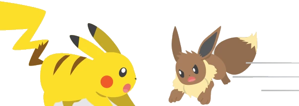

### ② 步骤二：下达指令 & 骰命中

由于先攻掷骰运气较好，伊布获得先手！此时训练家说：“小伊！使用‘撞击’！”随即，伊布立即行动起来。

> [!rule] 骰命中会消耗伊布的第一次行动
>
> **命中骰池 = 基础能力 + 技能**

伊布使用「撞击」

<b>撞击</b><em>威力</em>2

<dl class="mc-body">
<dt>属性</dt><dd>一般</dd>
<dt>分类</dt><dd>物理</dd>
<dt>命中</dt><dd>敏捷/力量 + 运动</dd>
<dt>伤害池</dt><dd>力量 + 威力</dd>
<dt>目标</dt><dd>单一目标</dd>
</dl>

伊布掷出 ：{{3/4/4}}，3成功！需要多少成功？

（多重行动的第一次行动，只需要1成功。）

掷骰成功！

这是战斗关键时刻，皮卡丘会如何应对？！

### ③ 步骤三：反应

当前仍处于伊布的回合，但皮卡丘有瞬间的机会反应来袭的攻击。它的训练家大喊：“火花，快躲开！”

皮卡丘使用了闪避战技。（更多关于反应与闪避的信息，见<a href="#/04-pokemon-battles?id=冲抵-amp-闪避">冲抵 &amp; 闪避</a>）

若招式或战技带有该“反应图标”，则无论当前回合由谁行动，均可使用该动作。

<icon-frame class="reaction ico-solo"><b>反应</b>↑1</icon-frame>即时反应<icon-frame class="reaction ico-solo"><b>反应</b>↓1</icon-frame>延迟反应

皮卡丘掷出 ：{{2/6/6}}，只拿到2成功。

哦糟糕，不满足战技的条件，闪避失败了！

> [!rule] 骰反应会消耗皮卡丘的第一次行动
>
> 反应再快也算一次行动，一轮五次，用一次少一次。

### ④ 步骤四：伤害

若反应失败，或宝可梦未采取反应动作选择承受攻击，则需进行伤害掷骰，记住计算公式并考虑特性与属性一致加成。

伊布的伤害骰池

<b>力量</b>{{2/5}}
+
<icon-frame class="power"><b>威力</b>2</icon-frame>
−
<b>物防</b>1
+
<b>适应力</b>
+
<b>S.T.A.B.</b>
=

直接命中！皮卡丘掷出 ，{{2/5}}——受到2点伤害。

> [!tip] 适应力
>
> 当本宝可梦使用与自身属性相同的物理或特殊招式时，为该招式的伤害池额外增加1颗骰子。

属性一致加成的完整规则见<a href="#/04-pokemon-battles?id=属性一致加成（stab）">属性一致加成</a>；特性的完整列表在第534页（第十章，尚未上线）。

### ⑤ 步骤五：结算

皮卡丘受到伤害，所幸未达到伤痛惩罚阈值。咦……怎么回事？伊布陷入了麻痹状态，但原因呢？

某些追加效果仅在造成伤害后才会触发。在这种情况下，皮卡丘的特性已经生效。

> [!tip] 静电
>
> 当受到接触类的物理攻击时，该宝可梦掷3枚几率骰子，以对对手造成麻痹效果。

<icon-frame class="paralysis ico-solo"><b>麻痹</b>3</icon-frame>

在进入下一回合前，请留意招式与特性的额外影响。

关于<a href="#/04-pokemon-battles?id=伤痛惩罚">伤痛惩罚</a>与<a href="#/04-pokemon-battles?id=异常状态与状态变化">异常状态</a>的更多信息，见对应小节。

### ⑥ 步骤六：下一回合

伊布回合结束，轮到皮卡丘行动！是时候反击了，训练家立即发出指令：“现在使用电击，火花！”

> [!rule] 骰命中会消耗皮卡丘的第二次行动
>
> **命中 = 基础能力 + 技能**

皮卡丘使用「电击」

<b>电击</b><em>威力</em>2

<dl class="mc-body">
<dt>属性</dt><dd>电</dd>
<dt>分类</dt><dd>特殊</dd>
<dt>命中</dt><dd>敏捷 + 制导</dd>
<dt>伤害池</dt><dd>特攻 + 威力</dd>
<dt>追加效果</dt><dd>掷1枚概率骰，命中则令对手麻痹</dd>
<dt>目标</dt><dd>单一目标</dd>
</dl>

皮卡丘掷出 ：{{5/6}}，5成功！需要多少成功？

（多重行动的第二次行动，需要2成功。）

掷骰结果比所需成功高出3点。

**击中要害！**

### ⑦ 步骤七：重复

战斗中每个回合都需要重复执行步骤2至步骤5。

伊布本有机会使用反应动作，但因麻痹状态且皮卡丘的电击命中骰数足够，伊布的闪避骰池不足以规避伤害。

重复步骤2至步骤5，直到所有参战者完成回合行动，或无人可再使用任何动作为止。

注意：每位战斗者每轮最多可使用5个动作。

一轮打下来，两边的动作条

### ⑧ 步骤八：一轮结束

当所有参战者完成行动且无可用/想用动作时，回合结束。若未决出胜者，则开启新回合并从步骤2重新开始。

这场友谊赛以皮卡丘获胜告终！该休息啦伙伴们！

部分招式、异常状态和战场条件会在此战斗阶段生效。

训练家也可在此阶段安全替换宝可梦。

若此时未决出胜者，则开启新回合并重置行动次数计数。

## 战斗机制

你已掌握系统基础规则并了解基本战斗流程，现在我们将详细解析每个战斗环节。

### 先攻

战斗开始时，参战者入场就位。如何确定行动顺序？这正是掷先攻的作用。

> [!rule] 基础先攻
>
> **基础先攻 = 敏捷 + 警觉**

获得该数值后请立即记录下来，因为每次进入战斗时都需要使用它。

接下来是掷骰环节：掷一枚骰子并将数字结果加到你的基础先攻上，最终数值即为本次战斗的先攻。

> [!rule] 先攻
>
> **基础先攻 + D6**，这里的 D6 就是一颗六面骰：
>
> 

现在让我们通过示例演示：

<b>敏捷</b>{{2/5}}+<b>警觉</b>{{1/5}}=<b>基础先攻</b>3

现在掷一次骰子并加上数字结果：

<b>掷骰</b>5+<b>基础先攻</b>3=<b>先攻</b>8

当所有参与者完成先攻掷骰后，数值最高者率先行动，依次类推直至数值最低者最后行动。

若出现平局，则基础先攻较高者优先。若仍持平，可让平局参与者重新掷骰。

只需在战斗开始时及新参与者加入时掷骰。若宝可梦暂时离场后返回，是否重新掷先攻由你决定，但建议整场战斗保持同一数值。

行动顺序确定后，是时候点燃战场了！

### 对战场地

战斗不会在真空中进行。对战场地虽是常被忽视的元素，却是任何宝可梦对战的重要组成部分。

对战场地指的是宝可梦对战发生的场地。它包含所有活动的主要场地，以及理论上安全的两个训练家区域。

无论正式对战与否，战斗开始时对战场地即被视为存在。但战场的构成远不止于此，因为其中还包含你这一侧与敌方那侧：

<figure class="field-map">

训练家 区域

主竞技区

训练家 区域

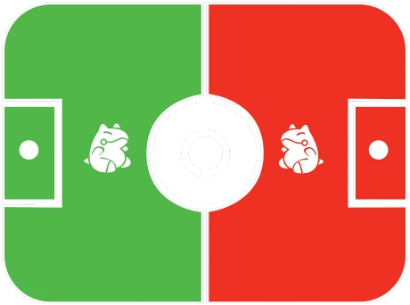
<figcaption>上：主竞技区 ＋ 两侧训练家区域。下：沿中线分成己方（绿）与敌方（红）半场。</figcaption>
</figure>

当对战场地本身在战斗中成为目标时，某些效果仅会影响其中一侧。

本系统不设网格，采用想象剧场模式。无论招式从哪侧发动，主竞技区内所有位置都在双方的攻击范围内。

这是因为对战并非静态，宝可梦会在战场上不断移动进行攻击或闪避。

但有些招式能让宝可梦“超出攻击范围”，即离开主战场区域，使多数攻击无法命中。

### 命中骰池

回顾<a href="#/02-system-explained?id=时间与对战设定">系统详解 · 时间与对战设定</a>，我们已学过场景、轮、行动这些计量单位。

你可能也记得<a href="#/02-system-explained?id=命中掷骰与多重行动">命中掷骰与多重行动</a>那一节，讲过怎么为命中组建骰池。

每个招式的词条中都会标明它的命中掷骰要求。完整的招式表在原书第434页起（第九章，尚未上线）。

让我们看个示例，本次掷骰的要求是：

> [!rule] 命中骰池
>
> **敏捷/力量 + 运动**

这意味着你可以选择这两个基础能力中的任意一项，加上运动技能值进行掷骰。建议选择你最强的那一项，因为唯一影响的只是叙事效果。例如：

<b>敏捷</b>{{3/5}}+<b>运动</b>{{2/5}}=

掷骰后统计成功数，每个掷出4、5或6点的骰子都计为一次成功。

至此，你已完成命中掷骰！

> [!rule] 注意事项
>
> - 进行命中掷骰消耗1次行动。
> - 命中成功与否需参考已执行行动次数和多重行动难度表。
> - 命中掷骰失败意味着使用者未能凝聚足够能量/专注力来正确执行动作。
> - 部分招式具有低命中率（见<a href="#/04-pokemon-battles?id=降低命中的招式">降低命中的招式</a>）。
> - 可使用意志值影响掷骰结果（见<a href="#/02-system-explained?id=意志值wp">意志值</a>）。

### 多重行动

我们此前已确定本游戏中各类时间计量的大致持续时间。完整场景用此图标表示：

长时间持续。若为战斗场景，则持续至战斗结束、战斗人员退出战斗或被替换。

一轮用标有轮数的图标表示：

每轮中，每位战斗人员最多可执行5个动作。每个招式/战技每轮仅能使用一次，需等待新一轮才能重复使用。

动作无专属图标，但战斗开始后将确定行动顺序，每位角色在自己的回合可使用一个动作。

动作可以是招式、战技，或由叙事者裁定需进行命中掷骰/技能掷骰的其他行为。

每轮最多执行5个动作，同一轮内动作越多，命中掷骰/技能掷骰所需的成功数就越高。请牢记这个简易对照表：

|多重行动|所需成功数|
|:---:|:---:|
| 第一行动 | 1 |
| 第二行动 | 2 |
| 第三行动 | 3 |
| 第四行动 | 4 |
| 第五行动 | 5 |

### 每次行动都有对应的反应

反应机制将是本游戏中最具特色的招式与战技之一。带有以下图标的反应动作：

<icon-frame class="reaction ico-solo"><b>反应</b>↑1</icon-frame>即时反应<icon-frame class="reaction ico-solo"><b>反应</b>↓1</icon-frame>延迟反应

这些动作几乎是瞬间发动的，可在非己方回合时使用。

唯一区别在于箭头方向：上箭头代表即时反应，下箭头代表延迟反应。两者都可在他人回合使用，但即时反应会在对方攻击命中前生效，而延迟反应则在攻击命中后生效。

每回合只能使用一次反应——即使不是你的回合。但请注意，每次反应都会消耗你该轮的一次行动。

要理解即时反应与延迟反应的运作机制，我们需要明确招式的结算时点——即伤害生效与追加效果触发的时刻。

战斗中所有参与者依次行动，直到本轮行动耗尽后重新开始：

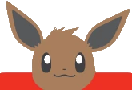<b>伊布的回合</b>
→
<b>皮卡丘的回合</b>
→
<b>伊布的回合</b>
→
<b>皮卡丘的回合</b>

但在每个角色行动时，其他人都有机会做出反应。区别在于结算时点。

即时反应会在主动作之前完成——虽然两者同时发生，但即时反应的启动与结束更为迅速。

伊布的回合

<b>伊布的行动</b>
→
<b>皮卡丘的即时反应</b>
→
<b>皮卡丘即时反应的结果</b>
→
<b>伊布行动的结果</b>

即时反应（↑）抢在主动作命中之前收尾。

延迟反应在主动作之后结算。虽然启动迅速，但结束较慢，使得主动作能优先完成。

伊布的回合

<b>伊布的行动</b>
→
<b>皮卡丘的延迟反应</b>
→
<b>伊布行动的结果</b>
→
<b>皮卡丘延迟反应的结果</b>

延迟反应（↓）启动得快，但要等主动作走完才收尾。

反应机制的战略价值在战斗中至关重要，熟练掌握它们会让你更接近成为宝可梦大师。有些反应属于防御性质，有些则具有攻击性。

当宝可梦使用反应时，只要你的反应招式上的数字大于对方，就能进行反制。

<figure class="art-panel">
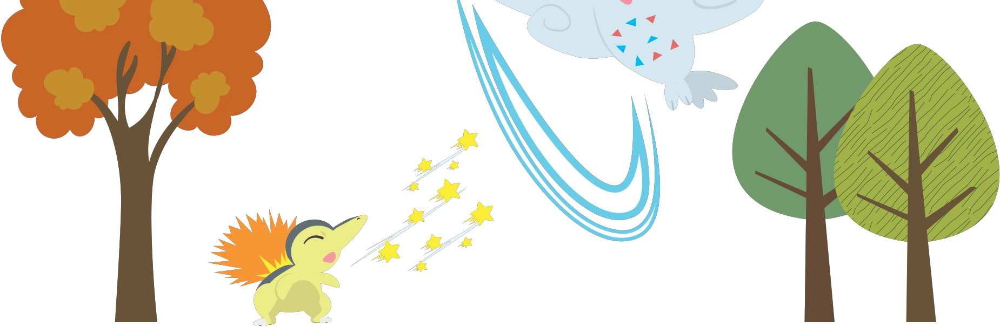
<figcaption>原书 p.60 页脚的插图：火球鼠一记电光一闪，波克基斯俯冲躲开。</figcaption>
</figure>

> [!tip] 例：火球鼠对波克基斯
>
> 火球鼠与波克基斯正在对战。现在是波克基斯的回合，它使用了非反应类技能“空气斩”并掷骰成功。至此一切正常。
>
> 但此刻轮到火球鼠发动反应，它选择了可作即时反应使用的招式电光一闪（↑1）。
>
> 由于这个即时反应实际目标是波克基斯，后者在自己的回合内也能进行反制！但关键点在于？
>
> 关键在于即时反应数值必须高于针对你的那个数值。这种情况下，波克基斯选择用神速（↑2）正面迎战火球鼠。
>
> 所有招式都成功发动，过程如下：
>
> 波克基斯正准备使用空气斩，就在即将释放时，火球鼠突然以电光一闪冲撞过来。
>
> 波克基斯感知危险，以神速迎击！两只宝可梦猛烈相撞！火球鼠跌落地面，而它身后的波克基斯虽受伤仍稳住身形，最终释放出空气斩！
>
> 火球鼠赌在波克基斯使出空气斩前击败它。虽未成功，但迫使波克基斯消耗了两次行动。

延迟反应看似不如快速反应实用，却能诱使敌人放松警惕，使其无法在回合中途作出反应——因为延迟反应只能用更高数值的延迟反应来反制。

<figure class="art-panel">
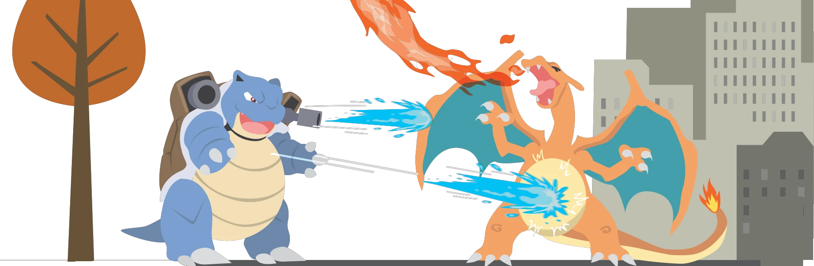
<figcaption>原书 p.61 页脚的插图：喷火龙的劈开撞上水箭龟的雪崩，两边同时开火。</figcaption>
</figure>

> [!tip] 例：喷火龙对水箭龟
>
> 喷火龙与水箭龟正在对战。喷火龙的回合，它使用了非反应类招式劈开，并掷骰成功。至此一切正常。
>
> 水箭龟判断能承受这击，但准备用延迟反应招式雪崩（↓4）设下陷阱造成更大伤害。
>
> 由于雪崩作为延迟反应使用，喷火龙的劈开会先结算。
>
> 与即时反应相同，延迟反应可用更高数值的延迟反应反制，但数值更高的后结算。本例中喷火龙选择用龙尾（↓6）反击水箭龟。
>
> 所有招式都成功发动，过程如下：
>
> 喷火龙以利爪使出劈开！水箭龟周身覆雪准备承受冲击！
>
> 喷火龙未察觉异样劈开雪幕，积雪如雪崩般倾泻而下。但当喷火龙被雪流卷走时，它用强力龙尾抽飞水箭龟，将其击出对战场地！
>
> 喷火龙虽中陷阱，却通过延迟反应延长回合扳回一局！

我们已了解即时反应对即时反应、延迟反应对延迟反应的机制，那组合运用呢？

即时反应无法反制延迟反应。

但可以使用延迟反应来对抗即时反应。

在前例中，若轮到水箭龟行动时喷火龙使用电光一闪（↑1）进行反应，水箭龟仍可在自身主行动后使用雪崩（↓4）进行延迟反应。此时电光一闪（↑1）会先结算，接着是水箭龟的主行动，最后才是其延迟反应雪崩（↓4）。

> [!rule] 注意事项
>
> - 发动任何反应都将消耗1次行动。
> - 所有反应都可在他人回合使用。
> - 每回合仅能使用1次反应。
> - 除极特殊例外情况，反应命中率同样受多重行动难度表约束。
> - 数值更高的反应会优先结算。
> - 数值更高的延迟反应会较晚结算。
> - 仅当反制其他反应/延迟反应时，才可在自己回合使用反应/延迟反应。
> - 可用延迟反应反制普通反应，但反之则不行。

需特别注意：若无正当理由，你在自己回合内不能随意使用任何类型的反应。除非你是在反制针对你或你招式发起的即时反应/延迟反应，否则回合内只能执行主行动。

反应机制将成为你对战中最强大的武器，务必善加利用！

### 伤害骰池

宝可梦对战的首要目标是通过对对手造成伤害来击败它。削减对手的HP，直到它们认输或因精疲力尽而倒下。

一旦命中掷骰成功且无其他阻碍，下一步就是造成伤害。此前我们在<a href="#/02-system-explained?id=命中与伤害">系统详解 · 命中与伤害</a>里已学过怎么构建伤害骰池。

所有招式和战技都会注明所需属性及招式威力。具体表现为：

<b>力量</b>{{2/5}}+<icon-frame class="power"><b>威力</b>2</icon-frame>=

但这并非最终掷骰数，还需扣除对手物防进行修正。

−<b>敌人物防</b>5→

物防/特防无法将伤害骰降为零，至少会保留一颗骰子。

注意物理防御仅适用于物理招式：<poke-icon class="cat physical"></poke-icon>

而特防则作用于特殊招式：<poke-icon class="cat special"></poke-icon>

投掷前请确认所有能增加伤害骰的增益效果。

#### 属性一致加成（S.T.A.B.）

所有宝可梦都能操控不同属性能量，但当使用本系属性时能量会自然增强。

例如草系宝可梦更擅长操控植物，而普通系尝试相同操作时则力有不逮。

使用与宝可梦自身属性相同的招式将获得伤害加成。

当宝可梦施展与其属性相符的物理或特殊招式时，将获得“属性一致加成”（简称S.T.A.B.）。

> [!rule] 属性一致加成
>
> 该招式伤害骰池额外+1颗骰子。

让招式属性与宝可梦属性相匹配才能发挥最大威力！

#### 额外伤害骰

某些招式与特性在满足特定条件时，能够增加伤害骰池中的骰子数量。

注意此图标：

<icon-frame class="extra ico-solo"><b>伤害</b>+X</icon-frame>

在招式的追加效果或技能描述中，“X”代表骰子数量。若满足条件，伤害骰池将获得额外骰子。

需警惕相反效果：

<icon-frame class="extra down ico-solo"><b>伤害</b>−X</icon-frame>

特定情况下招式可能削弱，导致骰池中骰子减少。务必仔细阅读追加效果说明。

#### 击中要害

还记得多重行动难度表吗？每次行动都需达成特定成功数。

命中掷骰表现优异时，可获伤害骰池加成。

想要击中要害，需要在命中掷骰中获得比成功要求多出至少3个成功。

击中要害可为伤害骰池增加2枚额外骰子。

同时，记得留意标有此图标的招式：

<poke-icon class="mv crit lg"></poke-icon>

这类“高要害率”招式只需比成功要求多2个成功数即可击中要害！

#### 固定伤害池

部分招式或技能不采用伤害骰池，直接造成固定伤害。

此类伤害称为固定伤害，无需投掷骰子，直接造成图标所示伤害值：

<icon-frame class="damage ico-solo"><b>伤害</b>X</icon-frame>

固定伤害招式因无需掷骰，故不享受属性一致加成、击中要害或任何其他伤害骰池的额外骰子增益，但作为补偿，它能够无视防御。

#### 多样化伤害池

其他伤害池不通过常规公式计算，你需仔细阅读这些招式说明，以了解应掷出多少骰子，部分招式甚至可以无视防御。

### 伤害

当伤害骰池准备就绪时，即可进行掷骰：每个成功造成1点伤害。

若掷骰未获得成功，仍会造成1点伤害。

但你必须骰出至少一个成功，才能触发属性克制的伤害加成。

你或你的宝可梦每次被击中时，至少会承受1点伤害。

属性抗性、保护类招式和力场等可能避免伤害，但这些并非总能生效。

若想长期持续战斗，必须尽量减少宝可梦承受的伤害，否则将面临严重后果。

当HP过低时，身体会感到疼痛并遭受伤痛惩罚，这会削弱战斗表现。若HP归零则会陷入昏厥。

即便受到伤害，也无需绝望。人类和宝可梦每经过8小时游戏内时间可自然恢复1点伤害。

每场战斗后充分休息并随身携带药品。宝可梦中心也能免费帮你恢复健康！

### 伤痛惩罚

身体受伤时会感到疼痛。当你或你的宝可梦受到伤害时，伤口会影响行动能力和整体表现。这就是所谓的伤痛惩罚。

伤痛惩罚会扣除受伤状态下行动骰的成功数。根据总HP值参照以下简表判断疼痛程度：

|生命值状态|伤痛惩罚|身体状态|
|------|------|----------|
| 生命值全满 | 无 | 无疼痛或不适。 |
| 半数生命值（向下取整） | 移除成功1 | 疼痛正阻碍行动，移动变得困难。 |
| 剩余1点生命值 | 移除成功2 | 即将陷入昏厥。视线模糊，站立时疼痛难忍。 |

适用于以下掷骰：命中、伤害、社交属性、力量、敏捷、特攻和洞察会受到影响；不过，使用耐力和意志的掷骰不受影响。

当生命值恢复足够时，伤痛惩罚立即消失。

若无法恢复生命值，也可消耗1点意志值来忽略1个因惩罚移除的成功数（见<a href="#/02-system-explained?id=意志值wp">意志值</a>）。这意味着你最多需消耗3点意志值，才能在本场景中完全无视伤痛惩罚。

> [!gm] 🎭 叙事者笔记
>
> 伤痛惩罚也可通过叙事方式施加，无需实际承受伤害。例如因疲惫、饥饿或睡眠不足导致。
>
> 伤痛惩罚会与其他移除成功数的效果叠加，请务必控制伤势，别让宝可梦在治愈前承受过多伤害，否则后果可能更严重！

### 昏厥

生命值归零时将陷入昏厥。昏厥状态下无法移动或进行任何行动。

即使承受超过剩余生命值的伤害，生命值归零时，伤害将停止计算。

陷入昏厥者平均需8小时才能苏醒。此后其身体会自动恢复1点伤害值，角色可能恢复意识。

复活草可使昏厥者在数秒内苏醒。普通伤药能治愈身体损伤并防止伤势恶化，但角色仍会保持昏厥。

昏厥对宝可梦是糟糕的体验。若经常命令它们战斗至力竭，会降低它们的幸福度和忠诚度，最终影响你们的关系。

让训练家在战斗中陷入昏厥绝对不是明智的选择。宝可梦昏厥后可以收回精灵球等待治愈，可训练家一旦昏厥，只能依靠人类同伴进行救助——宝可梦是没办法使用治愈药物的。

#### 保持安全

采取预防措施避免你和宝可梦陷入昏厥。

- **不要吝啬治愈道具**：伤药或许昂贵，但宝可梦同伴的性命无价。
- **教授宝可梦回复招式**：如果宝可梦可以学习能恢复少量生命值的招式，应当优先选择学习这类招式，而非攻击招式。
- **学习医术技能**：伤药会用尽，队伍中有一位懂得寻找和制作治愈药剂或稳定伤口的训练家，将成为真正的救命稻草！
- **躲避攻击寻找掩体**：宝可梦对战中火焰与能量光束四处横飞，减少伤害的最佳方式就是不被击中。

野生宝可梦通常会在训练家昏厥失去威胁后停止攻击。但长时间昏厥不醒完全无助，可能会让你角色的生命陷入危险。

### 致命伤害（可选规则）

有些故事基调较为黑暗，或者你可能想在剧情关键时刻增加风险、提升赌注。

若想在游戏中引入永久死亡的可能性，可采用致命伤害规则。

规则如下：

当训练家或宝可梦陷入昏厥后仍持续受到伤害，该伤害将转化为致命伤害。

某些宝可梦能习得毁灭性的招式，若蓄意使用可直接造成致命伤害。

和普通伤害每8小时就能自动恢复不同，致命伤害代表伤者已经遭受了极为严重的创伤，倘若不及时进行处理，伤势会不断持续恶化。

当承受的致命伤害达到总HP时，角色将面临死亡威胁。再受1点伤害就会真正死亡。

如果角色承受1点致命伤害后没有得到任何照料，每小时会额外承受1点致命伤害，直到身体无法继续支撑为止。

治愈致命伤害需要双倍时间、药物和伤药单位。

每单位伤药可治愈1点普通伤害，但治愈1点致命伤害需消耗两单位。

若有同伴稳定伤势或接受医疗护理，每16小时（而非8小时）可恢复1点致命伤害。

联盟正式赛事禁用致命伤害，但某些残忍的训练家或野生宝可梦不会对敌人手下留情。

所有标记此图标的招式：

<poke-icon class="mv lethal lg"></poke-icon>

若宝可梦有意或得到指令，也可造成致命伤害。

> [!gm] 🎭 叙事者笔记
>
> 当宝可梦或训练家面临死亡时，应使其成为故事中富有意义的部分——任何牺牲都不应徒劳，每个角色都不可随意舍弃。
>
> 若追求危险带来的刺激感，可采用致命伤害规则；反之则可忽略。

### 对战中的训练家行动

训练家默认处于后方战线，其战斗角色主要为指挥者与治愈者。

正式对战中禁止他们干预战局，也不得置身宝可梦对战中央使自身或他人陷入险境。

只要停留在战场的训练家区域内，理论上可免受危险。

但在不受控的环境下，训练家不仅能观战，还可主动参战。

训练家的主要行动包括：

- 下达指令
- 替换宝可梦
- 对宝可梦使用道具
- 寻找掩体
- 加入战斗
- 逃离战场

和其他角色一样，你的训练家每回合最多只能执行5次行动。

只要停留在训练家区域内，训练家可以在他们的宝可梦的回合内行动。

他们还会在每轮结束前额外获得一次行动回合。

#### 下达指令

只要身处训练家区域或全身掩体后方，向宝可梦下达指令不消耗行动。

在此你可以纵览全局，安全地专注于战术部署。

如果训练家进入战场，将失去这项战术优势。虽然仍可随时下达指令，但是需要消耗行动。

放任宝可梦自主行动存在风险，它们会完全根据种族天性和个体性格行动，未必能够遵循最有利的战术。

当宝可梦自主行动时，它们在每轮中通常不会执行超过一到两次行动，即便它们有能力执行更多动作也是如此。

忠诚度不足时，它们甚至可能临阵脱逃。

> [!trainer] 💡 训练家贴士
>
> 让宝可梦独自应对战斗绝非良策，这会损害你们的关系，它们正期待着你的指挥！
>
> 注意战场态势，留守宝可梦身后方能激发其全部潜力，它们坚信你会成为最出色的指挥官！

#### 替换宝可梦

在训练家区域内，每轮可免费召回或派出最多两只宝可梦。

超出限额的每次替换都将消耗一次行动。

任何时候都能够在宝可梦行动前将其召回，但正式比赛中必须立即派出替补宝可梦，否则视为认输。

最安全的宝可梦替换时机，是在每轮结束时进行。此时战斗双方已停止行动，被替换的宝可梦有时间观察战场局势。

当新一轮开始时，为刚替换上场的宝可梦投掷先攻。

若在一轮中途替换宝可梦，它会因突然从精灵球的安全环境进入混乱战场而惊慌失措。

该宝可梦将无法行动直至下一轮，届时才能正常投掷先攻并继续战斗。

这种做法风险极高，被替换的宝可梦可能立即成为攻击目标。

若训练家决定参战，每次收回与派出宝可梦都将消耗其一次行动。

即使训练家正在参与战斗，所有关于宝可梦替换的规则限制仍然适用。

> [!trainer] 💡 训练家贴士
>
> 收回全部宝可梦极其危险，这将使训练家成为暴怒野生宝可梦的唯一目标。
>
> 谨慎选择出战宝可梦，避免频繁替换造成战术漏洞。

#### 对宝可梦使用道具

除了指挥作战，训练家的核心职责是最大限度维持宝可梦的健康状态。

训练家可消耗一次行动来使用药剂单位/进行治愈/使用其他恢复道具，需掷骰：

> [!rule] 使用道具
>
> **聪明 + 医术**

注意！身处训练家区域时将无法直接接触宝可梦。

若要在该区域使用药物，你的宝可梦也必须消耗当回合的一次行动来靠近你。

在正式比赛中，训练家不得介入战斗以免受伤或冒险援助宝可梦。

但如果训练家加入混战，宝可梦就无需消耗行动来靠近，因为训练家可以主动接近它们。

> [!trainer] 💡 训练家贴士
>
> 请注意在大多数正式比赛中，除非所有训练家一致同意，否则不允许使用恢复类道具。

#### 投身战局

非正式比赛时，有时你需要离开安全的训练家区域，亲自掌控战局。

战斗开始时，你可以选择与宝可梦同时加入战斗，否则需等待这一轮结束，在下一轮开始时进场。

我们已提及参战的利弊，现在具体说明相关规则：

- 训练家需掷先攻骰并获得行动回合。
- 训练家可在其回合使用战技攻击敌人或辅助战斗。
- 向宝可梦下达指令将消耗一次行动。
- 收回与派出宝可梦各消耗一次行动。
- 对盟友使用恢复道具不占用该盟友的行动。
- 全身掩体可形成安全区，作为战场内的临时训练家区域。

直接参战会使训练家面临重伤风险，联盟已禁止正式赛事中出现此类行为。

你可以依靠宝可梦在训练家区域保护你，亦可投身战斗向世界证明你们的羁绊！

> [!trainer] 💡 训练家贴士
>
> 每轮结束时，训练家可选择撤回训练家区域或继续留在战场。

#### 寻找掩体

正式对战会将训练家区域设置在远离战斗的安全距离，训练家可在此寻找掩体并指挥宝可梦进行防御。但非正式对战混乱无序，有时周边没有安全区域，导致战斗开始时训练家已身处混战，所有攻击都能直接波及他们。

身处混战时，训练家可使用一次行动并进行掷骰：

> [!rule] 寻找掩体
>
> **洞察 + 警觉**

快速搜索周围环境寻找全身掩体。该掷骰难度由叙事者决定。但找到掩体是一回事，抵达掩体还需消耗训练家的另一次行动。

只要掩体未被破坏，就能持续保障训练家安全。这相当于在战斗中临时构建出训练家区域。

#### 逃离战斗

不必战至宝可梦全部倒下昏厥。正式比赛中可直接认输结束对战，非正式对战则稍显复杂。

训练家在回合结束时收回所有宝可梦并尝试逃跑，进行对抗掷骰：

> [!rule] 对抗掷骰
>
> **训练家敏捷 + 运动 VS 敌方敏捷 + 运动**

若成功数超过敌方，战斗立刻终止。

野生宝可梦可能追击，但确认你无威胁后会放弃。你也可以骑乘高速宝可梦脱身。

当心被拦截导致无法逃脱。

### 多只宝可梦参战

战斗中可使用多只宝可梦。宝可梦联盟规则就允许双打对战。

可由单个训练家指挥两只宝可梦，或两名训练家各指挥一只。

单人同时指挥两只宝可梦毫无压力。但若同时放出三只以上，下达指令时就会变得困难。

如果训练家尝试同时指挥三只及以上宝可梦，宝可梦可能无法理解指令。

这时宝可梦需要进行洞察掷骰，成功数需达到训练家指挥的宝可梦数量。

此掷骰不消耗任何行动，但洞察掷骰失败的宝可梦将不会按指令行动。

根据叙事者的判断，它们可能选择保留原状、依照性格行动、逃跑，甚至陷入混乱状态。

正式对战通过将多人战斗限制为双打对战来维持秩序。

这并不意味着每方只能派出两只宝可梦，而是指训练家同一时间只能指挥两只宝可梦。

在野外，宝可梦不会遵守联盟的规则限制。

战场上可以容纳任意数量的宝可梦，但参与者越多，战斗就会越混乱。

在这个示例中，两名训练家各自使用两只宝可梦与一群野生宝可梦对战。

你方的所有成员都被视为盟友。通过协作来提高成功概率。你不仅可以与自己的宝可梦组队，还能与同伴的宝可梦配合，制定出精妙的团队策略。

### 目标锁定

目前我们所见都是单一目标的招式。

但众所周知，战场上可能存在多个战斗单位，因此开战后招式就有多种目标选择。

红色图标锁定敌方阵营，绿色图标锁定己方阵营：

|图标|目标|说明|
|:---:|------|----------|
| <poke-icon class="tgt foe"></poke-icon> | 单一目标 | 仅针对一个角色，通常是敌方目标。 |
| <poke-icon class="tgt foe-random"></poke-icon> | 随机敌方 | 若存在多个敌方目标，则随机选择其中一个。 |
| <poke-icon class="tgt foe-all"></poke-icon> | 范围内所有敌人 | 根据你的等级限制选择任意数量的敌人作为目标。 |
| <poke-icon class="tgt self"></poke-icon> | 以自身为目标 | 以使用者为目标的招式。 |
| <poke-icon class="tgt ally"></poke-icon> | 单一友方目标 | 选择己方一名同伴为目标。 |
| <poke-icon class="tgt ally-all"></poke-icon> | 范围内自身及友方 | 根据你的等级限制选择自身和任意数量的同伴作为目标。 |
| <poke-icon class="tgt area"></poke-icon> | 大范围招式 | 无特定目标，范围内所有单位（包括友方）都会受到影响。 |
| <poke-icon class="tgt battlefield"></poke-icon> | 以对战场地为目标 | 以整个对战场地为目标。包括己方和敌方区域。 |
| <poke-icon class="tgt field-self"></poke-icon> | 己方对战场地区域 | 仅以己方区域为目标。 |
| <poke-icon class="tgt field-ally"></poke-icon> | 敌方对战场地区域 | 仅以敌方区域为目标。 |

选择目标对于某些反应动作（如闪避或冲抵）至关重要，因为部分目标类型会限制这些反应的触发。

掌握不同目标类型的招式能深化战术策略，让你灵活应对各种战况。

**能否用针对敌人的招式攻击友方？** <poke-icon class="tgt foe"></poke-icon>

可以。这种情况虽罕见，但某些时刻值得尝试，比如对拥有“蓄电”特性的同伴使用电系招式。

**能否让宝可梦用针对友方/敌人的招式攻击自己？** <poke-icon class="tgt ally"></poke-icon><poke-icon class="tgt foe"></poke-icon>

不行。大多数针对友方或敌人的招式（如“您先请”或“帮助”）无法对使用者自身生效，必须指定其他目标。若想命令宝可梦用招式攻击自己，它们可不会乖乖配合。

**敌方正在使用以自身和/或其同伴为目标的招式，我能冲抵/闪避来应对或阻止吗？** <poke-icon class="tgt self"></poke-icon><poke-icon class="tgt ally"></poke-icon><poke-icon class="tgt ally-all"></poke-icon>

不能。只有当招式以你为目标时才能冲抵或闪避。若敌方专注于自身或同伴的行动，除某些特定招式外基本无法阻止。

**一个招式以对战场地为目标，我能用冲抵/闪避来应对或阻止吗？** <poke-icon class="tgt battlefield"></poke-icon><poke-icon class="tgt field-self"></poke-icon><poke-icon class="tgt field-ally"></poke-icon>

以战场为目标的招式既不能被冲抵也无法闪避。但某些招式和能力可以防止你方场地受影响，甚至能将效果转移到敌方场地。

**我使用了大范围招式，会击中队友吗？** <poke-icon class="tgt area"></poke-icon>

大范围招式没有特定目标，而是根据你等级允许的最大目标数，去影响相应数量的战斗单位。

若你的等级允许攻击最多4个宝可梦，而其中仅有2只是敌方宝可梦，那么队友也会被纳入伤害范围。不过这种情况下会优先攻击敌方宝可梦，因此情况并非完全不利。不过，你需要为队伍制定一套巧妙的策略，以应对这类招式。

**我能碰撞队友施展的、即将击中我的大范围招式吗？** <poke-icon class="tgt area"></poke-icon>

大范围招式只能用另一大范围招式冲抵。如果你有可用招式，尽管去冲抵。虽然队友因此受伤可能会不高兴，但……是他们先出手的，对吧？

**如何为随机选择目标的招式选定攻击对象？** <poke-icon class="tgt foe-random"></poke-icon>

掷骰子、抛硬币、抽短签。根据叙事者的判断，你可以自由选择最便利的方式。

关于目标单位如何与特定战技互动，我们将在本书后续章节深入探讨。

#### 多目标招式

你的等级决定了大范围招式及可攻击多个敌人的招式能影响多少目标。

<poke-icon class="tgt foe-all"></poke-icon><poke-icon class="tgt ally-all"></poke-icon><poke-icon class="tgt area"></poke-icon>

对于以使用者和范围内队友为目标的特效，使用者本身也算作一个目标。

只要不使用大范围招式，你可以选择攻击少于最大目标数的对象。大范围招式总会影响你范围内的所有单位。

|等级|最大目标数量|等级|最大目标数量|
|:---:|:---:|:---:|:---:|
| 入门级 | 1 | 专家级 | 5 |
| 新手级 | 2 | 精英级 | 6 |
| 正式级 | 3 | 大师级 | 8 |
| 资深级 | 4 | 冠军级 | 10 |

针对多个目标的招式只需进行一次命中掷骰。

但伤害计算本质上虽相同，仍需微调骰子投掷方式以确保对所有目标公平造成伤害。

#### 多重目标伤害计算

当单一招式对多个目标造成伤害时，伤害公式保持不变。但需从最高双防者开始，逐个对象掷骰，保留每次掷骰结果，以确保所有目标公平承受伤害。

计算多重目标招式伤害时，必须优先对最高双防的目标掷骰，直至处理双防最低的目标。

假设你的宝可梦使用招式命中三个目标。已知基础伤害骰池为6颗骰子，需扣除对手物防得到最终伤害骰池。

然而所有目标防御值不同：是否需要分别投掷？既是也不是。首先对最高物防掷骰：

- 你的基础伤害骰池6 − 目标A物防5 = 伤害骰池 （成功1）→ 目标A承受1点伤害！保留该结果，继续对次高物防值投掷。
- 你的基础伤害骰池6 − 目标B物防3 = 伤害骰池 （成功2）→ 目标B承受2点伤害！
- 你的基础伤害骰池6 − 目标C物防1 = 伤害骰池 （成功3）→ 目标C承受3点伤害！

所有目标均遭同一攻击命中，但不同的物防导致它们所承受的伤害存在差异。

这就是正确的处理方式！

### 冲抵 & 闪避

我们已经知道如何将招式作为反应动作使用，但战技呢？

虽然它们与招式的运作方式基本相同，但有几种战技与众不同。

这些战技能帮助你避免招式的绝大部分（并非全部）伤害，即冲抵与闪避。

### 冲抵

冲抵威力 —

<dl>
<dt>属性</dt><dd>无</dd>
<dt>分类</dt><dd>变化</dd>
<dt>命中</dt><dd>力量或特攻 + 冲抵</dd>
<dt>目标</dt><dd>自身</dd>
<dt>反应</dt><dd>↑6（不受多重行动难度表影响）</dd>
</dl>

发动冲抵意味着你使用物理攻击或特殊招式，试图偏转对手的攻击；此时两种能量会发生冲撞，产生小型爆炸，从而抵消攻击的完整威力，但可能同时对双方造成伤害。

*示例：伊布用撞击扑向皮卡丘！皮卡丘稳住身形，用电击与伊布的撞击进行冲抵！*

<figure class="mn-art">
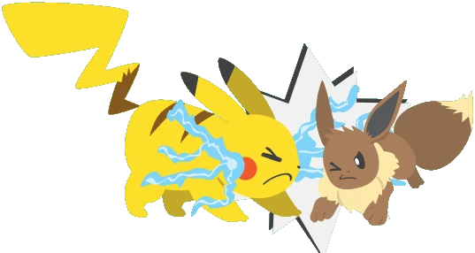
</figure>

电击是特殊招式，因此皮卡丘需掷骰：

<b>特攻</b>+<b>冲抵</b>

并达到或超过伊布使用撞击时命中掷骰的成功数。

**若成功：**

- 冲抵伤害会对两只宝可梦各造成1点伤害。
- 属性抗性／弱点生效。
- 冲抵被视为本回合已使用过的招式。
- 冲抵不会触发用于冲抵的招式或被冲抵招式的追加效果。
- 由于使用了物理或特殊招式，某些特性可能因此触发。

**部分招式无法被冲抵，例如：**

- 命中掷骰使用社交属性的招式
- 变化招式
- 无视防御／固定伤害的招式
- 战技
- 针对对战场地的招式
- 大范围招式只能被大范围招式冲抵

### 闪避

闪避威力 —

<dl>
<dt>属性</dt><dd>无</dd>
<dt>分类</dt><dd>变化</dd>
<dt>命中</dt><dd>敏捷 + 闪避</dd>
<dt>目标</dt><dd>自身</dd>
<dt>反应</dt><dd>↑6（不受多重行动难度表影响）</dd>
</dl>

执行闪避意味着脱离危险路径或招式爆炸范围，通过躲避危险区域，使潜在伤害归零。

*示例：伊布用撞击扑向皮卡丘！但皮卡丘在伊布冲来的瞬间向后跳跃！*

<figure class="mn-art">
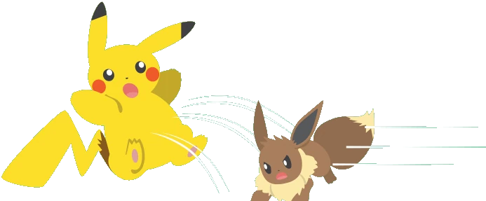
</figure>

皮卡丘需掷骰：

<b>敏捷</b>+<b>闪避</b>

并达到或超过伊布使用撞击时命中掷骰的成功数。

**若成功：**

- 宝可梦脱离对手的攻击范围，不承受任何伤害或效果。
- 这一下要消耗它的一次行动。

**某些招式无法闪避，例如：**

- 使用社交属性进行准确掷骰的招式
- 附带“必中”效果的招式
- 针对对战场地的招式

存在允许每回合多次闪避的招式与特性。也有能暂时阻止你闪避的招式与特性。

**闪避与冲抵都不受多重行动难度表影响**——它们可以是你的第一或第五次行动，只要骰数够就成立；但即便失败，也照样消耗一次行动。

<figure class="art-panel">
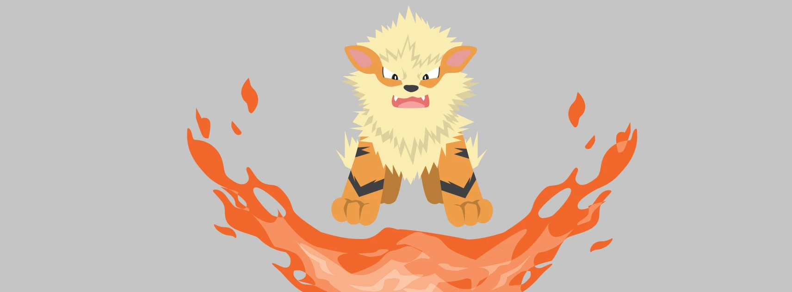
<figcaption>原书 p.71 的插图：风速狗一发热风扫向全队，四只宝可梦各想各的办法。</figcaption>
</figure>

**同一发热风，四种应对。** 敌方风速狗正用热风攻击全队！它在命中掷骰时掷出了4个成功数。每位队员要如何应对？

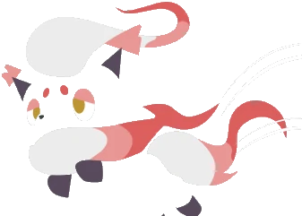
<b>索罗亚</b>

敏捷 + 闪避掷骰，拿到4个成功数——未受伤害与效果影响，安全避开了爆炸。

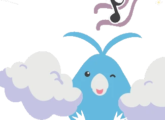
<b>青绵鸟</b>

特攻 + 冲抵掷骰，同样4个成功数。因冲抵承受1点伤害，借这个空档穿过热风。

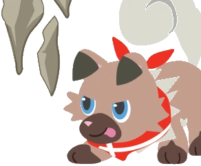
<b>岩狗狗</b>

力量 + 冲抵，成功数远超4！尖石攻击劈开热风击中风速狗：火系对它效果不好，它没受伤；岩石系克制火系，风速狗吃2点冲抵伤害。

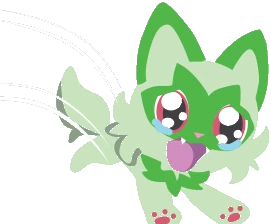
<b>新叶喵</b>

敏捷 + 闪避只拿到2个成功数，闪避失败——只好吃下热浪的全部伤害与追加效果。

> [!rule] 重要细节
>
> - 冲抵掷骰需根据招式类别（物理／特殊）进行。
> - 多名宝可梦冲抵同一招式时，仅最高伤害对攻击方生效。
> - 冲抵可触发特性，但不会触发招式的追加效果。
> - 这些应对都是不成功便成仁：冲抵或闪避掷骰必须达到或超过对手的命中值，否则将承受全额伤害。

## 实用策略

战斗中获胜的并不总是最强壮、最迅速或等级更高的宝可梦。

如何仅凭一只小小的皮卡丘就击败大岩蛇？

当然，制定策略往往就能扭转战局！

本节将教你几招可用于辅助战斗的技巧。

#### 延迟行动

当你在回合中声明延迟行动时，你的角色会保持静止并观察对手。这实际上相当于跳过你的回合，让队列中的下一位角色执行他们的回合。

这看似有违直觉，但你并非放弃回合，只是延迟行动，等待最佳时机。

你可以将延迟的行动用于：

- **之后再进行你的回合**——与队友配合使用，也许让他们先行动更有利，亦或你正以此下套。
- **维持效果持续**——若你使用的某个招式或战技的效果可能在下回合消失，延迟行动可延长该效果。

但需谨记：若战场一方延迟行动，而对方也选择延迟行动，则该回合直接结束。这是因为双方都暂停了战斗，陷入僵持的对峙。

当然，这种跳过回合的做法也可能获得战术优势，务必仔细评估局势。寻找最佳行动时机……或者直接选择按兵不动。

#### 掩护

寻找掩护会为你的防御提供加成，抵御攻击及其追加效果，但具体效果取决于你身体的被覆盖程度。

|身体覆盖程度|对攻击的物防/特防加成|受到追加效果|
|:---:|:---:|:---:|
| 1/4 | +1 | ✔ |
| 1/2 | +2 | ✔ |
| 3/4 | +3 | ✔ |
| 完全 | 必须优先摧毁掩体 | ✘ |

处于完全掩护状态下时，你将不会受到伤害，不仅如此，完全掩护还能阻止绝大部分招式与特性的追加效果对你生效。

但必须注意的是，你的掩护在承受数次攻击后可能被破坏。

也可通过「掩护同伴」战技以身作盾：

掩护同伴

常规掩护与同伴掩护的核心区别在于：当攻击来袭时，无论其身体能提供多大范围的掩护，同伴都会代替你成为攻击目标。

> [!trainer] 💡 训练家贴士
>
> 可先执行“掩护同伴”战技，再保持待机状态持续提供掩护。但若你或被掩护的同伴在战场上使用任何招式或行动，则视为主动解除掩护状态。你可运用“掩护同伴”战技为宝可梦提供肉身护盾，亦可指挥宝可梦为你实施掩护！

#### 战斗治愈

角色在战斗中主要有三种治愈方式：

- **使用治愈道具**——向伤口施以伤药或中药。单次使用恢复1点伤害，双倍剂量可治愈1点致命伤害。
- **使用携带道具**——树果或剩饭等治愈类道具可由宝可梦直接使用，无需消耗行动。
- **施展治愈类招式**——轻微治愈、基础治愈与完全治愈等招式效果可恢复宝可梦HP，但需要消耗意志值方能生效，所以使用次数有限。

尽管这个世界的治愈速度快得惊人，但想要一轮内完全恢复仍不现实，因此每轮HP恢复量存在上限。

> [!rule] 每轮治愈上限
>
> 战斗中，治愈道具与招式每轮最多只能恢复3点HP。
>
> 不过，完全治愈、全满药与全复药不受此限制。

若超过治愈上限，超额治愈将无效化，请勿浪费本可在后续轮次使用的药品！

非战斗状态下可通过药品、饮品完全恢复，当然，最佳选择则是前往宝可梦中心接受治愈。

#### 手下留情

有时需要控制宝可梦招式的全力输出。

此类情况下，你可下达“收力”“克制些”“别用全力”等指令，以实现以下一种或多种效果：

- **只造成一半伤害**——你正常进行伤害掷骰，但只对受此招式影响的目标造成向下取整后的一半伤害。
- **放弃对目标的追加效果**——你的招式命中目标，但你不希望对其产生持续影响，因此放弃所有本应作用于目标的追加效果。影响使用者的追加效果仍然生效。
- **放弃击中要害奖励骰**——虽然你的命中掷骰可能完美无缺，但不会在伤害骰中添加额外骰数。

即便如此，该招式仍视为成功击中要害，但我们可不会因此就让异色宝可梦陷入昏厥！

#### 无慈悲

有时你会想全力发动攻击，彻底击垮对手。

若启用了致命伤害的可选规则，所有带有此图标的招式：

<poke-icon class="mv lethal lg"></poke-icon>

在怀有恶意使用时将直接造成致命伤害。

命令宝可梦无情攻击即可达成此效果，但要注意正式对战禁止使用致命伤害，只有冷酷的训练家和极恶的宝可梦才会动用。

> [!gm] 🎭 叙事者笔记
>
> 致命伤害会加剧战斗紧张感，体育竞技将演变为生死对决。
>
> 请谨慎运用这一叙事手段。

### 追加效果

追加效果存在于相关的所有招式与战技中。绝大多数追加效果会在命中掷骰成功后生效——只要成功击中目标，即使该招式未对目标造成伤害，追加效果仍会触发。

请务必仔细阅读招式描述，你会注意到其中有许多图标，这些图标能帮助你快速识别招式可能具备的所有追加效果。

让我们一探究竟！

#### 始终生效/永不生效

这些图标的意义不言自明。

当效果带有此图标时，该效果将始终自动生效：

<icon-frame class="flinch ico-solo"><b>畏缩</b></icon-frame>必定畏缩

当效果带有此图标时，该效果永远不会被触发：

<icon-frame class="flinch ico-solo"><b>畏缩</b></icon-frame>不会畏缩

你总会发现这些图标与效果说明共处于同一个方框内。

#### 能力变化

这些效果将在你的冒险旅程中发挥重要作用。它们会提高或降低指定的能力值。基础能力包括：力量、耐力、敏捷、特攻与洞察。

衍生能力指由基础能力衍生而来或结合基础能力与技能计算的骰池，例如：物防、特防、意志、闪避、命中。

上箭头表示属性获得提高，下箭头表示属性遭受降低。

<icon-frame class="buff ico-solo"><b>物防</b>↑1</icon-frame>蓝色图标将改变使用者自身的能力值。

<icon-frame class="debuff ico-solo"><b>物防</b>↓1</icon-frame>红色图标将改变对手的能力值。

“X”代表变动的数值点数。招式可能造成1点、2点或3点的能力值提高或降低。

该效果仅持续短暂时间，通常作用于当前场景，或持续至宝可梦被收回精灵球。

同种属性的能力变化不会叠加，仅取修正值最高的招式效果。

> [!tip] 例：大舌贝的两道壳
>
> 一只物防为5的大舌贝使用了招式缩入壳中，该效果使其物防提高1点。大舌贝的物防将提高1点，使其总物防达到6。
>
> 下一回合，大舌贝使用了招式铁壁，该招式使物防提高2点。大舌贝的物防现在变为7，缩入壳中的效果被铁壁取代。
>
> 如果大舌贝再次使用缩入壳中或铁壁，其物防将保持不变。

当某项能力同时受到提高和降低影响时，两种效果视为同时生效，除非其中一方数值更高，否则会相互抵消。

↑1 + ↓1 = 0

↑3 + ↓1 = ↑2

> [!tip] 例：铁壁遇上了瞪眼
>
> 我们的大舌贝使用了铁壁，其物防提高至7。但对手对大舌贝使用了招式瞪眼！瞪眼使大舌贝物防降低1点。
>
> 现在同时存在两种能力变化：铁壁的↑2与瞪眼的↓1。大舌贝的物防回落至6。
>
> 此时大舌贝再次使用铁壁将无效，对手使用瞪眼同样不会生效。

记住，系统会保留最高修正值，增益与减益可以并存。说到降低效果，有个好消息是它们不会让你完全丧失战斗力。

降低效果最多只能将能力值降至1点。

降低效果无法将你的能力值降为零。而提高效果虽然强大，但也不能解决所有问题。

提高效果最多只能让宝可梦的能力达到10点。这意味着如果你的宝可梦某项能力已达10点，将无法继续提高。

若宝可梦某项能力已达极限，通过招式或特性再次提高时，只要总增幅保持在10点以内，仍可正常生效。

部分道具也能提高或降低宝可梦能力，但遵循相同规则：效果不叠加，仅取最高数值。

但当能力变化效果来源包含特性时，存在叠加特例。

组合使用招式/道具与特性，能实现更大幅度的能力变化！

> [!tip] 例：浮潜鼬的三重提速
>
> 浮潜鼬拥有4点敏捷。其特性为悠游自如，雨天时敏捷提高2点。
>
> 当前正值雨天，浮潜鼬回合内使用招式高速移动。该招式使使用者敏捷提高2点。
>
> 浮潜鼬最终获得总计8点敏捷：其中4点为基础值，特性赋予2点，招式追加2点。与特性组合时，宝可梦能获得惊人的能力提高。

注意：招式与道具产生的能力变化效果互不叠加，但均可与特性效果叠加。但特性之间永不叠加，即使该特性来自其他宝可梦。

> [!trainer] 💡 训练家贴士
>
> 正式联盟赛禁止携带已强化宝可梦入场。需将其收回精灵球，待对战开始再放出。

#### 封锁

<poke-icon class="mv blocking lg"></poke-icon>

此效果使目标陷入无法逃走状态，意味着特定时间内无法逃离对战场地、替换下场或被收回精灵球。

同时会阻止替换类招式的效果触发。

#### 概率骰

你已了解如何掷骰池。而概率骰同样需要掷出，不为掷骰成功，只为博取幸运机会！

以该图标标识：

其中X代表你将投掷的概率骰数量。这些骰子不用于任何行动掷骰，仅用于触发特殊效果的几率。

当你掷出概率骰时，若出现6点，则效果将被激活。

无论投掷多少枚概率骰，只要有一枚出现6点即生效。

有时效果描述左侧会标注概率骰图标。像这种例子，玩家需掷5枚概率骰，若出现6点则使用者物防提高1点：

<icon-frame class="buff ico-solo"><b>物防</b>↑1</icon-frame>

另有些情况下，概率骰图标会出现在状态异常框内，表示触发该异常的几率：

<icon-frame class="paralysis ico-solo"><b>麻痹</b>3</icon-frame>

骰子数量越多，触发几率越高。

#### 蓄力招式

蓄力招式是威力强大的攻击招式，需稍作准备方能释放。其标识图标如下：

<poke-icon class="mv recharge lg"></poke-icon>

蓄力招式需消耗两回合（即两次行动）完成：首次行动蓄力，第二次行动释放。

**蓄力招式运作机制：**

- **使用者回合**：掷命中骰并记录成功数。
- 若掷骰成功，招式开始蓄力。
- 蓄力过程将消耗一次行动。
- **在使用者的下个回合**：释放招式时机已至，正常进行伤害掷骰并消耗另一行动。若目标试图冲抵/闪避，可在招式释放当回合进行，蓄力阶段不可进行。
- 蓄力期间，使用者仍可进行闪避。
- 此类招式无需蓄力即可直接用于冲抵。若使用者在蓄力期间选择冲抵，则必须使用当前蓄力的招式进行冲抵，这将导致蓄力回合的能量积累被浪费——虽非上策，但有时确是最佳选择。

#### 拷贝招式

<poke-icon class="mv copy ico-solo"></poke-icon>

带有此图标的招式可完美复制其他招式。

复制招式将继承原招式的分类、威力及追加效果，只有命中掷骰保持独立。

通常你可选择复制目标的招式，随后可对原目标或对战场地上其他目标发动复制招式。借此既能以彼之道还施彼身，亦可增强己方火力。

> [!tip] 例：比雕的镜面反射
>
> 上回合比雕的盟友火暴兽使用燃尽未击倒对手！此刻比雕抓住时机发动镜面反射！
>
> 成功掷出洞察 + 表演后，完美复刻盟友的招式燃尽直取敌阵！

此类图标招式多为变化招式，不可用于冲抵；但复制得到的物理/特殊招式仍可触发冲抵。

专属招式不可复制，且无法再次复制已被复制的招式。

务必仔细阅读拷贝招式的说明，可能存在特殊限制。

#### 持续时间

我们已知晓游戏内的时间计量方式，但部分效果存在时效性——自激活时开始倒计时，倒计时结束就会失效。另外，有些效果具有更稳定的持续时间，可长期维持。

**持续数轮** 

效果仅持续指定轮数，于每轮结束时推进计数。

重复使用此类招式不会重置倒计时，必须等待效果自然结束方可重新激活。

**持续完整场景** 

效果将持续整个场景或直到受影响的宝可梦离开战斗。

若重复使用，效果不会叠加，只有最近一次使用的效果才会生效。大多数能力变化的招式默认具有此时效。

**永久有效**

效果将永久持续且不可逆转，请谨慎选择。

若需深入了解游戏中时间概念的详细说明，请回<a href="#/02-system-explained?id=时间与对战设定">系统详解 · 时间与对战设定</a>。

#### 对入场宝可梦有效的招式

<poke-icon class="mv hazard ico-solo"></poke-icon>

这是置于敌方场地的陷阱类效果，会在对手入场时立即对其造成危害，而己方场上的单位则不受影响。

具体效果标注于相关招式条目，常见效果包括造成伤害、属性降低和状态异常。与切换类招式配合使用时效果极佳。

#### 力场护盾

若招式带有此图标：

<poke-icon class="mv field ico-solo"></poke-icon>

表示其效果为作用于己方场地的力场，可减免该侧所有单位的伤害。

减伤幅度、持续时间和适用伤害类型（物理/特殊/全部）详见招式说明。

针对同类型伤害的力场护盾效果不可叠加。

#### 治愈与HP恢复

部分宝可梦能够学会恢复生命值的招式。它们会带有以下图标标识：

<poke-icon class="mv heal-basic ico-solo"></poke-icon>**基础治愈**——恢复等同于 **X** 的普通伤害与致命伤害。

<poke-icon class="mv heal-complete ico-solo"></poke-icon>**完全治愈**——恢复等同于 **X** 的普通伤害与致命伤害。

<icon-frame class="heal ico-solo"><b>回复</b>X</icon-frame>**轻微治愈**——恢复微量HP。

当你的宝可梦对带有这些图标的招式成功进行命中掷骰时，需消耗1点意志值才能获得治愈效果，若命中掷骰失败则无需消耗意志值。

部分未标注治愈图标的招式也具备恢复效果，但这些招式需依赖特定条件恢复HP，并非稳定的治愈来源。

> [!trainer] 💡 训练家贴士
>
> 治愈招式并非无限使用！宝可梦的意志值可能在HP完全恢复前耗尽。务必随身携带伤药！
>
> 每回合治愈上限通常为3HP。更多规则见<a href="#/04-pokemon-battles?id=战斗治愈">战斗治愈</a>。

**例：大竺葵的青草场地。** 

大竺葵正与野生宝可梦战斗，你令它使用青草场地：

<b>青草场地</b><em>威力</em>—

<dl class="mc-body">
<dt>属性</dt><dd>草</dd>
<dt>分类</dt><dd>变化</dd>
<dt>命中</dt><dd>洞察 + 生存</dd>
<dt>伤害池</dt><dd>—</dd>
<dt>目标</dt><dd>己方半场</dd>
<dt>效果</dt><dd>己方场地上所有物理／特殊草属性招式各加1颗额外伤害骰；己方每轮结束回复1HP。消耗1点意志值激活，持续4轮。</dd>
</dl>

<poke-icon class="cat support"></poke-icon>
<icon-frame class="extra"><b>伤害</b>+1</icon-frame>
<icon-frame class="heal"><b>回复</b>1</icon-frame>

大竺葵消耗1点意志值激活招式的治愈效果。己方全体成员都将受益于此恢复效果！

数回合后，场地上有人把天气变成了大晴天。大竺葵此时只剩3点HP，你令它使用光合作用：

<b>光合作用</b><em>威力</em>—

<dl class="mc-body">
<dt>属性</dt><dd>草</dd>
<dt>分类</dt><dd>变化</dd>
<dt>命中</dt><dd>洞察 + 生存</dd>
<dt>伤害池</dt><dd>—</dd>
<dt>目标</dt><dd>自身</dd>
<dt>效果</dt><dd>基础治愈，成功则消耗1点意志值激活。若大晴天生效，此招式变为完全治愈；若下雨、沙暴或冰雹生效，则只回复1HP。</dd>
</dl>

<poke-icon class="mv heal-basic"></poke-icon>
<poke-icon class="mv heal-complete"></poke-icon>

这意味着大竺葵将恢复5HP，从而重回满血状态！由于本回合治愈已达上限，回合结束时青草场地的治愈效果将失效。

#### 容易击中要害的招式

若重新查阅<a href="#/04-pokemon-battles?id=击中要害">击中要害</a>的规则，你会知道在成功通过命中掷骰后，该效果能提升伤害值。通常而言，击中要害需要比行动难度表要求多出3个成功。

容易击中要害的招式可将该要求降低1点。这意味着只要多出2个成功，就能用带有此图标的招式触发击中要害：

<poke-icon class="mv crit lg"></poke-icon>

具有该效果的招式可与特性“超幸运”叠加生效。

#### 致命伤害

<poke-icon class="mv lethal lg"></poke-icon>

当启用致命伤害可选规则时，若宝可梦被下达“无慈悲”指令或处于极度狂暴状态，这些招式可造成致命伤害。

这些招式默认不会造成致命伤害，必须收到“无慈悲”指令。正式对战中不允许使用致命伤害。

更多信息见<a href="#/04-pokemon-battles?id=致命伤害（可选规则）">致命伤害（可选规则）</a>。

#### 降低命中的招式

若使用带有降低命中图标的招式：

<icon-frame class="accuracy ico-solo"><b>命中</b>↓2</icon-frame>

从招式的命中掷骰中扣除标注的成功。

这意味着你尝试使用的招式具有特殊的操控难度。

必须提升能力和技能数值才能更好掌控时机，因为降低的命中会与多重行动难度叠加，在本回合越晚使用该招式，成功几率就越低。

> [!tip] 例：打雷与烟幕
>
> 皮卡丘正试图用“打雷”攻击对手臭鼬噗，而这一招自带**降低2命中**。

<em>皮卡丘的骰池</em>

与

<icon-frame class="accuracy"><b>命中</b>↓2</icon-frame><em>招式命中修正</em>

=

−2<em>成功数</em>

掷骰失败。雷击落在场地上，但没打中目标。

臭鼬噗的回合，它使出“烟幕”，让皮卡丘的命中再降1点。下一轮皮卡丘的“打雷”就变成：

<em>皮卡丘的骰池</em>

与

<icon-frame class="accuracy"><b>命中</b>↓3</icon-frame><em>招式命中修正</em>

=

−3<em>成功数</em>

皮卡丘需要训练技能，才能更好地掌控这类攻击。

伤痛惩罚及其他惩罚可能从你的掷骰结果中扣除更多成功。

某些招式的威力或许看起来很诱人，但要想赢得对战，仅靠强力招式还远远不够。

若对手依赖威力大但命中低的招式，不必畏惧，通过闪避或冲抵将他们的优势转为劣势。

#### 基于……的招式

这些图标用于标明招式是否与特定特性产生互动。

<poke-icon class="mv bite"></poke-icon>**啃咬类招式**——这类招式通过撕咬对手发动，能受强壮之颚特性加成。

<poke-icon class="mv cutter"></poke-icon>**切斩类招式**——这类招式通过劈砍发动，能受锋锐特性加成。

<poke-icon class="mv fist"></poke-icon>**拳击类招式**——这类招式通过拳击发动，能受铁拳特性加成。

<poke-icon class="mv projectile"></poke-icon>**球弹类招式**——这类招式通过发射爆破物发动，会被防弹特性阻挡。

<poke-icon class="mv wind"></poke-icon>**风类招式**——这类招式借助气流发动，能强化拥有风力发电特性的对象。

其他特性也可能与各自对应类型的招式产生互动。

#### 使用后下一回合自己将无法动弹的招式

某些强力招式可无需蓄力直接释放，但会使使用者精疲力竭，需稍作休整才能恢复能量。

若见此图标请保持警惕：

<poke-icon class="mv recharge lg"></poke-icon>

掷骰成功后，使用者下轮首个行动必须用于蓄力。即使宝可梦被召回，该蓄力需求依然存在。

此效果可叠加，若一轮使用三个带此图标的招式，下回合需用前三个行动进行蓄力。

若招式命中掷骰失败、被冲抵/闪避或用于冲抵，则使用者无需蓄力。

> [!note] 译注
>
> 我说真的，没命中就可以下一轮继续放？比动画还离谱。我的建议是叙事者直接按照原作来。

#### 无法闪避的招式

<poke-icon class="mv never-miss lg"></poke-icon>

带此图标的招式无法被闪避：但仍可被冲抵，且命中掷骰未必总能成功。

尽管如此，它们会因攻击迫在眉睫而给对手持续施压。

> [!note] 译注
>
> 原作里的“必中招式”叫「攻击必定会命中的招式」，但它这个描述只是无法闪避，又吃降低命中又吃冲抵，于是我把译名换成了更贴切的版本。

#### 持续伤害

面对带此图标的招式需格外谨慎：

<poke-icon class="mv ongoing lg"></poke-icon>

这些招式可能伤害目标、使其困于有害环境，或附着撕裂性物体。

回合结束时，对目标掷2颗无属性伤害骰。

多个持续伤害来源不会叠加，每次仅生效最早施加的效果。

效果持续时间详见招式说明。

#### 超出攻击范围

此图标表示宝可梦已远离战场，使大多数招式无法触及：

<poke-icon class="mv out-of-range lg"></poke-icon>

处于攻击范围外时，宝可梦将不受招式或战技的影响。

仅有特定招式能根据其脱离方式（飞行、钻地、潜水等）命中目标。

#### 粉末类招式

<poke-icon class="mv powder lg"></poke-icon>

此图标标记使用粉末/尘雾/孢子的招式，吸入后可能影响其他目标。

虽然多数宝可梦会受影响，但草系宝可梦天然免疫此类招式，不会受到伤害或负面效果。

#### 暴走状态

若说真有招式能释放宝可梦体内的凶性，暴走类招式当属此列，以此图标为标识：

<poke-icon class="mv rampage lg"></poke-icon>

当命中掷骰成功后，原始凶性将在宝可梦意识中点燃，暴走状态随即激活。

- 暴走招式每回合最多可连续使用3次。
- 暴走期间，该招式仅能在使用者回合或冲突对抗时使用。
- 暴走持续期间，使用者无法闪避或施展其他招式，否则暴走终止。
- 暴走结束后，使用者将陷入“混乱”状态。
- 暴走期间可发起冲突对抗，但会消耗3次使用机会中的1次。
- 仅使用暴走招式进行冲抵时，不会触发暴走效果。
- 首次使用招式后可随时终止暴走，但即便仅使用一次也会引发混乱。

#### 远程招式

此图标表示该招式不会在使用者与目标之间产生物理接触：

<poke-icon class="mv ranged lg"></poke-icon>

仅出现在造成远距离伤害的物理招式上，意味着宝可梦与目标距离不足以产生肢体接触。

某些特性会因接触或距离过近而触发。这类招式能让你在施展物理力量的同时与危险保持安全距离。

特殊招式始终被视为远程攻击。

#### 即时反应与延迟反应

<icon-frame class="reaction ico-solo"><b>反应</b>↑1</icon-frame>即时反应<icon-frame class="reaction ico-solo"><b>反应</b>↓1</icon-frame>延迟反应

表示你可以将该招式作为即时反应或延迟反应使用。具体用法见<a href="#/04-pokemon-battles?id=每次行动都有对应的反应">每次行动都有对应的反应</a>。

#### 反作用力

<poke-icon class="mv recoil lg"></poke-icon>

使用者将受到自身招式的伤害。正常对敌人掷伤害骰后，将获得的每个成功数作为无视防御的伤害再次为使用者掷骰。

#### 固定伤害

固定伤害意味着将造成标注数值的伤害，无视防御等外部因素。

<icon-frame class="damage ico-solo"><b>伤害</b>X</icon-frame>

造成标注数值的固定伤害。

能减免固定数值伤害的效果也是存在的。

#### 声音类招式

与基于特定属性的招式类似，声音类招式顾名思义基于声音，但它们除了与某些特性互动外还有特殊机制。当你看到这个图标时：

<poke-icon class="mv sound lg"></poke-icon>

这意味着该招式的能量通过声波传递，因此几乎能抵达任何地方。

音波类招式可绕过替身、力场护盾和掩体。

#### 保护类招式

保护类招式带有此图标：

<poke-icon class="mv shield lg"></poke-icon>

其效果各不相同，但都有一个共同点——这些动作都涉及格挡来袭攻击。

多数保护类招式可作为即时反应使用，能立即提供保护。

与冲抵和闪避不同，保护类招式能正面承受攻击且确保使用者几乎毫发无损，可将所受伤害降为零。

但也有限制条件……

每轮只能使用一次保护类招式而不受惩罚。连续使用时，会叠加呈指数增长的“降低2命中”惩罚。

|连续使用的轮次|惩罚|
|:---:|:---:|
| 第1轮使用保护类招式 | 无惩罚 |
| 第2轮使用保护类招式 | 降低2命中 |
| 第3轮使用保护类招式 | 降低4命中 |

若持续不间断使用，惩罚将大幅增加导致大失败概率激增。需整轮不使用保护类招式才能重置惩罚。

#### 连续行动

每轮都能够执行多重行动。

但有些特殊招式能在单回合内发动多重行动，这被称为连续行动。

连续行动允许单回合内重复同一招式最多5次。

所有动作均作用于同一目标。

由以下图标标记：

<poke-icon class="act double"></poke-icon>**双重行动**——每回合可使用该招式最多2次。

<poke-icon class="act triple"></poke-icon>**三重行动**——每回合可使用该招式最多3次。

<poke-icon class="act successive"></poke-icon>**连续行动**——每回合可使用该招式最多5次。

运作原理如下：

> [!tip] 例：喵喵的疯狂乱抓
>
> 喵喵将使用连续行动招式「疯狂乱抓」。虽然单回合最多可重复使用5次疯狂乱抓，但喵喵的训练家仅选择发动2次。
>
> 进行命中掷骰时，喵喵将遵循多重行动规则投掷骰子，但所有攻击会一次性释放。
>
> 若通过训练提升骰池数量，喵喵单回合内将能发动最多5次连续攻击！

#### 替换类招式

虽然战斗中替换宝可梦通常并非明智之举，但你的宝可梦可能掌握了一些小窍门——这些窍门能让高风险的替换变得轻而易举，甚至理想情况下能迫使对手也替换宝可梦，从而在回合中段打乱其策略。替换类招式可通过以下图标识别：

<poke-icon class="mv switcher lg"></poke-icon>

- **替换使用者**——从己方队伍中替换宝可梦。
- **替换对手**——将对手送走，迫使其进行宝可梦替换。

> [!tip] 例：伏特替换
>
> 本回合持续已久，皮卡丘选择在第三次行动时使用伏特替换！同伴水水獭登场备战，并将继承皮卡丘的先攻与剩余行动次数。
>
> 造成伏特替换的伤害后，皮卡丘将返回精灵球，由另一只宝可梦接替其位置。此后战斗将正常继续。

> [!rule] 替换类招式要点
>
> - 新登场的宝可梦将继承被替换者的剩余行动次数与先攻。
> - 每位训练家每轮仅能触发一次强制替换效果。
> - 使用者可以强制替换招式对对手的强制替换招式进行反制。
> - 强制替换招式冲抵时不会触发效果。
> - 强制替换招式被冲抵时也不会触发效果。

#### 专属招式/特性

某些宝可梦拥有专属招式/特性，使其能发挥特殊的力量掌控。

此图标表示你正在查看专属招式/特性：

<poke-icon class="mv unique lg"></poke-icon>

专属通常威力惊人或使用方式独特，因此不会被多数招式或特性复制、替换、无视或覆盖。其他种类的宝可梦也无法习得，但叙事者可根据剧情需要酌情调整。

#### 破绽状态

带有此图标的特定招式：

<poke-icon class="mv vulnerable lg"></poke-icon>

将使使用者进入破绽状态，这意味着它更容易受到特定来源的伤害。

使用者可能被特定招式选中为目标，即使超出攻击范围。

宝可梦处于破绽状态时，无法进行反应动作，也无法对标记招式使用力场护盾或掩体保护。

若在破绽状态下被击中，该宝可梦将承受2点额外伤害。

## 异常状态与状态变化

存在改变或损害人类与宝可梦正常状态的状况，统称为异常状态与状态变化。

可能是灼伤等痛苦效果，或是混乱等干扰效果。

状态变化数分钟后会自行消解，而异常状态可能需要紧急医疗处理。

某些宝可梦属性对特定异常状态免疫。若攻击来源是其抵抗属性时也可免疫，但仍建议随身携带药品和恢复道具。

> [!rule] 异常状态与状态变化可以相互叠加
>
> 这意味着你或你的宝可梦可能同时陷入睡眠、中毒和混乱状态。同理，多次施加灼伤或中毒会使症状升级。

官方联盟比赛可能会限制宝可梦的状态叠加。例如当对手宝可梦中毒或睡眠时，联盟裁判会禁止你附加其他状态，违规将受处罚。

仅万能药、全复药和木子果能治愈多重状态。若无这些道具，需逐个治愈或采用原始方法：停下、卧倒、翻滚。部分状态可自愈或持续时间较短，但有些会恶化甚至持续数小时。

异常状态与状态变化分为三大类。

> [!rule] 三大类
>
> - **恶化型**——若不及时处理，症状将持续加重并造成更多持续伤害。
> - **固定型**——该状况维持现状，不会随时间恶化，但也不会自行痊愈。
> - **易变型**——该状况是暂时的，数分钟后或更换受影响对象即可自行恢复。
>
> 请注意！当异常状态叠加或未及时处理时，可能会造成致命威胁。

> [!note] 译注
>
> 下表中带 ** 的效果，只有启用<a href="#/04-pokemon-battles?id=致命伤害（可选规则）">可选规则「致命伤害」</a>时才会造成致命伤害。

### 1级灼伤

*固定型*

极高的温度灼伤了您的皮肤，导致起水泡。

**异常效果**

- 每轮结束时造成1点伤害。
- （火属性宝可梦免疫）

**解决方案 & 持续时间**

- 每次轮到该角色的回合时，进行一次敏捷 + 运动的掷骰：累计这些投掷的成功次数，直到达到4。
- 脱离战斗后，其他人可以协助缓解灼伤。
- 此效果持续至目标昏厥或接受完全部治疗为止。

### 2级灼伤

*固定型*

你身体的一部分正被火焰吞噬！

**异常效果**

- 每轮结束时造成2点致命伤害**。
- （火属性宝可梦免疫）

**解决方案 & 持续时间**

- 每次轮到该角色的回合时，进行一次敏捷 + 运动的掷骰：累计这些投掷的成功次数，直到达到6。
- 脱离战斗后，其他人可以协助缓解灼伤。
- 此效果持续至目标昏厥或死亡为止。**

### 3级灼伤

*恶化型*

你被火焰完全吞没！

**异常效果**

- 每轮结束时造成3点致命伤害**。
- 之后每轮伤害值增加2点。
- （火属性宝可梦免疫）

**解决方案 & 持续时间**

- 每次轮到该角色的回合时，进行一次敏捷 + 运动的掷骰：累计这些投掷的成功次数，直到达到8。
- 脱离战斗后，其他人可以协助把火扑灭。
- 此效果持续至目标昏厥或死亡为止。**

### 混乱

*易变型*

是不是有人刚刚命令你攻击自己？

**状态效果**

- 目标会根据其等级从所有行动检定中扣除相应数量的成功：
- 从入门级到正式级扣除1成功；
- 从资深级到精英级扣除2成功；
- 达到大师级或更高等级则扣除3成功。
- 若行动失败，受试者将受到1点伤害。

**解决方案 & 持续时间**

- 在回合开始时进行洞察掷骰；若在混乱影响下达到2成功，则该角色可在该回合正常行动。
- 脱离战斗后，目标会陷入意识混乱约5分钟，期间可能攻击自己或己方盟友。

### 定身法

*易变型*

有什么正在阻止你发动攻击！

**状态效果**

- 目标无法发动陷入定身法状态的招式。
- 只有一项招式会被影响。
- 每当有新的招式陷入定身法状态，旧的招式就不再无法使用。

**解决方案 & 持续时间**

- 在效果自行消失之前，无法抵抗此效果。脱离战斗后，该效果持续5分钟。

### 麻痹

*固定型*

你的肌肉被限制住了，几乎无法活动。

**异常效果**

- 目标的敏捷降低2点。
- 叙事上表现为降至原速的一半，或几乎无法移动。
- （电属性宝可梦免疫）

**解决方案 & 持续时间**

- 目标无法自行处理该异常。正常情况下效果持续12小时。
- 在战斗之外，其他人可进行掷骰：力量 + 医术，通过按摩对目标进行治疗；每个成功可将持续时间缩短1小时。

### 畏缩

*易变型*

你想要做出反应，但身体却不听使唤！

**状态效果**

- 目标下个回合无法行动，且在该回合结束前不能使用反应行动。每轮每个对象只能施加一次畏缩状态。

**解决方案 & 持续时间**

- 持续至目标的下个回合结束。
- 在效果自行消失之前，无法抵抗此效果。战斗外仅持续数秒。

### 冰冻

*固定型*

你被冻结在冰里了！

**异常效果**

- 目标因被封在冰块中无法执行任何行动。冰块具有5HP，物防与特防均为2。
- 每轮结束时，目标或其盟友可尝试用招式击碎冰块。
- 对冰系效果绝佳的招式可立即破冰。
- （冰属性宝可梦免疫）

**解决方案 & 持续时间**

- 效果持续至冰块碎裂或数小时后自行融化。若自行融化，被影响者将处于无意识状态。

### 着迷

*易变型*

你会保护心爱之人！……等等，她叫什么来着？

**状态效果**

- 目标陷入着迷。若所爱之敌仍处于对战场地，目标会对该目标及其盟友手下留情（见<a href="#/04-pokemon-battles?id=手下留情">手下留情</a>）。
- 投掷目标的忠诚/洞察骰，需至少3个成功才能使之全力攻击所爱之敌及其盟友。

**解决方案 & 持续时间**

- 非战斗状态下，目标会坠入爱河并消除所有敌意约24小时。
- 若遭遇心碎或多名目标同时迷恋同一只宝可梦，持续时间可能缩短。

### 中毒

*固定型*

你感到恶心反胃并伴有低烧。

**异常效果**

- 每轮结束时造成2点伤害。
- （毒与钢属性宝可梦免疫）

**解决方案 & 持续时间**

- 战斗外若目标静卧不动，伤害改为每小时触发一次。持续8小时或直至昏厥。
- 处于精灵球内无法避免该效果。

### 剧毒

*恶化型*

你正发着高烧，全身疼痛难忍。

**异常效果**

- 每轮结束时造成2点致命伤害**，之后每轮伤害值增加2点。
- （毒与钢属性宝可梦免疫）

**解决方案 & 持续时间**

- 同中毒状态。持续至目标昏厥或死亡**。
- 精灵球无法隔绝该效果。
- 剧毒状态下昏厥者每小时承受致命伤害**。

### 睡眠

*固定型*

眼皮越来越沉……或许该……zzz

**异常效果**

- 目标陷入深度沉睡，在苏醒前无法执行任何行动。
- 若目标处于战斗中或承受压力，在其回合开始时需进行洞察掷骰。
- 累计获得5次成功即可苏醒，每次洞察掷骰被视为一次行动。

**解决方案 & 持续时间**

- 非战斗状态下，除非承受压力或感知危险，目标将陷入数小时沉睡。
- 他人可尝试唤醒目标。

### 状态异常向导

原书在这里是两页图文教程（怎么灭身上的火、怎么敲开冰壳、怎么给麻痹的宝可梦按摩），
内容与上面的卡片重复，这里压成一张速查表，跑团时看这一张就够。

|状态|战斗中的处理|相关道具|
|------|----------|----------|
| **灼伤** | 每轮用**敏捷 + 运动**掷骰，累计成功数（1级4个 / 2级6个 / 3级8个）即可熄灭。 | 灼伤药、莓莓果、万灵药、万能粉、冰淇淋 |
| **冰冻** | 冰块5HP、双防2；每轮结束前，被困者或其盟友可用招式打碎。**格斗 / 火 / 岩石 / 钢**属性效果绝佳，一击即碎。 | 解冻药、利木果、万灵药、万能粉、烘焙点心 |
| **麻痹** | 战斗内只能靠道具、招式与特性。战斗外由他人**力量 + 医术**按摩，每个成功缩短1小时。 | 解麻药、樱子果、万灵药、万能粉、烘焙点心 |
| **中毒 / 剧毒** | 战斗内无解，只能靠道具、招式与特性。战斗外静卧可将伤害改为每小时一次，但仍需就医。 | 解毒药、桃桃果、万灵药、万能粉、烘焙点心 |
| **睡眠** | 每轮开始时**洞察**掷骰，累计5个成功即醒（每次掷骰算一次行动）。 | 解眠药、零余果、万灵药、万能粉、烘焙点心 |

## 天气

天气会在生态系统中自然形成，你可以按照预期在最适合野生宝可梦生存的气候中找到它们。

它们的招式、能力会因天气和周围环境而提高或降低。

森林、丛林、山脉或火山、苔原，甚至地下或水下环境都可能让你在战斗中占据优势或劣势。

阳光、降雨、降雪、沙暴等天气条件会影响战场环境。

有些宝可梦能通过特殊招式暂时召唤特定天气。据记载，另一些宝可梦拥有随心所欲改变天气的惊人能力。

当战场存在特定天气时，将产生以下效果：

某些属性招式会造成更多或更少伤害，部分宝可梦能力会得到强化。有些天气甚至会直接对战场上所有单位造成伤害！

这使得战场成为动态变化的场景，而非静止的竞技场。昼夜、天气和地形都可能影响胜负概率。

宝可梦使用招式或特性可以覆盖自然形成的天气。

但当两只宝可梦同时试图改变天气时会出现僵局，解决规则如下：

- 若双方都使用招式改变天气，后发动的招式生效。
- 若双方都拥有天气类特性，需进行意志掷骰，成功数多者生效。
- 特性改变的天气可被招式或其他天气覆盖。若首发宝可梦被替换下场后重新登场，其特性将覆盖当前天气（后发动的招式仍具有优先权）。

请注意，某些特定天气条件无法被覆盖。

改变天气是宝可梦强化自身的众多方式之一，善用其优势，准备好探索这个生机勃勃的世界吧！

### 大晴天

*明媚阳光普照大地。气候炎炎，你会感到口渴和疲惫。*

这种天气常见于平原、热带地区和半荒漠地带。野生宝可梦会寻找阴凉处或水源降温。

- 所有火系招式伤害骰池增加1个额外骰子。
- 所有水系招式总伤害降低1。
- 夜间或阳光无法照射的区域无法生效。
- 不会陷入冰冻状态（除非在晴天开始前已被施加该状态）。
- 特定招式与特性会与此天气产生交互（如：日光束、朝阳、叶绿素、太阳之力等）。

### 下雨

*倾盆大雨。你浑身湿透，积水成洼，行进困难。*

这种天气常见于雨林、湖畔和沼泽。部分野生宝可梦会寻找庇护所，也有些喜欢在雨中嬉戏。

- 所有水系招式伤害骰池增加1个额外骰子。
- 所有火系招式总伤害降低1。
- 室内或雨水无法到达的区域无法生效。
- 除非在雨天天气开始前陷入灼伤，否则任何单位不会受到二级或三级灼伤状态的影响。
- 特定招式与特性会与此类天气产生交互（例如：打雷、暴风、悠游自如）。

### 沙暴

*由沙砾与碎石构成的浓密的棕黄色沙云笼罩战场，能见度极低，尖锐的碎片会刺痛眼睛与皮肤。*

此类天气常见于沙漠与沙丘地带。岩石、地面与钢属性宝可梦不受影响，但其他宝可梦会纷纷寻找掩体躲避。

- 战场上所有非岩石/地面/钢属性的宝可梦在每轮结束时受到1点无属性伤害。
- 全身掩体可避免沙暴伤害。
- 场上所有岩石属性宝可梦的特防提高1。
- 无法在室内或沙暴无法触及的区域生效。
- 特定招式与特性会与此类天气产生交互。

### 下雪

*万物被厚厚的冰雪覆盖，纷飞的雪花环绕四周。若非严寒刺骨，这本该是绝美景致。*

此类天气常见于高山、极地及冬季多数时段。野生冰属性宝可梦在此环境下如鱼得水，但多数宝可梦会寻求温暖之所。

- 所有冰属性招式的伤害骰池额外增加1个骰子。
- 场上所有冰属性宝可梦的防御提高1。
- 施加冰冻异常状态时的概率骰掷骰增加1个骰子。
- 将冰冻异常状态生成的冰块的HP和物防提升至7HP和3点。
- 特定招式与特性会与此类天气产生交互。

### 冰雹

*暴雨般的尖锐冰球以足以砸穿天花板、击碎窗户的力道坠落，快寻找掩体！*

该天气常见于平原地区及特定季节的高海拔地带。几乎所有宝可梦都厌恶这种天气，唯有冰属性能够抵御。

- 战场中所有非冰属性宝可梦在每轮结束时受到1点无属性伤害。
- 全身掩体可避免冰雹伤害。
- 所有施加冰冻异常状态时的概率骰掷骰增加1个骰子。
- 无法在室内或冰雹无法触及的区域生效。
- 特定招式与特性会与此类天气产生交互。

### 大日照

*极端高温环境中甚至会出现熔岩，某些物体会自燃。需要特殊装备才能在此天气行动。*

该天气仅存在于极度干旱的沙漠与火山区域。只有最具韧性的野生宝可梦能在此极端天气中生存。

- 所有火属性招式伤害骰池额外增加2个骰子。
- 所有水属性招式无法发动。
- 大日照天气持续期间无法激活其他天气，仅大雨或乱流天气可将其覆盖。
- 任何单位都不会受到冰冻状态效果。
- 回合开始时，除火属性宝可梦外，所有耐力4及以下的单位需进行耐力掷骰（需2成功）。若失败则受到2点火属性伤害。

### 大雨

- 所有水属性招式伤害骰池额外增加2颗骰子。
- 所有火属性招式均无法发动。
- 大雨天气持续期间无法激活其他天气。仅大日照或乱流天气可将其覆盖。
- 任何单位都不会受到任何程度的灼伤状态效果。
- 回合开始时，除水属性宝可梦外，所有耐力4及以下的单位需进行耐力掷骰（需2成功）。若失败则受到2点水属性伤害。

### 乱流

*强劲气流将一切卷至空中盘旋。你或被狂风裹挟，或正高速坠向地面。*

该天气仅出现在海拔30,000英尺以上的高空。飞行属性与漂浮特性的宝可梦可滞留空中，其余单位可能坠落或相互碰撞。

- 所有飞行属性招式伤害骰池额外增加2颗骰子。
- 飞行属性单位不会受到效果绝佳招式的额外伤害。
- 强风天气持续期间无法激活其他天气。一旦生效便不可被覆盖。
- 回合开始时，除飞行属性宝可梦与具备漂浮特性的宝可梦外，所有敏捷4及以下的单位需进行敏捷掷骰（需2成功）。若失败则受到2点无属性伤害。

## 环境挑战（可选）

若将环境因素纳入考量，可为对战增添额外挑战性。

虽非强制使用，但联盟正式锦标赛通常会在竞技场中为每场比赛设置一至两项环境挑战。

以下提供若干可用的环境挑战范例：

### 浓雾/黑暗

*视野受限*

场上所有宝可梦针对对手的招式均额外获得降低1命中状态。

### 泥泞

*行动困难*

地面上的所有宝可梦敏捷降低1点，且陷入封锁状态。

### 水下

*争分夺秒*

每轮结束时，非水系宝可梦与训练家需进行耐力掷骰以维持呼吸，每回合难度递增2点。若掷骰失败，将陷入昏厥。

### 烈焰熊熊！

*危险陷阱*

每轮结束时，掷3枚概率骰，对场上所有单位造成二级烧伤。

### 电气柱

*电属性强化*

所有宝可梦的电属性招式伤害骰池将额外增加1颗骰子。

### 花团锦簇

*舒缓效果*

对战场地是一片花田，散发出诱人的香气，既能防止对方闪避，也能降低其攻击性。

### 下水道/垃圾堆

*恶臭难忍*

对战场地污泥深及膝盖。每轮结束时，掷3颗概率骰，对场上所有角色施加中毒效果。

### 丛林深处

*增加伪装*

茂密的植被覆盖着战场。所有涉及潜行和自然技能的掷骰额外增加2个骰子。

### 踩高跷

*坠落风险*

回合结束时，非飞行属性/漂浮特性宝可梦需进行敏捷 + 运动掷骰，以维持平衡；若掷骰失败，将承受2点伤害。

### 洒水器

*改变属性*

对战场地上的所有生物都会因洒水而被打湿。它们的属性会变为水。持续时间为整个场景。

### 宝可梦墓地

*令人发毛的环境*

对战场地令人毛骨悚然。所有涉及威吓技能的掷骰，额外增加2个骰子。非幽灵属性宝可梦将获得逃跑特性。

### 雷区

*隐藏陷阱*

小心脚下。所有进入该区域的宝可梦都会受到1点无属性伤害。

### 治愈伤口

*恢复HP*

该场地中存在某些区域，能够使那些花费行动去接触这些区域的人恢复HP；随后该区域会枯竭。

### 毁坏的世界

*扭曲的空间*

在这对战场地上，物理定律已不再适用。所有招式都会随机改变其目标。

### 终点

*力量测试*

禁用道具不可闪避不可冲抵

只有最原始的力量。

欢迎自由创建你自己的环境！

## 成功战斗10大要诀

<b>1. 训练你的宝可梦。</b>
通过训练，你可以尝试不同搭配，通过组合能力、技能和招式，寻找最强的队伍。强大的训练家需要强大的宝可梦。

<b>2. 善用优势。</b>
不仅是属性克制。要考虑你的宝可梦擅长什么，以及如何利用这点创造有利局面。

<b>3. 利用或制造弱点。</b>
如果对手太强或太快，你用什么来反制？也许对手正在使用降低命中的招式，你可以进行躲避，适时施加减益效果就能削弱对手取胜。

<b>4. 了解你的招式。</b>
掌握常用招式的威力、命中和效果，才能发挥最大效用。

<b>5. 闪避、冲抵与掩体。</b>
除非确信能承受攻击，否则要闪避、冲抵或寻找掩体。尽量降低每回合受到的伤害。

<b>6. 使用多重行动。</b>
掌握多重行动是成为宝可梦对战高手的关键，积少成多能帮你获得优势，充分利用并累积骰池。

<b>7. 适应对手的策略。</b>
重复相同行动只会得到相同结果。如果某种战术不奏效，必须及时作出改变，否则会输。

<b>8. 把握时机。</b>
保持耐心，握好手中底牌。别过早暴露，也别错失良机。

<b>9. 果断作出决策。</b>
不要因犹豫不决而让对战无休止地拖延下去。

<b>10. 坚持尝试。</b>
你和宝可梦是并肩作战的伙伴，荣辱与共。失败乃成功之母。别灰心，继续踹哈！

如你所见，宝可梦对战既激动人心又危机四伏。

败北不应挫伤你的锐气，成功必经失败洗礼，脚踏实地逐步前行。

训练家必须懂得宝可梦的承受极限，它们需要你的引导才能激发全部潜能。

你必须明辨何时应当承受伤害，而何时又该极力闪避。

当局面无法挽回时，或许该消耗意志值让命运裁决。

掌握对战策略需要长期磨练，但与伙伴共同学习会让这件事变得简单。

实践才能出真知，快去亲身体验宝可梦对战的魅力吧！

> [!gm] 🎭 叙事者笔记
>
> 通过详细描述对战过程保持战斗趣味性。不仅要记录伤害值，更要刻画行动细节与效果。

## 本章回顾

《宝可梦角色扮演游戏》的对战系统易上手难精通。看似复杂实则简单，由于战斗极具策略性，理解以下核心概念至关重要：

|概念|一句话回顾|
|------|----------|
| **不同的宝可梦属性** | 宝可梦共有18种属性，各自存在弱点、抗性与免疫。受到效果绝佳招式时伤害提高，效果不好时伤害降低。 |
| **宝可梦对战指南** | 战斗开始时先掷先攻。每只宝可梦轮流行动，在行动期间其他宝可梦可作出反应。当所有宝可梦完成回合或用尽行动后，本轮结束并开始新的一轮。 |
| **对战场地** | 在想象剧场中，战场是以抽象概念存在的动态空间。主要分为主竞技场与训练家区域，以及己方与敌方阵营。 |
| **先攻** | 战斗初始阶段的掷骰，决定后续战斗的行动顺序。 |
| **行动、回合与轮次** | 行动指角色执行招式、战技或反应。每轮最多执行5次。所有角色必须完成当前回合行动后才能再次行动。 |
| **选择目标** | 招式可选取的目标类型：单一目标、以自身为目标、单一友方目标、自身与全体队友、所有敌人、大范围或对战场地。 |
| **反应** | 角色可对来袭攻击采取进攻性或防御性应对。即时反应在敌方攻击命中前生效，延迟反应在攻击结算后触发。反应始终在他人回合进行，并消耗使用者1次行动。 |
| **冲抵与闪避** | 用于减轻伤害的战技。冲抵用宝可梦招式偏转攻击，闪避则通过位移规避伤害。 |
| **伤害骰池** | 如何计算成功招式造成的伤害骰池，以及可对其产生影响的各类效果修正。 |
| **伤害与伤痛惩罚** | 伤害对角色生命值的影响，以及其如何逐步削弱角色战斗能力。 |
| **昏厥与致命伤害** | 当角色生命值归零时将陷入昏厥并输掉战斗。游戏提供可选规则增加危险性——角色可能真正死亡。 |
| **对战中的训练家行动** | 训练家不仅是旁观者，更是团队的指挥官、医疗员与守护者。他们可以选择安全观战，或与宝可梦并肩作战。 |
| **追加效果** | 所有可在招式和特性中触发的效果。 |
| **异常状态与状态变化** | 干扰战斗表现的负面状态，分为固定型、恶化型与易变型。主要异常状态包括：灼伤、麻痹、中毒、冰冻与睡眠。 |
| **天气条件** | 能为战斗带来优势的战场环境，可自然形成或由宝可梦引发。 |

掌握这些概念对体验游戏战术要素至关重要，需要针对对手制定策略并随机应变。

单靠一只宝可梦可不够！让我们进入下一章——毕竟收集全部宝可梦也是乐趣所在！
