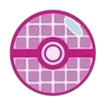

# 收服宝可梦

训练家以一只宝可梦启程，但旅途中能带在身边的伙伴，最多六只。

想要的那只宝可梦不会自己走到你面前——你得跑很多地方，翻过很多草丛，才能与它相遇。

这个世界比我们的世界还要辽阔。
有些地方对特定种类的宝可梦有着天然的吸引力，也有些宝可梦只在地球的某个角落出没。

若要寻找某只特定的宝可梦，先弄清楚该去哪里找它，比什么都重要。

## 栖息地

以下是探索这个世界时，你会遇到的主要生物群系。

> [!gm] 🎭 叙事者笔记
>
> 留意你的玩家想在这个故事里遇见什么样的宝可梦，并围绕它们设计冒险。

### 城镇与都市

住在人类聚居地之内或近旁的野生宝可梦，往往被当成害兽。

它们的属性五花八门：一般、电、飞行、恶、超能力……应有尽有。

别小看它们——这些家伙机灵、精明，深谙街头的生存之道。

### 平原与草原

大多数宝可梦都藏身于高草之中，所以这里最适合遇见各种各样的属性。

不过最常见到的，大概还是一般与飞行。

### 森林与丛林

草、虫、毒三种属性在这类环境里最为繁盛。

如果你敢在黄昏之后穿行其间，说不定会被潜伏在夜色里的幽灵或妖精属性吓一跳。

### 湖泊、河流与海洋

想找水属性宝可梦？潜下去，或者备一根钓竿。

你也可能撞见正在捕食鱼类宝可梦的家伙，或是单纯泡在水里纳凉的宝可梦。

### 洞窟与山地

岩石与钢属性在这种环境里极易藏身。

生存条件严苛，格斗属性反而在此磨炼自身——越往深处走、越往高处爬，宝可梦就越强。

### 沙漠与火山

没多少宝可梦受得了那种高温。但若你要找的是地面、火，甚至龙属性，这些地方值得仔细探索。

### 极寒地带

冰属性极少离开自己的天地。

探索这类区域时务必小心——离你最近的宝可梦中心，可能在数百公里之外。

<!-- 可在此插入：原书第96页底部的高草丛插图 -->

以上区域里想放什么宝可梦，都随你。

## 野生宝可梦

野生宝可梦与人类饲养的宝可梦之间，有着相当大的差别。

城镇附近遇到的宝可梦，大多是被人类驯化的宝可梦的后代。
一代代的繁殖与训练，让它们变得友善、忠诚、听话。

而野外的宝可梦只有两种：一生与人几乎毫无接触的，和被遗弃之后野化的。
这意味着它们只能靠纯粹的实力与生存本能变强。

无论哪一种，野生宝可梦都不信任人类，甚至嫉妒那些有人陪伴的同类。

有的会因恐惧而逃走，有的会变得凶暴，拼尽全力保护自己，把一切都当成对生存的威胁。

野生宝可梦磨炼出了人类饲养的宝可梦所没有的生存技能。

还有些种类，因为实力过于可怖，从未被驯服或驯化。
收服其中之一并与它建立羁绊，能让你在与别的训练家较量时占得先机。
它们能教你团队合作、自然的法则，以及如何追随本能——而你能教它们的，是人类的世界。

> [!rule] 收服一只新宝可梦时
>
> - 调查并探索它的栖息地。
> - 留意可能遇见的特殊宝可梦。
> - 通过对战削弱它。
> - 带够精灵球。

你最多能携带6只宝可梦。若收服的数量超过这个上限，多出来的会被传送到存储系统。

## 特殊宝可梦

世界各地都有些宝可梦，并不严格符合其种类的刻板印象。

每只宝可梦都是独一无二的，但有些个体带着百万分之一的特殊之处——
鲜亮的配色、不同的属性、更大的体型，甚至是该种类从未见过的招式或特性。

> [!note] 译注
>
> 这一节的几个术语，官方与民间的叫法并不统一：Shiny Pokémon 官译“异色”，玩家更爱叫“闪光”；Alternate Forms 指同种宝可梦之间的形态差异，官译多为“其他形态”；Regional Variants 就是“地区形态”；Alpha Pokémon 官译“头目”。 
> 本书统一采用“异色／替代形态／地区形态／头目”这套译法，在别处遇到不同的叫法，按此对照即可。

### 异色宝可梦、替代形态与地区形态

有些宝可梦的毛皮、皮膜、羽毛或鳞片会呈现不同的颜色。

这种变化可能只是外观上的，也可能牵涉属性、能力极限、招式和／或特性的改变。

#### 异色宝可梦 Shiny Pokémon

凭它们身后留下的闪光便能认出——仿佛浑身覆着一层闪粉。

异域般的外表让它们在华丽大赛上备受追捧，人们愿意花大价钱弄到一只。

不过除了好看，它们的外观不影响任何东西。

#### 替代形态 Alternate Forms

同种宝可梦之间，有时就是会长得不一样。

这种差异可能是与该种类的进化方式相关的永久特征，也可能是宝可梦凭自己的意志做出的暂时变化。

变化范围从外观、属性、能力到招式，各有不同。

#### 地区形态 Regional Variants

多数宝可梦都有固定的栖息地，但把它们带离故土、引入陌生的地区，会迫使它们适应新的环境。

于是同一种宝可梦在不同地区长得不一样：属性、特性、招式表都变了，甚至演化出与原地同类截然不同的进化形态。

去探索这个世界，找出各种各样的宝可梦，以及它们形形色色的形态与地区形态吧。

### 头目宝可梦 Alpha Pokémon

每个种类都有平均的体型与体重，但也有些被记录在案的个体，堪称同类之中的巨人。

许多训练家为了让宝可梦变大而拼命喂食，最后只是把它们喂胖了。

头目宝可梦天生就是如此。它们的主要特征是保持体型与体重的比例，只是整体放大了一号。

它们出生时可能只是普通大小，但会迅速长到异常巨大的尺寸——越强，长得越大。

头目宝可梦极为罕见，往往藏身于偏远之地。

> [!rule] 头目宝可梦
>
> 体型大于同类，基础HP也高于普通个体。 
> **基础HP +2**。

寻找头目宝可梦时要当心——它的族群必定紧随其后。

### 隐藏招式与特性

这个世界的历史上留有记载：某些宝可梦使出了与同类截然不同的力量与特性。

少数老练的训练家——道馆馆主、四天王之类——以拥有至少一只这样的特殊宝可梦而闻名。

至今成谜的是：他们收服时这些宝可梦就带着罕见能力，还是后来与它们共同努力才得到的。

> [!rule] 特殊个体
>
> 宝可梦可以拥有不同的特性，也可以学会其图鉴条目招式池里没有列出的招式。

> [!gm] 🎭 叙事者笔记
>
> 是否允许宝可梦拥有本不该有的招式与特性，由叙事者裁定。

## 精灵球

想收服野生宝可梦，你就需要精灵球。任何友好商店都买得到。

这项奇妙的发明，几乎能把物质转化为能量，安全地收纳进一个口袋大小的装置里。

在这个世界，人们用它携带各种各样的东西，从物品到宝可梦。

当然它也有极限：装不了人类，装不了扎根的物体（比如树木、山岩），也装不了含大量细小零件的机械——机动车、电子产品都不行。除此之外，什么都能装。

用精灵球收服宝可梦时，芯片会把你的训练家 ID 烙印在它身上。
这样一来，别的训练家的精灵球就无法困住你的宝可梦，把它偷走。

帐篷、自行车、成批的伤药这类大件，会连同自己的精灵球一起出售，方便收纳。
一只精灵球一旦装过东西，就被编码锁定，再也装不了别的。
和宝可梦一样，它装载的物品也带着你的 ID；万一遗失，或是想把它存起来，都能通过电脑取回。

科技真了不起，对吧？

不过你不是来惊叹科技进步的，你是来收服宝可梦的。

那就先认识一下精灵球，以及它们的封印强度。

### 封印强度

| 道具 | 封印强度 |
|:---|:---:|
| 精灵球 Pokéball | 4颗骰 |
| 超级球 Greatball | 6颗骰 |
| 高级球 Ultraball | 8颗骰 |
| —— 定制球 Customized Ball | 最多9颗骰 |

精灵球是最常用的收服道具。

超级球与高级球比普通精灵球贵得多，但封印更强，收服高等级宝可梦时更好用。

### 定制精灵球

几十年前，想得到一只精灵球，你得去找一种叫球果的果实，再亲手把它做出来。
那是个漫长又艰苦的过程，要花上好几天。那时候，收服一只宝可梦是真的要拼命。

如今，精灵球产业不断推陈出新，为勤勉的训练家提供各式各样的产品。

这些球会对你收服的宝可梦产生特殊效果，或在收服符合特定条件的宝可梦时提供专精。

它们是限量版，通常不出售；就算出售，也绝不便宜。

| 精灵球 | 效果 |
|:---|:---|
| **贵重球** | 只发给与联盟有渊源、或直接为联盟工作的人。 |
| **豪华球** | 金钱确实能买到宝可梦的快乐；用它收服的宝可梦，幸福度会提升。 |
| **究极球** | 以太基金会为其 UB 计划特别设计的球。 |
| **极巨球** | 伽勒尔科学家的骄傲，这种虚拟精灵球能造出以假乱真的巨大全息影像。 |
| **大师球** | 西尔佛公司的明星项目，传闻它能万无一失地收服任何宝可梦。 |

> [!tip] 关于定制精灵球的简要说明
>
> 现有精灵球的名单很长，但本书只收录了此处与<a href="#/07-items">“旅途道具”</a>章节（原书第122页）所列的这些，其余的性能与能力并未收录。 
> 若决定在故事中加入它们，请把它们当作**情节装置（PLOT DEVICE）**。

<!-- 可在此插入：原书第98页底部的宝可梦群插图 -->

## 收服野生宝可梦

你已踏入高草丛，精灵球准备就绪——是时候收服那只宝可梦了！

越强的宝可梦越难收服。所以永远要把野生宝可梦的等级纳入考量，据此决定收服掷骰需要多少个成功。

| 野生宝可梦等级 | 所需成功数 |
|:---|:---:|
| 入门级 Starter | 3 |
| 新手级 Rookie | 4 |
| 正式级 Standard | 6 |
| 资深级 Advanced | 8 |
| 专家级 Expert | 9 |
| 精英级 Ace | 10 |

> [!tip] 该用哪种球？
>
> 等级表里每行前面那颗小球，就是原书给的提示——收服这个等级的宝可梦，用这种球最方便。

怎么回事？精灵球的封印强度不够？

那是因为你得先通过对战削弱野生宝可梦！

削弱宝可梦会根据它的身体状况，给你额外的成功数。

| 野生宝可梦的状态 | 额外成功数 |
|:---|:---:|
| 宝可梦处于一半 HP | 1 |
| 宝可梦处于1点 HP | 2 |
| 陷入异常状态 | 每项异常状态1 |

造成伤害、施加异常状态，都会修正你的收服掷骰。
这些加值可以彼此叠加，为你的收服掷骰添上若干额外成功数。

但当心！面对一只已经昏厥的宝可梦，你会失去**全部**额外成功数。

宝可梦被削弱之后，就该投出精灵球，看看三种结局中的哪一种在等你。

> [!rule] 三种结局
>
> **“差一点！就差那么一点！”** 
> 没凑够所需成功数——宝可梦脱球而出，但精灵球可以在场景结束时找回。  
> **“不！宝可梦挣脱了！”** 
> 大失败（比所需成功数少3个）——宝可梦挣脱，精灵球报废，不能再使用。  
> **“野生宝可梦被收服了！”** 
> 奏响胜利的号角吧！只要收服掷骰达到或超过所需成功数，你就多了一位新的宝可梦伙伴！

> [!rule] 收服之后
>
> 把新收服的宝可梦填进角色卡，**幸福度给 2 点，忠诚度给 1 点**。 
> 属性、招式与其他特质如何分配，由叙事者裁定。

> [!tip] 呃……我“不小心”把野生宝可梦打倒了，还能收服吗？
>
> 可以试试。但全部额外成功数都会被移除，只能靠所用精灵球的封印强度。 
> 就算成功，这只宝可梦的幸福度与忠诚度也会降到零——别指望一只刚被你揍成肉饼的宝可梦，会成为快乐又听话的伙伴。 
> 下次记得用“手下留情”（原书第73页），或者等它恢复意识后再来一次。

如果最近收服的宝可梦对你爱答不理，试着理解它、补偿它。

与它互动，是让新宝可梦融入队伍的主要方式。

不过接下来，就得靠你自己了！

## 收服实战：四步走

纸上谈兵到此为止。跟着下面这个例子，把流程完整走一遍。

<!-- 可在此插入：原书第100页的「Pokémon Catching Guide」标题横幅 -->

> [!tip] 一只野生姆克儿出现了！
>
> 上吧，小闪！对战开始，几个回合下来，我们判定这是一只**正式级（Standard）**的宝可梦。

### 第一步：评估等级

查表，看看面对这个等级的宝可梦，收服掷骰需要几个成功。

宝可梦越强，就越难收服。

正式级——**6 个成功**。

### 第二步：削弱！

挨了几下之后，姆克儿的 HP 掉到了一半，还陷入了麻痹。

来看看削弱野生宝可梦能换来哪些加值：一半 HP 给1个，异常状态每项给1个。

看吧！收服掷骰多出 **2 个额外成功**。该把精灵球掏出来了。

### 第三步：投出精灵球！

训练家消耗一次行动，向野生宝可梦投出精灵球。与此同时，自己的宝可梦原地待命。

> [!rule] 投出精灵球
>
> 掷 **敏捷／力量 + 投掷**。

当心，有些野生宝可梦会试图闪避、寻找掩体、使出护盾招式，甚至以冲抵撞碎精灵球！

### 第四步：掷封印骰

精灵球晃动的那几秒，空气都凝住了……

掷出所用精灵球的封印强度——精灵球，4颗骰。

 → 运气不错，4个成功！

别忘了削弱野生宝可梦换来的2个额外成功。

合计 **6 个成功**。

野生姆克儿，收服成功！

## 收服的替代方案

对战之后再收服，是训练家与野生宝可梦之间最典型的一来一往。但让宝可梦成为伙伴的方法，不止这一种。

友善的接触或许能避免一场不必要的战斗，还能赢得它的忠诚。

不过，为了找一只宝可梦而走遍世界，终究是件危险的差事。

难道就没有别的办法——不用半夜被野兽扑，也不用走遍整个地区累到腿软？

来看看获取宝可梦的其他途径。

### 领养宝可梦

这项极度竞争性的运动有个悲哀的事实：有些宝可梦会被训练家遗弃。

原因各异。有的被认为太弱、太叛逆，有的也许只是害怕对战。

这些宝可梦无法放归野外，因此在城镇之外设有收容所，照顾它们，直到另一位训练家前来领养。

**领养对所有注册训练家免费。**

领养宝可梦是开始冒险的好方式。不过它们的性格或性情，未必是最好的。

若看到收容所，就进去看看吧——也许你能在那里找到属于自己的那只宝可梦。

收容所里的每只宝可梦都有独一无二的故事。给予它们尊重与妥善照料，它们或许会成为你最忠诚的伙伴。

### 购买宝可梦

宝可梦培育是备受尊敬的职业。
人们毕生投入其中，培育最优秀的个体，确保某些特质——温顺的性格、良好的工作性情，甚至特殊的招式。

不过，买宝可梦是奢侈消费。

价格从数千宝可元起。若培育的宝可梦在野外难得一见，价格还要更高。

在不太正规的地方，也能花几百宝可元买到常见宝可梦——但这类场所是否可信，得由你自己判断。

### 交换宝可梦

有时宝可梦并不是你期待的样子。也许同种宝可梦养得太多，也许只想摆脱一个糟糕的伙伴。

与其遗弃，为什么不交换呢？

有很多训练家在城市之间旅行，寻找新的宝可梦。

若遇到愿意用他的宝可梦换你的宝可梦的训练家，就前往最近的宝可梦中心。
把两只精灵球放上机器，等待流程完成。

> [!rule] 每次交换宝可梦
>
> **幸福度与忠诚度各降低 1 点。** 
> 哪怕换回来的是你原本的宝可梦，也一样。

宝可梦身上的芯片仍会把你记为它的原训练家，但它从此归另一位训练家所有。

请记得，交换来的宝可梦需要时间适应新的训练家。

### 放生宝可梦

有时候别无选择——你与这只宝可梦同行的日子，到头了。

你可以直接把宝可梦从精灵球里放出来，留在它的新家，然后离开。
若几周之内都没被收回、也没靠近过自己的精灵球，它身上的芯片就会失效，别的训练家便能收服它。

另一种办法是找一台电脑，手动注销宝可梦的芯片与 ID，再让机器把它传送并释放到安全的地点。

送走伙伴总是令人难过，而为了肤浅的理由遗弃宝可梦，在宝可梦联盟的圈子里是要被人戳脊梁骨的。

宝可梦是敏感的生物，被遗弃会伤害它们的情感，也会削弱它们信任人类的能力。

做一个负责任的训练家，别去收服你不打算好好照顾的宝可梦。

只放生那些愿意被放生的宝可梦。

## 本章回顾

《宝可梦：角色扮演游戏》的旅途会跨越一个乃至数个地区，一路上你都可以用精灵球把新的宝可梦收入队伍。
但在扩充队伍之前，有几件事得先想清楚。

| 要点 | 说明 |
|---|---|
| **收服宝可梦** | 训练家以一只宝可梦启程，最多可携带6只。想找到心仪的宝可梦，就得探索许多地方。 |
| **栖息地** | 不同的宝可梦偏好不同的栖息地：城镇、草原、森林、湖泊与海洋、沙漠、洞窟，甚至火山与极寒地带。 |
| **特殊宝可梦** | 荒野深处有些宝可梦并不完全符合其种类的标准。它们成为特殊个体的方式有很多。 |
| **异色、替代形态与地区形态** | 异色宝可梦的毛色或肤色不同，日夜闪着光；替代形态是同种宝可梦在体型、颜色或属性上的差异，且可能随心改变；地区形态则是某个种类被引入陌生环境后，被迫在体型、属性、能力、招式与特性上发生的改变。 |
| **头目宝可梦** | 比普通个体更大，并且随着实力增长继续变大。 |
| **隐藏招式与特性** | 有些宝可梦能使用不符合该种类常规的招式或特性。 |
| **精灵球** | 收服宝可梦的主要道具。此外还有封印更强的超级球与高级球，以及能力各异的定制版本。 |
| **收服步骤** | 遭遇野生宝可梦时：评估等级、削弱它、投出精灵球、掷封印骰——收服！ |
| **收服的替代方案** | 遭遇并非总是必要：你可以说服宝可梦跟你走，也可以在收容所领养，或是购买一只。 |
| **交换宝可梦** | 你可以在宝可梦中心与其他训练家交换宝可梦。 |
| **放生宝可梦** | 宝可梦可以被送回野外。但只应在它愿意被放生时才这么做。 |

在你所能探索的每一处地方找到并收服新的伙伴，是这段宝可梦世界之旅的重要部分。

很快就会有更多宝可梦加入你的冒险队伍，随之而来的是更多乐趣，也是更多责任。

要成为一名宝可梦训练家，你得维持一支强大的队伍，一起学习，也彼此学习。

这句话你懂的——“你教教我，我教教你”。
