# 💊 道具与精灵球价格

> [!tip] 怎么用
>
> 表中价格单位一律是**宝可元（₽）**，通常情况下，新人的起步资金是2,000。 
> *包含大量DIY，我说原规则书的东西太少了有没有懂的？*

> [!rule] 三条容易踩的规则
>
> **卖出**：宝可梦商店给常规商品最高只会出到市价的一半，但他们会为不常见的货物开出更高的收购价。 
> *我说黑店啊黑店，哦原作收购价可能还不到一半，那没事了。更高收购价方面这方面由叙事者自由心证。*
>
> **战斗中使用**：占用宝可梦当回合的**行动**；若训练家离开训练家区、进入对战场地，则改占训练家自己的行动。
>
> **大件物品**：买下的大件都会装进精灵球里，不用操心负重。 
> *宝可梦世界的设定就是精灵球能用来装各种各样的东西，当然你随便买的球能不能装，就由叙事者自由心证。*

---

## 旅途装备

### 露营与随身装备

| 道具 | 价格 | 说明 |
|------|--------:|------|
| 大号露营帐篷 | 10,000 | 够一整队人舒服过夜的宽敞帐篷。布料经过处理，能驱避野生宝可梦。 |
| 小号露营帐篷 | 2,500 | 一到两人的舒适空间。布料经过处理，能驱避野生宝可梦。 |
| 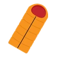睡袋 | 1,000 | 谈不上舒服。能睡得暖和干燥，但连睡几晚肯定腰酸背痛。 |
| 露营炉具与炊具 | 10,000 | 别再像野人一样挖草根了！有了这套豪华装备，随时都能吃上讲究的一餐。 |
| 口粮 | 75 | 谈不上精致，但至少不用饿着肚子上路。一份就等于一天的食物。 |
| 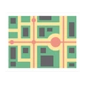地区地图 | 150 | 标出所在地区的路线、城镇与宝可梦中心。 |
| 指南针 | 100 | 能够指向正确的方向。注：请远离磁铁。 |
| 宝可梦图鉴 | 5,000 | 收录本地区宝可梦基础资料的电子百科，可以自己补充研究记录。 |
| 图鉴升级 | 2,500 | 把新地区宝可梦的资料加进你的图鉴。 |

### 交通工具

| 道具 | 价格 | 说明 |
|------|--------:|------|
| 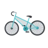山地自行车 | 1,500 | 全地形通吃，赶路速度翻倍。但这个价钱简直离谱。 |
| 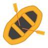充气艇 | 1,000 | 两人用的小船。可以让宝可梦拖着你走，也可以自己划。 |
| 钓竿 | 300 | 用来钓生活在水下的宝可梦。记得选对饵，不然保证空军。 |
| 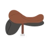骑乘鞍 | 500 | 绑在体型够大的宝可梦身上的鞍具。骑着宝可梦跑，确实带劲！ |
| 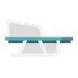雪橇 | 400 | 让一只大个子或几只小个子宝可梦拉着你，在雪地、沙地或任何平滑地面上滑行！ |
| 滑翔翼 | 3,000 | 没有飞行宝可梦？没关系。用它滑过天空——只是落地时要多加小心。 |

> [!rule] 使用交通工具会缩短赶路时间
>
> 相关的技能检定难度，也可以由叙事者酌情下调。

### 防护道具

| 道具 | 价格 | 说明 |
|------|--------:|------|
| 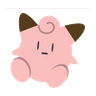宝可梦玩偶 | 1,000 | 等身大的替身，用来从野生宝可梦手里脱身。有人喜欢专门收集这个。 |
| 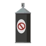宝可梦驱避喷雾 | 350 | 大约8小时内，大部分宝可梦不会靠近你。这味道现在还能通过机洗去除。 |
| 防狼喷雾 | 50 | 能吓退小体型宝可梦，但可能激怒大型宝可梦。可用5次。 |

---

## 治疗用品

> [!tip] 一次性用品
>
> 下面的药、树果、饮料**全是一次性**的。

### 异常状态药

| 道具 | 价格 | 效果 |
|------|--------:|------|
| 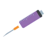解毒药 | 100 | 解除中毒与剧毒。一针下去清除毒素、退烧、止痛。 |
| 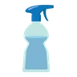解眠药 | 250 | 解除睡眠。水性喷雾，专治昏昏欲睡的家伙。 |
| 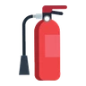灼伤药 | 250 | 解除所有等级的灼伤。扑灭火焰、帮助灼伤处愈合的药粉。 |
| 解冻药 | 250 | 解除冰冻。发热装置，让体温回到正常、缓解冻伤。 |
| 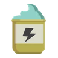解麻药 | 200 | 解除麻痹。放松肌肉、止住痉挛的药膏。 |
| 万灵药 | 600 | 解除所有异常状态。高级喷雾配方，一秒见效。 |

> [!tip] 自制药物
> 医学技能够高、材料也齐的话，可以自己配药。需要什么材料则由叙事者自由心证。

### 补充状态治愈（汉化组 DIY）

*哐哐DIY，意气风发啊伙计们！*

表里的价格是**当地购买价**，没写购买价、在其他地方购买就请叙事者自由心证，网购说不定也要邮费是吧。

| 特产 | 产地 | 当地购买价 | 效果 |
|------|:---:|--------:|------|
| 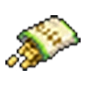深灰米果 | 关都·深灰市 | 500 | 深灰特产的糕点。能治愈1只宝可梦的所有异常状态。 |
| 愤怒馒头 | 城都·卡吉镇 | 300 | 卡吉镇特产的馒头。能治愈1只宝可梦的所有异常状态。 |
| 釜炎仙贝 | 丰缘·釜炎镇 | 200 | 釜炎特产的仙贝。能治愈1只宝可梦的所有异常状态。 |
| 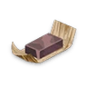森之羊羹 | 神奥·百代市 | —— | 百代不为人知的特产。能治愈1只宝可梦的所有异常状态。 |
| 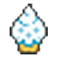飞云冰淇淋 | 合众·飞云市 | 100 | 飞云市特产的冰淇淋。能治愈1只宝可梦的所有异常状态。 |
| 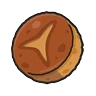密阿雷格雷派饼 | 卡洛斯·密阿雷市 | 100 | 在密阿雷市很受欢迎的点心。能治愈1只宝可梦的所有异常状态。 |
| 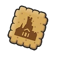娑罗沙布蕾 | 卡洛斯·娑罗市 | 350 | 娑罗市特产的沙布蕾。能治愈1只宝可梦的所有异常状态。 |
| 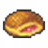大马拉萨达 | 阿罗拉 | 350 | 阿罗拉特产的油炸面包。能治愈1只宝可梦的所有异常状态。 |
| 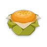祝庆玛芬 | 洗翠·祝庆村 | —— | 祝庆村不为人知的特产，是宝可梦喜爱的食物，如今正渐渐流行起来。吃下后能治愈异常状态。 |

> [!tip] 它们也是甜点
> 
> 不在战斗里使用时，可以按[“甜点”](#甜点)计算幸福度，我说大家谁不爱来点没见过的特产。

#### 玻璃哨（可重复使用）

*仍记得红蓝绿宝石狂踩火山灰搓哨子的那些年。*

| 道具 | 价格 | 效果 |
|------|--------:|------|
| 红色玻璃哨 | —— | 解除着迷。可以反复使用。 |
| 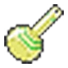黄色玻璃哨 | —— | 解除混乱。可以反复使用。 |
| 蓝色玻璃哨 | —— | 解除睡眠。可以反复使用。 |

### 伤药

| 道具 | 价格 | 剂量 | 效果 |
|------|--------:|:---:|------|
| 伤药 | 400 | 2剂 | 随身装的小喷瓶，止痛、化瘀。 |
| 好伤药 | 700 | 4剂 | 常规浓缩装。能封住伤口，连骨裂都能缓解。 |
| 厉害伤药 | 1,200 | 14剂 | 超划算的大包装。可分配给队里的小伤，也能一次用在重伤上。 |
| 全满药 | 1,700 | — | 一次性胶囊，回满HP。但到第二天之前，宝可梦无法再恢复体力。 |
| 全复药 | 2,000 | — | 一次性豪华胶囊，回满HP并解除异常状态。同样到第二天之前，无法再恢复体力。 |

> [!rule] 剂量换算
>
> **1剂 = 1点伤害**，**2剂 = 1点致命伤害**，没写恢复致命伤害的直接减半就行了。 
> 全满药与全复药会绕过战斗中的治疗限制，所以正式比赛通常不许使用。 
> 宝可梦已经昏厥时，伤药只能帮它稳住伤势，**无法让它醒过来**。

### 补充回复道具（汉化组 DIY）

*你说的对，原本我是想设计圣灰的，但是圣灰到底是恢复一只还是恢复一队我左右脑互搏了，所以留给叙事者自由心证去吧。*

| 道具 | 价格 | 效果 |
|------|--------:|------|
| 心形甜点 | 100 | 非常甜腻的巧克力。一次性恢复1点伤害。 |
| 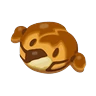卡娜莉面包 | 1,300 | 以卡娜莉的脸为造型制作的面包。一次性恢复4点伤害（无视治疗限制）。 |
| 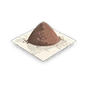中药 | 300 | 一次性恢复2点伤害。味道很苦，喂多了会让幸福度的提升变得困难。 |
| 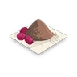好中药 | 500 | 一次性恢复4点伤害。同样很苦，和伤药同效。味道很苦，喂多了会让幸福度的提升变得困难。 |
| 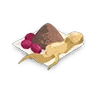厉害中药 | 900 | 一次性恢复14点伤害。同样很苦，和伤药同效。味道很苦，喂多了会让幸福度的提升变得困难。 |

### 树果

树果按稀有度分三档：**常见 / 少见 / 稀有**。

*你说的对，但是我们的规则书不提供树果的直接售卖，想和原作一样在大超市买树果请叙事者自由心证。*

| 树果 | 稀有 | 效果 |
|------|:---:|------|
| 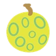利木果 | 常见 | 解除冰冻 |
| 樱子果 | 少见 | 解除麻痹 |
| 零余果 | 常见 | 解除睡眠 |
| 橙橙果 | 少见 | 恢复1点伤害 |
| 桃桃果 | 少见 | 解除中毒 |
| 柿仔果 | 常见 | 解除混乱 |
| 莓莓果 | 少见 | 解除一、二级灼伤 |
| 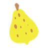文柚果 | 稀有 | 恢复3点伤害，或者恢复1点致命伤害 |
| 木子果 | 稀有 | 解除所有异常状态 |

> [!tip] 树果当持有物时
>
> 宝可梦会在**需要时直接吃掉**，不消耗行动。 
> 中异常就会当场吃掉解对应异常的树果；回血的，HP 掉到上限一半（向下取整）以下时吃。
>
> 一丛灌木上通常只有三四颗熟透的树果，要一次吃完才有完整效果。

### 补充树果（汉化组 DIY）

*没错，原书树果到上面就完了，我们继续DIY。*

#### 能力果

HP 掉到一半（向下取整）以下时自动吃下，效果持续时间为整场战斗。

| 树果 | 稀有 | 效果 |
|------|:---:|------|
| 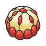枝荔果 | 稀有 | HP 掉到上限一半以下时自动吃下，力量+1。 |
| 龙睛果 | 稀有 | HP 掉到上限一半以下时自动吃下，物防+1。 |
| 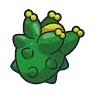沙鳞果 | 稀有 | HP 掉到上限一半以下时自动吃下，敏捷+1。 |
| 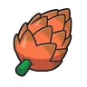龙火果 | 稀有 | HP 掉到上限一半以下时自动吃下，特攻+1。 |
| 杏仔果 | 稀有 | HP 掉到上限一半以下时自动吃下，特防+1。 |
| 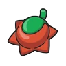兰萨果 | 稀有 | HP 掉到上限一半以下时自动吃下，攻击招式获得容易击中要害的效果。 |
| 星桃果 | 稀有 | HP 掉到上限一半以下时自动吃下，随机一项能力+2。 |
| 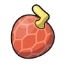释陀果 | 稀有 | HP 掉到上限一半以下时自动吃下，本轮开始先攻掷骰+3。 |
| 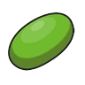奇秘果 | 稀有 | HP 掉到上限一半以下时自动吃下，下一次招式命中掷骰+2。 |

#### 受击果

被对应类别的招式打中后自动吃下，效果持续时间为整场战斗。

| 树果 | 稀有 | 效果 |
|------|:---:|------|
| 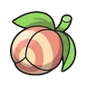亚开果 | 稀有 | 受到物理招式打中后自动吃下，物防+1。 |
| 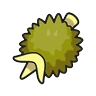香罗果 | 稀有 | 受到特殊招式打中后自动吃下，特防+1。 |

#### 抗性果

受到**效果绝佳**的对应属性招式时自动吃下，那次伤害-1。

| 树果 | 稀有 | 效果 |
|------|:---:|------|
| 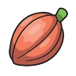巧可果 | 少见 | 受到效果绝佳的火属性招式时自动吃下，那次伤害-1。 |
| 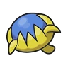千香果 | 少见 | 受到效果绝佳的水属性招式时自动吃下，那次伤害-1。 |
| 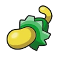烛木果 | 少见 | 受到效果绝佳的电属性招式时自动吃下，那次伤害-1。 |
| 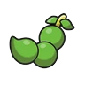罗子果 | 少见 | 受到效果绝佳的草属性招式时自动吃下，那次伤害-1。 |
| 番荔果 | 少见 | 受到效果绝佳的冰属性招式时自动吃下，那次伤害-1。 |
| 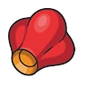莲蒲果 | 少见 | 受到效果绝佳的格斗属性招式时自动吃下，那次伤害-1。 |
| 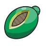通通果 | 少见 | 受到效果绝佳的毒属性招式时自动吃下，那次伤害-1。 |
| 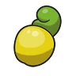腰木果 | 少见 | 受到效果绝佳的地面属性招式时自动吃下，那次伤害-1。 |
| 棱瓜果 | 少见 | 受到效果绝佳的飞行属性招式时自动吃下，那次伤害-1。 |
| 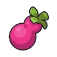福禄果 | 少见 | 受到效果绝佳的超能力属性招式时自动吃下，那次伤害-1。 |
| 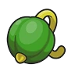扁樱果 | 少见 | 受到效果绝佳的虫属性招式时自动吃下，那次伤害-1。 |
| 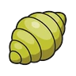草蚕果 | 少见 | 受到效果绝佳的岩石属性招式时自动吃下，那次伤害-1。 |
| 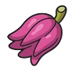佛柑果 | 少见 | 受到效果绝佳的幽灵属性招式时自动吃下，那次伤害-1。 |
| 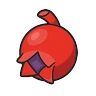莓榴果 | 少见 | 受到效果绝佳的龙属性招式时自动吃下，那次伤害-1。 |
| 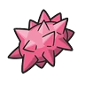刺耳果 | 少见 | 受到效果绝佳的恶属性招式时自动吃下，那次伤害-1。 |
| 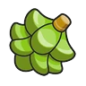霹霹果 | 少见 | 受到效果绝佳的钢属性招式时自动吃下，那次伤害-1。 |
| 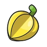灯浆果 | 少见 | 受到一般属性招式时自动吃下，那次伤害-1。 |
| 洛玫果 | 少见 | 受到效果绝佳的妖精属性招式时自动吃下，那次伤害-1。 |

#### 喂食果

**喂给野生宝可梦**：消耗一次行动，接下来对它的**收服掷骰+1**（同一只只算一次）。 
**喂给自己的宝可梦**：恢复3点伤害，或恢复1点致命伤害。

| 树果 | 稀有 | 效果 |
|------|:---:|------|
| 蔓莓果  | 稀有 | 收服+1 ／ 恢复3点（或1点致命） |
| 蕉香果  | 稀有 | 收服+1 ／ 恢复3点（或1点致命） |
| 凰梨果  | 稀有 | 收服+1 ／ 恢复3点（或1点致命） |

#### 降能力果

和[“维生素”](#维生素)正好相反：**幸福度+1，但对应能力-1，持续30天**。

*如果有人想不通为什么要DIY能力换幸福度，那我说你肯定没看牵绊变身有多离谱。*

| 树果 | 稀有 | 降低 |
|------|:---:|:---:|
| 榴石果 | 少见 | HP |
| 藻根果 | 少见 | 力量 |
| 比巴果 | 少见 | 物防 |
| 哈密果 | 少见 | 特攻 |
| 萄葡果 | 少见 | 特防 |
| 茄番果 | 少见 | 敏捷 |

### 复活道具

| 道具 | 价格 | 效果 |
|------|--------:|------|
| 活力碎片 | 1,500 | 让昏厥的人或宝可梦恢复意识，并稳定全部伤势（恢复1点 HP）。 |
| 活力块 | 非卖品 | 恢复意识并回满 HP。深洞深处偶尔能挖到，极其稀有。 |

> [!rule] 活力碎片是一次性的
>
> 用完能量就会散尽，变回一块普通石头。商店只有少量进货，也没法自制。

### 汉方药

| 道具 | 价格 | 剂量 | 效果 |
|------|--------:|:---:|------|
| 元气根 | 800 | 14剂 | 味道糟糕但管用。可以整根吃，也能做成4份药剂（需医学技能掷骰）。 |
| 药剂 | 450 | 4剂 | 喝完满嘴怪味。宝可梦只在受伤时才肯吃，吃完还会记恨你好几天。 |
| 万能粉 | 500 | — | 把最难吃的几种草药混在一起，就成了这包万灵粉。解除所有异常状态。 |
| 复活草 | 2,800 | — | 不知是药效神奇还是味道太冲，总之能让人醒过来、痛感全消。极其稀有。 |

> [!tip] 汉方药会掉幸福度
> 
> 长期喂草根、苦药和药粉，宝可梦可能会不高兴，幸福度也更难涨。

### 能量饮料

| 道具 | 价格 | 效果 |
|------|--------:|------|
| 树果汁 | 100 | 恢复至多2点 HP。各种树果调成的混合饮品，有些宝可梦自己就能生产。 |
| 美味之水 | 200 | 恢复至多4点 HP。纯水和刚好的钠含量，记得每天喝八杯！ |
| 劲爽汽水 | 250 | 恢复至多5点 HP。甜滋滋的气泡，热天来一瓶最爽。 |
| 果汁牛奶 | 300 | 恢复至多6点 HP。柠檬酸加维生素，运动后的最爱。 |
| 哞哞鲜奶 | 350 | 恢复至多8点 HP。现挤的，新鲜又有机，最适合养身体。 |

> [!rule] 起效缓慢
>
> 大约**一小时后**（游戏内）才生效，所以**战斗中完全没有用**，也治疗不了致命伤害。

### 甜点

| 道具 | 价格 | 效果 |
|------|--------:|------|
| 烘焙点心 | 100 | 解除睡眠、冰冻、中毒与麻痹。刚出炉的，新鲜着呢。 |
| 巧克力 | 100 | 恢复至多1点 HP。讨人欢心的甜食，入口即化。 |
| 蜂蜜 | 200 | 会吸引野生宝可梦。循着气味，它们会成群结队地来。 |
| 冰淇淋 | 100 | 解除所有等级的灼伤。长得像迷你冰的香草甜筒。 |
| 极巨甜蜜 | 非卖品 | 恢复意识并回满 HP。蜂女王酿的极品，想拿到这个你得干掉整个蜂群。 |

> [!rule] 甜点不提升战斗表现
>
> 糖果与甜点在战斗中没有任何效果。它们的作用是**涨幸福度**： 
> 每点幸福度大约需要10份，可以和食物、美容的效果叠加。

---

## 精灵球

### 商店在售的精灵球

| 精灵球 | 捕获强度 | 价格 | 效果 |
|------|:---:|--------:|------|
| 精灵球 用于投向野生宝可梦并将其捕捉的球。它是胶囊样式的。 | 4骰 | 200 | —— |
| 超级球 捕捉宝可梦的道具，比精灵球的性能高。 | 6骰 | 600 | —— |
| 高级球 有很高的几率可以捕捉到宝可梦的精灵球。 | 8骰 | 1,200 | —— |
| 治愈球 有点温柔的球。能回复捉到的宝可梦的HP并治愈异常状态。 | 4骰 | 300 | 收服后 HP 回满，异常状态一并解除。 |

> [!tip] 怎么用精灵球
>
> 捕获强度的具体用法见[收服宝可梦](05-catching.md)。

### 定制球（非卖品）

定制球不出售，但备齐材料、通过**工艺**检定后可以自己制作，带*的是基础值，具体看说明。

| 精灵球 | 捕获强度 | 效果 |
|------|:---:|------|
| 黑暗球（少见） 有点与众不同的球。能很容易地在夜晚或洞窟等阴暗的地方捕捉宝可梦。 | 4骰* | 在洞窟中 +4，在夜间 +5。 |
| 速度球（少见） 能很容易地捕捉逃跑速度很快宝可梦的球。 | 视情况 | 捕获强度等于目标宝可梦的敏捷值，最多9骰。 |
| 沉重球（少见） 能很容易地捕捉身体沉重宝可梦的球。 | 4骰* | 目标每重25kg（50磅）+1骰，最多加5颗。 |
| 豪华球（极稀有） 让被捕捉到的宝可梦更加友好的舒服的精灵球。 | 4骰 | 用它收服的宝可梦，幸福度 +1。 |
| 先机球（少见） 有点与众不同的球。如果战斗开始后立刻使用，就能很容易地捉到宝可梦。 | 9骰* | 战斗第1轮9骰，之后每过一轮 -2。 |
| 旧式精灵球（稀有） | 3骰 | 老型号，如今是收藏品。 |
| 大师球（传说） 一定能捕捉到宝可梦的最高级球。 | 必定收服 | 传闻中捕获力最强的球，但没人真正见过它出手。 |

> [!tip] 还可以自己造
> 书里只列了冰山一角。定制球的效果千差万别，欢迎自己设计。

### 补充球（汉化组 DIY）

*规则书说的对，欢迎自己设计，所以我直接DIY了。* 
*下方的精灵球来自原作存在但规则书没有的部分，译名和说明来自官方资料，效果由汉化组折算为规则书内容。*

> [!rule] 折算规则
>
> 本作里：精灵球4骰 = 原作1×，超级球6颗 = 原作1.5×，高级球8颗 = 原作2×。
> 也就是说 **1 骰 ≈ 0.25× 的倍率**，最高封顶**9颗**（等于高级球再往上半档）。
> 有条件才生效的球，一律写成「基础4颗，满足条件时给到 X 颗」。

| 精灵球 | 捕获强度 | 效果 |
|------|:---:|------|
| 计时球（稀有） 经过的回合越多就会更有效。 | 4骰* | 战斗第1轮4骰，之后每过一轮+1，封顶9颗。 |
| 重复球（少见） 更容易捕捉到以前捕获过的宝可梦的精灵球。 | 4骰* | 目标种类**已经收服过**时8骰。 |
| 巢穴球（少见） 更容易捕捉到弱小的宝可梦的精灵球。 | 4骰* | 根据遭遇的宝可梦等级判断，入门8颗、新手7颗、正式6颗、资深5颗，专家及以上4颗。 |
| 等级球（稀有） 要捕捉的宝可梦比自己宝可梦的等级越低，就会越容易捕捉的球。 | 4骰* | 目标等级**每比你低1级+1 颗**，最多8颗。 |
| 捕网球（常见） 更容易捕捉到水属性和虫属性宝可梦的精灵球。 | 4骰* | 目标带水或虫属性时8骰。 |
| 潜水球（常见） 更容易捕捉海底的宝可梦的精灵球。 | 4骰* | 在水下或贴着水面战斗时8骰。 |
| 诱饵球（常见） 能很容易地捕捉钓上来的宝可梦的球。 | 4骰* | 对用钓竿钓上来的宝可梦8骰。 |
| 月亮球（稀有） 能很容易地捕捉使用月之石进化的宝可梦。 | 4骰* | 对靠月之石进化的种类8骰。 |
| 甜蜜球（稀有） 和自己的宝可梦性别不同的时候，能很容易地捕捉宝可梦。 | 4骰* | 目标与你的宝可梦**同种且性别相反**时8骰。 |
| 梦境球（极稀有） 在连入之森中，不知何时出现在包包里的梦中球。能捉到任何宝可梦。 | 4骰* | 对已经睡着的宝可梦8骰。 |
| 究极球（极稀有） 为捕捉究极异兽而制作的特殊精灵球。很难捕捉究极异兽之外的宝可梦。 | 1骰* | 对异界来客（究极异兽）9骰。 |
| 友友球（少见） 捉到的野生宝可梦会立刻变得和训练家亲密起来的球。 | 4骰 | 收服后幸福度再+2（基础2，加上去是4，上限5）。 |
| 纪念球（常见） 为了纪念某些事件制作的稀有的精灵球。 | 4骰 | 在宝可梦商店买任意种类精灵球10个会获赠1个。 |
| 狩猎球（常见） 能在狩猎地带中捕捉野生宝可梦的球。 | 6骰 | 狩猎区专用。 |
| 公园球（极稀有） 在伙伴公园里使用的特殊的球。 | 6骰 | 伙伴公园内**必定收服**。 |
| 竞赛球（常见） 在捕虫大赛上使用的特殊的球。 | 4骰 | 捕虫大赛专用。 |

### 洗翠地区的球

> [!rule] 古代的球整体低一档
>
> 以原规则书里那枚**旧式精灵球**3骰，比现代精灵球少1颗，视作古代与现在的技术差距，所以洗翠的精灵球捕获强度更弱。 
> 但是我们加入了工艺DIY系统，可以自己搓球了。 
> *唉，回来吧，宝可梦LA，我最骄傲的信仰。*

> [!tip] 这里的「沉重球」不是上面那枚
>
> 上面定制球表里的**沉重球**是现代款，按**体重**加骰；洗翠的沉重球系是按「**对方有没有察觉你**」加骰，同名但不是一个东西。

| 精灵球 | 捕获强度 | 效果 |
|------|:---:|------|
| 沉重球（少见） 沉重而无法远投，但若能命中掉以轻心的宝可梦，就能发挥强大的捕获能力。 | 3骰* | 只能近身投。目标**没察觉你**（在睡觉、进食，或你从背后接近）时4骰。 |
| 超重球（稀有） 强化后的沉重球。沉重而无法远投，但若能命中掉以轻心的宝可梦，就能发挥强大的捕获能力。 | 6骰* | 只能近身投；偷袭时7骰。 |
| 巨重球（极稀有） 强化到最高阶的沉重球。沉重而无法远投，但若能命中掉以轻心的宝可梦，就能发挥强大的捕获能力。 | 8骰 | 只能近身投；偷袭时也是8颗。 |
| 飞羽球（少见） 能直线高速飞行的球。在捕捉动作快速的宝可梦及飞在高空的宝可梦时十分有效。 | 1骰* | 目标飞在空中或处在高处时4骰。 |
| 飞翼球（稀有） 强化后的飞羽球。能直线高速飞行，在捕捉动作快速的宝可梦及飞在高空的宝可梦时十分有效。 | 4骰* | 目标飞在空中或在高处时7骰。 |
| 飞梭球（极稀有） 强化到最高阶的飞羽球。能直线高速飞行，在捕捉动作快速的宝可梦及飞在高空的宝可梦时十分有效。 | 7骰* | 目标飞在空中或在高处时8骰。 |
| 起源球（传说） 独一无二的特殊精灵球。能够捕捉在神奥神殿狂暴大闹的宝可梦。 | 必定收服 | 传说中的精灵球。 |
| 奇异球（极稀有） ？？？ | 2骰 | 来历不明，据说是随宝可梦从别的世界一起传过来的。性能差得离谱。 |

## 宝可梦养护

### 食物

| 道具 | 价格 | 效果 |
|------|--------:|------|
| 干粮 | 10 | 普通颗粒饲料，没什么特别的。 |
| 高级食物 | 1,500 | 上等原料做的。长期食用高级食物，宝可梦的幸福度会涨得更快。 |
| 高性能食物 | 200 | 高蛋白运动粮。宝可梦下一次**训练掷骰+2骰**。 |

> [!tip] 一包管一天
>
> 每包食物够一只宝可梦吃一整天，也可以拿来当诱饵引野生宝可梦。

### 美容

| 道具 | 价格 | 说明 |
|------|--------:|------|
| 美容套装 | 100 | 打结的毛、乱翘的叶子、起皮的鳞片、粗糙的岩石、没抛光的钢……你懂的。 |
| 饰品 | 400 | 缎带、帽子、项圈，让搭档显得与众不同的小东西。 |
| 宝可梦服装 | 3,500 | 时髦的衣服。穿上会很好看，宝可梦自己也会喜欢。 |

> [!rule] 美容也能涨幸福度
>
> 每点幸福度约需10次美容，可以和食物、甜点叠加。 
> 饰品与服装**不是**持有物，不占携带位。

### 维生素

| 道具 | 价格 | 提升 |
|------|--------:|------|
| 蛋白质 | 9,800 | 力量 |
| 铁 | 9,800 | 物防 |
| 钙 | 9,800 | 特攻 |
| 锌 | 9,800 | 特防 |
| 卡路里糖 | 9,800 | 敏捷 |
| PP 提升剂 | 9,800 | 意志 +2点 |
| HP 提升剂 | 9,800 | HP +2点 |
| 神奇糖果 | 非卖品 | 任意一项能力 |

> [!rule] 维生素
>
> - 每瓶是30天份，但限定/默认每天都喂，相当于效果在游戏内持续一个月。 
> - 喂食期间能提升对应能力1。 
> - 同一种维生素的效果**无法叠加**。 
> - 维生素无法让能力突破**极限**。 
> - 神奇糖果例外，效果**永久**，可以和维生素叠加，也能突破上限，但每只宝可梦只能吃一颗。

---

## 进化道具

进化石里最常见的是火、水、雷、草四种。其他的多数又贵又难找，但运气好的话可能在山洞里挖到，又或者在比赛上赢得一枚。

| 进化石 | 价格 | 说明 |
|------|--------:|------|
| 火之石 | 5,000 | 内里有火，摸上去是烫的。多在火山脚下发现。 |
| 雷之石 | 5,000 | 会在暗处发光，能给小型电器供电。雷击之后才会形成。 |
| 水之石 | 5,000 | 封着一汪清亮的水。海底和一些湖底能找到。 |
| 叶之石 | 3,500 | 据说嵌在里面的叶子来自生命之树。森林与丛林里比较常见。 |
| 冰之石 | 10,000 | 像一块永不融化的冰，摸起来极冷。只在极地附近有。 |
| 月之石 | 3,500 | 月光照上去才会泛起幽光，平时就是块普通石头。洞窟里很常见。 |
| 日之石 | 3,500 | 红色石头，日光照到时会格外明亮。沙漠和平原能找到。 |
| 光之石 | 10,000 | 表面抛光得能看见里面的一团光。稀有，被视为幸运符。 |
| 暗之石 | 10,000 | 像一个小黑洞，会把房间里的光和快乐都吸走。极稀有。 |
| 觉醒之石 | 10,000 | 日出时分会发出刺眼的光，持续一分钟。极稀有。 |

## 招式学习器与记录

TM（招式学习器）可以教**好几只**宝可梦，TR（招式记录）只能教**一只**。

| 道具 | 招式威力 | 价格 | 说明 |
|------|:---:|--------:|------|
| 招式学习器·变化 | — | 15,000 | 教一只或多只宝可梦使用**变化招式**。 |
| 招式学习器·基础 | 1 – 3 | 20,000 | 教基础**物理或特殊**招式。 |
| 招式学习器·强力 | 4以上 | 50,000 | 教高威力**物理或特殊**招式。 |
| 招式记录·变化 | — | 5,000 | 同上，但**只能教一只**宝可梦。 |
| 招式记录·基础 | 1 – 3 | 10,000 | 同上，只能教一只。 |
| 招式记录·强力 | 4以上 | 25,000 | 同上，只能教一只。 |

## 持有物（非卖品）

持有物只能靠冒险获得，商店不会售卖。每只宝可梦同时只能带**一件**持有物，使用不消耗行动。

### 属性强化道具

下面18件是同一个效果：**对应属性的招式，伤害骰池+1骰**。

| 道具 | 属性 |
|------|:---:|
| 黑带 | 格斗 |
| 黑色眼镜 | 恶 |
| 木炭 | 火 |
| 龙之牙 | 龙 |
| 妖精之羽 | 妖精 |
| 硬石头 | 岩石 |
| 磁铁 | 电 |
| 金属膜 | 钢 |
| 奇迹种子 | 草 |
| 神秘水滴 | 水 |
| 不融冰 | 冰 |
| 毒针 | 毒 |
| 锐利鸟嘴 | 飞行 |
| 丝绸围巾 | 一般 |
| 银粉 | 虫 |
| 柔软沙子 | 地面 |
| 咒术之符 | 幽灵 |
| 弯曲的汤匙 | 超能力 |

### 其它持有物

| 道具 | 效果 |
|------|------|
| 气球 | 免疫地面属性。被击中（受到×2伤害）就会破。 |
| 护符金币 | 战斗奖金翻倍。 |
| 气势披带 | 第一次因招式伤害濒死时，保留1点HP。 |
| 厚底靴 | 免疫入场危害（撒菱、隐形岩之类）。 |
| 黑色铁球 | 敏捷-1，并失去地面免疫。 |
| 王者之证 | 特定宝可梦可借此进化；所有特殊招式追加1颗畏缩概率骰。 |
| 大葱 | 大葱鸭专用：所有物理与特殊招式获得容易击中要害的效果。 |
| 吃剩的东西 | 每轮结束恢复1点伤害；累计恢复3点后消耗掉。 |
| 生命宝珠 | 物理与特殊招式的伤害骰池+2骰，并获得「反作用力」效果。 |
| 电气球 | 皮卡丘专用：力量与特攻+1。 |
| 机变骰子 | 带概率骰的招式，每个效果再+2颗概率骰。 |
| 吉利拳 | 吉利蛋专用：所有物理招式获得容易击中要害的效果，力量 +2。 |
| 光粉 | 以这只宝可梦为目标的招式，追加一个降低命中1。 |
| 讲究头带 | 选一个物理招式，威力+3；其它招式威力-3。 |
| 讲究围巾 | 先攻+3；选一个招式获即时反应5；其它招式威力-3。 |
| 讲究眼镜 | 选一个特殊招式，威力+3；其它招式威力-3。 |
| 清净坠饰 | 持有者的能力不会被其它宝可梦降低。 |
| 红线 | 这只宝可梦陷入着迷时，对方也会同样着迷。 |
| 逃脱按键 | 受到伤害后，对持有者触发替换效果。 |
| 进化奇石 | 一阶或二阶宝可梦的物防与特防+1。 |
| 达人带 | 效果绝佳的招式额外造成1点伤害。 |
| 火焰宝珠 | 持有者陷入一级灼伤。每轮只触发一次。 |
| 防尘护目镜 | 免疫粉末类招式与孢子的追加效果。 |
| 附着针 | 每轮结束对持有者造成1点伤害；被非远程物理招式击中时，把针传给对方。 |
| 粗骨头 | 卡拉卡拉与嘎啦嘎啦专用：力量+2。 |
| 爽喉喷雾 | 使用声音类招式后，特攻+1。 |
| 剧毒宝珠 | 持有者陷入中毒。 |
| 万能伞 | 无视晴天、雨天与冰雹天气的效果。 |
| 弱点保险 | 被效果绝佳的招式击中后，力量与特攻 +1。 |
| 白色香草 | 恢复所有被降低的能力，一次性。 |
| 广角镜 | 命中掷骰+2骰。 |
| 对焦镜 | 招式上的降低命中减少至多2点（降低低命中5 → 降低命中3）。 |
| 节拍器 | 双重、三重与连续行动招式的伤害骰池+1骰。 |
| 强力香草 | 蓄力招式无需蓄力即可发动，一次性。 |
| 力量负重 | 敏捷-1，自选另一项能力+2。 |
| 部位护具 | 近身战斗时不会与对手直接接触，接触类效果不触发。 |
| 先制之爪 | 先攻掷骰+2。 |
| 锐利之爪 | 特定宝可梦可借此进化；所有物理与特殊招式获得容易击中要害的效果。 |
| 锐利之牙 | 特定宝可梦可借此进化；所有物理招式追加1颗畏缩概率骰。 |
| 红牌 | 受到伤害后，对对手触发替换效果。 |
| 标靶 | 移除持有者的所有免疫。 |
| 凸凸头盔 | 用非远程物理招式击中持有者的一方，受到1点伤害。 |

### 补充持有物（汉化组 DIY）

*规则书里持有物居然没有大根茎，像话吗？*

| 道具 | 效果 |
|------|------|
| 突击背心 | 特防+1；但**不能使用变化招式**，只能打物理与特殊招式。 |
| 黑色污泥 | 毒属性宝可梦每轮结束恢复1点伤害；非毒属性每轮结束受到1点伤害。 |
| 大根茎 | 吸取类招式的回复量+1点。 |
| 贝壳之铃 | 每轮结束时，只要本轮造成过伤害，回复1点。 |
| 拳击手套 | 拳击类招式威力+1，且**不被视作接触类招式**。 |
| 心之水滴 | 拉帝亚斯/拉帝欧斯专用：超能力与龙属性招式威力+1。 |
| 金属粉 | 百变怪专用：未变身时物防+2。 |
| 速度粉 | 百变怪专用：未变身时敏捷+2。 |
| 深海之牙 | 珍珠贝专用：特攻+2。 |
| 深海鳞片 | 珍珠贝专用：特防+2。 |
| 力量头带 | 物理招式威力+1。 |
| 博识眼镜 | 特殊招式威力+1。 |
| 焦点镜 | 所有物理与特殊招式获得容易击中要害的效果。 |
| 胆怯球 | 携带者受到**威吓**时敏捷+1（本场战斗），随后消耗掉。 |

### 补充场地种子（汉化组 DIY）

四种种子各对应一种场地。**踏上对应场地时自动吃下**，一次性。

| 道具 | 场地 | 效果 |
|------|:---:|------|
| 电气种子 | 电气场地 | 踏上场地时吃下，本场战斗物防+1。 |
| 青草种子 | 青草场地 | 踏上场地时吃下，本场战斗物防+1。 |
| 薄雾种子 | 薄雾场地 | 踏上场地时吃下，本场战斗特防+1。 |
| 精神种子 | 精神场地 | 踏上场地时吃下，本场战斗特防+1。 |

> [!rule] 持有物与招式、特性的叠加
>
> 持有物提升或降低的能力，**不与招式叠加**，只取数值高的那个；但**与特性叠加**。 
> 一次性道具（树果、强力香草、气球等）损耗之后，战斗结束也不会回来。
---

## 战斗道具（消耗品 · 汉化组 DIY）

*虽然理论上原作也没几个人会用这些东西，但是来都来了。*

> [!rule] 使用规则
>
> - 使用时**消耗一次行动**，效果只持续到**本场战斗结束**，打完不保留。 
> - **不与招式叠加**，但**与特性叠加**

### 能力强化

| 道具 | 价格 | 效果 |
|------|--------:|------|
| 力量强化 | 500 | 力量+1。 |
| 防御强化 | 550 | 物防+1。 |
| 特攻强化 | 350 | 特攻+1。 |
| 特防强化 | 350 | 特防+1。 |
| 速度强化 | 350 | 敏捷+1。 |
| 命中强化 | 950 | 命中掷骰+2。 |
| 闪避强化 | —— | 以它为目标的招式追加降低命中1。 |
| 要害攻击 | 650 | 所有物理与特殊招式获得容易击中要害的效果。 |
| 能力防守 | 700 | 本场战斗内，能力不会被降低。 |
| 多重强化 | —— | 力量、物防、特攻、特防各+1。 |
| 进攻药丸 | —— | 力量+2。 |
| 防守药丸 | —— | 物防+2。 |
| 双倍腌菜 | —— | 本场战斗内，招式伤害骰池+2。 |
| 讲究粽 | —— | 选定一个招式：它的威力+3，但你受到的所有伤害+1。 |
| 颠倒烧 | —— | 力量与物防互换，直到战斗结束。 |
| 极巨菇菇 | —— | 五项能力各+1。 |

### 特殊

| 道具 | 价格 | 效果 |
|------|--------:|------|
| 宝可尾草 | 1000 | 对野生宝可梦的战斗中**必定脱身**，不用掷骰。对训练家的宝可梦无效。 |

## 换金道具

*我说规则书经济系统只搓了一半有点太拉了，大家该卖金珠了。*

> [!tip] 价格偏高的那几件
> 这些东西**没有使用效果**，唯一的用途是卖钱。 
> 叙事者可以拿它们当战利品、任务报酬，或者“勇者们翻箱倒柜的结果”。 
> 也是队伍在两次冒险之间补充资金的主要来源。

### 金银珠宝

| 道具 | 售价 | 说明 |
|------|--------:|------|
| 星星沙子 | 900 | 美丽的红色沙子，可以高价出售。 |
| 大珍珠 | 3,500 | 漂亮的大颗珍珠，能高价卖出。 |
| 星星碎片 | 4,600 | 美丽的红色宝石碎片，可以非常高价出售。 |
| 金珠 | 5,000 | 以纯金制成，可以高价出售。 |
| 丸子珍珠 | 25,000 | 散发着美丽银辉且非常大颗的珍珠。爱好者会高价收购。 |
| 巨大金珠 | 30,000 | 以纯金制成，闪着金光的大珠子。爱好者会高价收购。 |
| 彗星碎片 | 60,000 | 彗星临近时，掉落到地表上的碎片。爱好者会高价收购。 |

### 蘑菇与生物材料

| 道具 | 售价 | 说明 |
|------|--------:|------|
| 美丽之羽 | 100 | 仅仅只是漂亮，没有任何效果，极其普通的羽毛。 |
| 小蘑菇 | 250 | 一般的蘑菇，可以低价出售。 |
| 南国贝壳 | 1,000 | 美丽的白色贝壳。或许是从温暖的海域那里漂流到这里的。 |
| 大蘑菇 | 2,500 | 珍稀的蘑菇，可以高价出售。 |
| 美味尾巴 | 4,900 | 非常美味，可以高价出售。 |
| 贵重骨头 | 5,000 | 在宝可梦考古学上非常贵重的骨头。可以在商店高价出售。 |
| 芳香蘑菇 | 25,000 | 能让附近一带芳香四溢的珍稀蘑菇。爱好者会高价收购。 |

### 古代遗物

| 道具 | 售价 | 说明 |
|------|--------:|------|
| 古代铜币 | 1,000 | 约3000年前的文明使用的铜币。爱好者会高价收购。 |
| 古代银币 | 5,000 | 约3000年前的文明使用的银币。爱好者会高价收购。 |
| 古代金币 | 10,000 | 约3000年前的文明使用的金币。爱好者会高价收购。 |
| 古代之壶 | 50,000 | 约3000年前的文明制造的壶。爱好者会高价收购。 |
| 古代手镯 | 100,000 | 约3000年前的文明制造的手镯。爱好者会高价收购。 |
| 古代石像 | 200,000 | 约3000年前的文明制造的石像。爱好者会高价收购。 |
| 古代王冠 | 300,000 | 约3000年前的文明制造的王冠。爱好者会高价收购。 |

### 捡来的零碎

| 道具 | 售价 | 说明 |
|------|--------:|------|
| 神秘摆设 | 5 | 据说是在远离卡洛斯地区的地方，模仿古时候被称为守护神的宝可梦而制作的摆设。 |
| 浅滩海盐 | 10 | 在浅滩洞穴这地方找到的海盐。 |
| 浅滩贝壳 | 10 | 在浅滩洞穴这地方找到的贝壳。 |
| 松掉的弹簧 | 10 | 细小的弹簧。被拉得太长了，不知道能派上什么用。 |
| 粉笔石 | 30 | 路边捡到的白白的小石头。 |
| 弹珠 | 150 | 非常圆润的玻璃球。能在透明的球体中看见彩色玻璃的花纹。 |
| 一边的耳环 | 300 | 某人遗失的单只耳环。 |
| 小竹笋 | 375 | 小小的珍贵竹笋。在部分美食家中拥有很高人气。 |
| 海边的玻璃 | 400 | 受到波浪的洗刷从而变成圆形的彩色玻璃片。表面摸起来有点粗糙不平。 |
| 银色叶子 | 500 | 神奇的银色叶子。 |
| 光滑泥球 | 600 | 用泥土制作的丸子。花了大把时间打磨，表面油光水滑。 |
| 金色叶子 | 1,000 | 神奇的金色叶子。 |
| 宝可梦木娃娃 | 1,000 | 宝可梦造型的木制玩具。可以在杂货店出售。 |
| 大竹笋 | 1,500 | 大大的珍贵竹笋。在部分美食家中拥有非常高人气。 |
